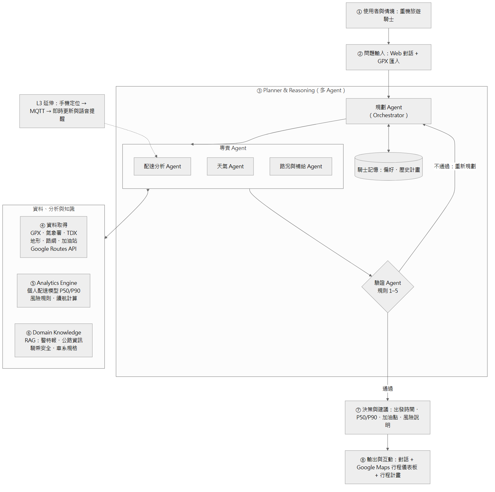

# DESIGN — Moto Touring Copilot 重機旅遊規劃顧問

> 狀態：Proposal 階段（2026-11）。本文件從 Proposal 開始維護，隨實作更新。
> 完整論述、文獻與證據見 [Proposal](docs/proposal/proposal.pdf)；本文件著重「下一位開發者如何理解、執行、驗證並接手」。

## 目錄

1. [Problem](#1-problem)
2. [Requirements](#2-requirements)
3. [Architecture](#3-architecture)
4. [Components](#4-components)
5. [Data](#5-data)
6. [AI / Analytics](#6-ai--analytics)
7. [Domain Knowledge](#7-domain-knowledge)
8. [Algorithm](#8-algorithm)
9. [Implementation Mapping](#9-implementation-mapping)
10. [How to Run](#10-how-to-run)
11. [Results](#11-results)
12. [Limitations](#12-limitations)
13. [Change Log](#13-change-log)

## 1. Problem

騎士出發前最常問、也最容易判斷錯的問題是：「照我的騎法，這趟山路幾點出發才能在天黑前回家？中途哪裡加油？哪一段可能下雨或封路？」

- 一般導航的預估時間是群體平均，不知道個別騎士在彎道與坡道的騎法。
- 天氣、日落、路況、加油站分散在不同平台，騎士要自己換算「抵達該路段時」的狀況。
- 大型語言模型單獨規劃行程並不可靠（TravelPlanner 中 GPT-4-Turbo 最終通過率 0.6%），需要外部工具計算與驗證。

定位：個人化的**出發前決策輔助**，不做事故預測。

## 2. Requirements

### 功能需求

| ID | 需求 |
| --- | --- |
| FR1 | 以自然語言描述行程（起訖、路線、日期、最晚回程時間），資訊不足時追問 |
| FR2 | 匯入騎士自己的 GPX 行程，建立並更新個人配速模型 |
| FR3 | 預測各路段騎乘時間，輸出 P50 / P90，並算出各點預計抵達時間 |
| FR4 | 依各路段預計抵達時間查天氣、警特報、民用暮光終 |
| FR5 | 查路況事件、沿線加油站位置與營業時間，檢查續航 |
| FR6 | 驗證整份計畫（規則 1–5），不通過就重新規劃；無可行解時說明原因與替代方案 |
| FR7 | 以對話、Google Maps 行程儀表板與可下載的行程計畫呈現，回答附出處 |
| FR8（延伸） | 騎乘中手機定位經 MQTT 回傳，即時更新抵達時間並語音提醒 |

### 非功能需求

| ID | 需求 |
| --- | --- |
| NFR1 | 回答中的每個時間、距離、機率都必須來自工具輸出（可追溯） |
| NFR2 | 原始 GPX 不進版控；公開資料只放裁掉頭尾後的衍生路段表 |
| NFR3 | 不在車上加裝任何設備 |
| NFR4 | 外部 API 失敗時明確回報，不以猜測補值 |

### 範圍（對應課程 Level）

| Level | 內容 | 範圍 |
| --- | --- | --- |
| L1 | 對話、讀 GPX 與開放資料、Python 分析、圖表 | 包含在 L2 內 |
| L2 | 知識庫、多 Agent 多步推理、驗證與重新規劃 | 承諾完成 |
| L3 | 騎乘中即時串流與語音提醒 | 延伸 |

## 3. Architecture



依作業規範的 ①–⑧ 模組：

| 編號 | 模組 | 內容 |
| --- | --- | --- |
| ① | 使用者與情境 | 在台灣騎重機旅遊的騎士 |
| ② | 問題輸入 | Web 對話介面、GPX 匯入 |
| ③ | Planner & Reasoning | 五個 Agent 分工（見 4.1）；驗證不通過就重新規劃；騎士記憶 |
| ④ | 資料取得 | 自己的 GPX、氣象署、TDX、地形、路網、加油站、Google Maps Routes API |
| ⑤ | Analytics Engine | 個人配速模型、風險規則、續航與日照檢查（確定性的 Python 工具） |
| ⑥ | Domain Knowledge | 知識庫檢索，回答附出處 |
| ⑦ | 決策與建議 | 出發時間、P50 / P90、加油點、風險說明 |
| ⑧ | 輸出與互動 | 對話 + Google Maps 行程儀表板 + 行程計畫 |

設計原則：LLM 負責理解、規劃與解釋；所有數字由 Analytics Engine 計算，驗證交給確定性規則。

## 4. Components

### 4.1 Agents

| Agent | 輸入 | 輸出 | 工具 |
| --- | --- | --- | --- |
| 規劃 Agent（Orchestrator） | 使用者問題、騎士記憶 | 任務分派、計畫草案 | 知識庫檢索 |
| 配速分析 Agent | 路線、出發時間、騎士 ID | 各段 P50 / P90、各點預計抵達時間 | 路線切段、地形特徵、配速模型、Google 預估時間 |
| 天氣 Agent | 各段位置與預計抵達時間 | 降雨、溫度、警特報、民用暮光終 | 氣象署開放資料 |
| 路況與補給 Agent | 路線、預計抵達時間、車型 | 路況事件、可用加油站、續航檢查 | TDX、加油站資料、車系規格 |
| 驗證 Agent | 計畫草案 | 通過或違反的規則清單 | 驗證規則 1–5 |

### 4.2 驗證規則

1. 日照：出發時間 + 整趟 P90 ≤ min（民用暮光終, 騎士設定的回程時間）
2. 續航：相鄰補給點距離 ≤ 續航 ×（1 − 安全餘裕），且抵達加油站的 P90 時間在營業時間內
3. 天氣：抵達時落在大雨以上警特報範圍的路段標為高風險
4. 路況：路段有封閉或管制事件時計畫不可行
5. 可追溯：回答中的數字都必須出現在工具輸出中

### 4.3 對應課程框架

| 課程 Workflow | 本專題 |
| --- | --- |
| Understand | 規劃 Agent 取出行程條件，缺資訊就追問 |
| Plan | 規劃 Agent 決定工具順序與候選出發時間 |
| Acquire | 配速、天氣、路況與補給 Agent 取得資料 |
| Analyze | 個人配速模型、風險規則、續航計算 |
| Generate | 驗證後產生建議；不可行時提出替代方案 |
| Interact | 對話、Google Maps 儀表板、行程計畫 |

六大能力（TALK、KNOW、SENSE、ANALYZE、THINK、SHOW）的對應見 Proposal §4.4.2。

## 5. Data

| 來源 | 用途 | 取得方式 | 備註 |
| --- | --- | --- | --- |
| BMW Motorrad Connected GPX（279 趟） | 訓練與驗證配速模型 | App 內逐趟匯出 GPX | 約 1 秒一點，只有經緯度、高度、時間；**不進版控** |
| 中央氣象署開放資料 | 預報、觀測、警特報、日出日沒 | opendata.cwa.gov.tw API（需授權碼） | 歷史逐時資料用 CODiS |
| 交通部 TDX | 省道即時路況 | TDX API（需授權碼） | 道路阻斷目前沒有機器可讀的歷史資料 |
| 內政部 20 m 數值地形 | 坡度 | 政府資料開放平臺 | 要用 DTM，不用 DSM（DSM 含植被與建物） |
| 公路局 GIS 開放資料 | 急彎、陡坡、速限 | 政府資料開放平臺 | |
| OpenStreetMap | 路網、道路等級 | OSMnx | |
| 中油加油站資料 | 位置、營業時間 | 政府資料開放平臺 data.gov.tw/dataset/6065 | 台塑無開放資料，以 OSM 補 |
| Google Maps Platform | 地圖顯示、兩輪車路線與預估時間（baseline） | Maps JavaScript API、Routes API | 需金鑰與帳單；兩輪車覆蓋清單有列台灣 |

### 資料處理流程（GPX）

1. 裁掉每趟起點與終點附近的路段（住家與工作地點隱私）
2. 清理車速跳點並平滑
3. 分離移動時間與停留時間
4. 切成路段（約 0.5–2 km 或依道路），對接地形、路網、歷史天氣，產生特徵

## 6. AI / Analytics

| 任務 | 方法 | Baseline | 指標 |
| --- | --- | --- | --- |
| 路段騎乘時間預測 | 多元迴歸 → LightGBM 分位數損失（P50 / P90） | 平均速度、速限換算、Google Maps 兩輪車預估時間 | 路段與整趟 MAE、MAPE；P90 覆蓋率 |
| 整趟區間 | 各段 P50 加總 + 以保留行程校正整趟 P90（conformal） | 各段 P90 直接相加 | 覆蓋率 |
| 風險評分 | 透明規則（門檻取自氣象署警特報） | — | 歷史封路日回測、敏感度分析 |
| Agent 整體 | 多 Agent + 驗證迴圈 | 只用 LLM；LLM + 知識庫 | 計畫可行率、時間誤差、數字可追溯率（消融實驗） |

驗證方式：依行程分組的交叉驗證（GroupKFold），再加上以最新行程為測試集的時間外推。

## 7. Domain Knowledge

五個核心思維模式（詳見 Proposal 第 3 章）與它們在系統中的落點：

| 思維模式 | 系統中的落點 |
| --- | --- |
| 以最難的路段規劃，不看平均速度 | 配速模型逐段預測；決策用 P90 |
| 山區天氣看時間窗 | 天氣 Agent 依預計抵達時間查詢 |
| 日光與騎乘時數是硬限制 | 驗證規則 1 |
| 補給看抵達時有沒有開 | 驗證規則 2 |
| 山區道路狀態是動態的 | 驗證規則 4；路況規則 |

知識庫內容：氣象署警特報說明、公路局行車資訊、騎乘安全資料、BMW 車系規格（油箱、油耗）、相關研究，回答時附出處。

## 8. Algorithm

```text
Algorithm 1: Plan with Verification
Input : rider query Q, rider id u, trip store S_u, knowledge base KB
Output: feasible trip plan with ranges and citations, or an infeasibility report

01: ctx ← UNDERSTAND(Q, MEMORY(u))
02: if MISSING(ctx) then return ASK_RIDER()
03: route ← BUILD_ROUTE(ctx); X ← SEGMENT_FEATURES(route)
04: repeat
05:   for each departure d in CANDIDATES(ctx) do
06:     (t50, ETA) ← PACE_AGENT(X, d, u)
07:     T90 ← Σ t50 + BREAKS + CONFORMAL_Q90(u)
08:     W ← WEATHER_AGENT(route, ETA)
09:     F ← SUPPLY_AGENT(route, ETA, VEHICLE(u))
10:     plan ← COMPOSE(d, t50, T90, W, F, SEARCH(KB))
11:     if VERIFY(plan) and SLACK(plan) > SLACK(best) then best ← plan
12:   if best = ∅ then ctx ← REPLAN(ctx, violations)
13: until best ≠ ∅ or attempts ≥ MAX
14: return best ≠ ∅ ? RENDER(best) : INFEASIBILITY_REPORT()
```

配速模型更新（Algorithm 2）見 Proposal §4.8。

## 9. Implementation Mapping

規劃中的程式結構（尚未建立，實作時依此建立並更新本表）：

| 模組 | 規劃位置 | 對應 |
| --- | --- | --- |
| GPX 匯入、裁切、清理、切段 | `src/moto_copilot/ingest/` | FR2、NFR2、Data §5 |
| 地形、曲率、道路等級特徵 | `src/moto_copilot/features/` | AI §6 |
| 配速模型（MLR、LightGBM、conformal） | `src/moto_copilot/pace/` | FR3 |
| 外部資料（氣象署、TDX、加油站、Google Routes） | `src/moto_copilot/sources/` | FR4、FR5 |
| Agents 與驗證規則 | `src/moto_copilot/agents/` | FR1、FR6、Architecture ③ |
| 知識庫 | `src/moto_copilot/kb/` | Domain Knowledge §7 |
| Web 介面與儀表板 | `app/` | FR7 |
| 實驗（E1–E4） | `experiments/` | Results §11 |
| 測試 | `tests/` | — |

技術選擇（暫定）：Python、pandas、scikit-learn、statsmodels、LightGBM、OSMnx、Streamlit、Google Maps Platform；LLM 為支援工具呼叫的 API 模型（供應商待定）。

## 10. How to Run

尚未實作。實作後在此補上：環境需求、API 金鑰設定（以環境變數提供，不進版控）、GPX 匯入步驟、啟動 Web 介面、執行實驗與測試的指令。

## 11. Results

尚無結果。預計進行的實驗：

| 實驗 | 問題 |
| --- | --- |
| E1 配速模型 | 個人模型是否比一般導航的預估時間準？ |
| E2 消融實驗 | 外部驗證能否提高計畫可行率？ |
| E3 風險規則 | 能否抓到歷史封路日？ |
| E4 案例研究 | 以過去行程回測預測回程時間 |

## 12. Limitations

| 限制 | 影響 | 對策 |
| --- | --- | --- |
| 只有一位騎士（n = 1） | 模型不能推廣到其他人 | 方法對任何匯入自己 GPX 的騎士適用，模型各自訓練 |
| 道路阻斷沒有機器可讀的歷史資料 | 路況規則的回測受限 | 先用 TDX 即時路況；阻斷資料列為延伸 |
| 風險評分沒有正確答案 | 不能宣稱預測事故 | 規則透明、回測、敏感度分析 |
| GPX 高度雜訊、車速跳點 | 坡度與速度誤差 | 坡度改用 DTM；車速平滑 |
| GPX 含住家位置 | 隱私 | 原始檔不進版控；裁掉頭尾 |

## 13. Change Log

| 日期 | 內容 |
| --- | --- |
| 2026-11 | 建立 repo 與本文件（Proposal 階段）：需求、架構、資料、方法、演算法、規劃中的程式結構 |
