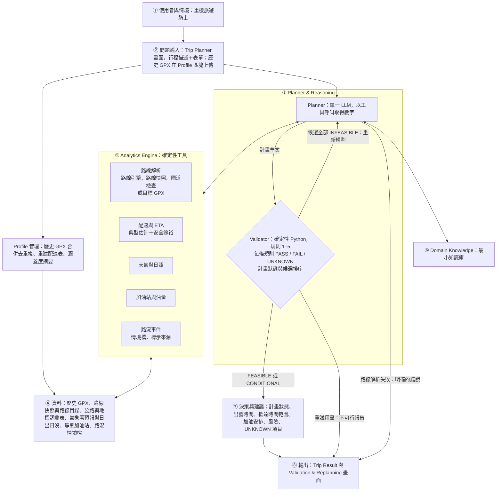

# DESIGN — Moto Touring Copilot 重機旅遊規劃顧問

> 狀態：實作前（2026-11-14 完成 Scope Reduction、Design Review Fix 與 M0 決策，當時的範圍為 Level 2 Lite 的 Agent-first MVP；2026-11-15 的 CR-01 把目標改為**對齊 Proposal 的 MVP**，見下一段）。**尚未實作，沒有任何實驗結果；UI Prototype 已建立並在 G3 凍結（§9.6）。** M0 進行中：資料契約 v0.2 已審查並凍結，供 M1 Spike 使用；最小專案骨架與契約測試已建立；已收到 21 趟 GPX；`ingest`、`routes`、`pace` 與 ETA 的 Spike 都已執行，輸出通過契約檢查。M1 Review 已完成：兩條示範路線與保留行程暫定接受（這是 CR-01 之前的狀態；之後示範路線降為 fixture，保留行程已依新規則重新指定）；LLM Smoke Test 只完成本地驗證，真實 API 測試為 NOT RUN（§13.4）。
> **CR-01（2026-11-15 批准）。** 本文件描述的目標是對齊 Proposal 的 MVP（課程 Level 2），取代「Level 2 Lite」：以自然語言描述行程、由路線引擎產生實際道路路線、當天來回、在介面上傳歷史 GPX 並更新 Profile。兩條示範路線降為 Demo 與測試用的 fixture，保留行程已依新規則重新指定。裁決與紀錄見 [§13.5](#135-cr-01-紀錄2026-11-15) 與 [CR-01 評估報告](docs/cr/CR-01-proposal-alignment.md)。CR-01 新增的範圍**都尚未實作**。四項技術檢查的現況：C1 通過；C4 未通過（公開伺服器忽略硬性排除），備案 C4b（軟性偏好）通過；路線參數已裁決為 `use_highways: 0` 加每個方向的獨立國道檢查；C2 為 FAIL；C3 為 BLOCKED／NOT RUN。CR-01 的修改已由兩位獨立審查者審查並修正。專題負責人的審查處置（2026-11-15）：接受 Scope Restoration，P-1 至 P-11 已裁決，**SPEC-001 的凍結尚未批准**；裁決與尚未解決的 Spec Blockers 在 §13.5。CR-01 的文件仍是 Draft／Pending。
> 完整論述、文獻與證據見 [Proposal](docs/proposal/proposal.pdf)。Proposal 描述的是縮減前的完整設計；兩者不一致時，實作以本文件為準。CR-01 之前的差異與理由記錄在 [§13.1](#131-scope-reduction-紀錄2026-11-14)，其中幾列已被 CR-01 取代；CR-01 之後仍有的差異見 [§13.5](#135-cr-01-紀錄2026-11-15)。設計審查的修正記錄在 [§13.2](#132-design-review-fix-紀錄2026-11-14)，M0 決策記錄在 [§13.3](#133-m0-決策紀錄2026-11-14)。
> 本文件著重「下一位開發者如何理解、執行、驗證並接手」。

## 目錄

1. [Problem](#1-problem)
2. [Requirements](#2-requirements)
3. [Architecture](#3-architecture)
4. [Components](#4-components)
5. [Data](#5-data)
6. [AI / Analytics](#6-ai--analytics)
7. [Domain Knowledge](#7-domain-knowledge)
8. [Algorithm](#8-algorithm)
9. [Implementation Mapping](#9-implementation-mapping)
10. [How to Run](#10-how-to-run)
11. [Results](#11-results)
12. [Limitations](#12-limitations)
13. [Change Log](#13-change-log)

## 1. Problem

騎士出發前最常問、也最容易判斷錯的問題是：「照我的騎法，這趟山路幾點出發才能在天黑前回家？中途哪裡加油？哪一段可能下雨或封路？」

- 一般導航的預估時間是群體平均，不知道個別騎士在彎道與坡道的騎法。
- 天氣、日落、路況、加油站分散在不同平台，騎士要自己換算「抵達該路段時」的狀況。
- 大型語言模型單獨規劃行程並不可靠（TravelPlanner 中 GPT-4-Turbo 同時滿足所有限制的最終通過率 0.6%；RETAIL 中最強的既有模型 1.0%），需要外部工具計算與驗證。
- 近期多 Agent 規劃系統（Vaiage、ROAM）已把天氣、道路距離與營業時間帶進規劃，但對象是城市景點行程，沒有依個人速度推算各點抵達時間。

定位：個人化的**出發前決策輔助**，不做事故預測，也不宣稱能降低事故率。

### 核心研究問題（MVP）

CR-01 之後，研究問題是兩題：

> 研究問題 1：依路段類別的個人配速表估計騎乘時間，誤差有多大？在山路段與沒騎過的路上，和單一平均速度、路線引擎的時間相比如何？（路線引擎的時間限於可以取得的路段，§6.2）
>
> 研究問題 2：AI Agent 結合確定性工具與獨立驗證機制，能否提高重機旅遊行程規劃的可行性？

研究問題 1 由 E1 Lite 回答（§6.2），研究問題 2 由 E2 回答（§6.3）。E1 Lite 分開報告單一平均速度、個人配速與路線引擎的時間，不混淆比較對象；本專題不宣稱個人配速比 Google Maps 或一般導航準（CR-01 D4）。

## 2. Requirements

### 2.1 功能需求

需求編號沿用 Proposal 階段的 FR1–FR8，內容依 MVP 範圍修訂。

| ID | 需求（MVP 版本） | 範圍 | 與原版的差異 |
| --- | --- | --- | --- |
| FR1 | 以一個自由文字欄描述行程（起點、目的地或公路、途經點、來回或單向），加上表單欄位（日期、最早可出發時間、期限、出發油量）；由路線引擎產生實際道路路線；支援來回行程（同一組起訖與途經點的去程與回程）與單向行程；缺起點、從哪一端進入、來回或單向時追問 | Must | CR-01 恢復 Proposal 的行程描述、實際道路路線與來回行程。公路與地標限於公路與地標詞彙表（先 5–8 條）；詞彙表以外的地名不自動解析，回覆「不在支援範圍」。也可以改用只讀幾何的目標 GPX 提供路線。期限在來回行程顯示為「最晚回到出發點時間」，在單向行程顯示為「最晚抵達終點時間」。會影響驗證的條件用表單欄位；會影響 ETA 的休息安排要轉成結構化資料。文字與表單衝突時以表單為準並提示。不做多輪聊天與地圖選點 |
| FR2 | 在介面上傳騎士自己的歷史 GPX（可多檔，可之後再加），合併並以內容去重複，更新 Profile（重建個人配速表），顯示涵蓋度摘要 | Must | CR-01 D1：不能只做指令匯入；**不設最少檔數**。資料不足時結果為 UNKNOWN 並說明還缺什麼。不訓練分位數模型 |
| FR3 | 估計各路段騎乘時間與各點抵達時間，輸出「典型估計」與「加上安全餘裕的保守估計」 | Must | 原為 P50／P90 分位數；MVP 的保守估計**不是**經過校正的 P90（§6.1） |
| FR4 | 依各路段預計抵達時間查氣象署預報與民用暮光終 | Must | 氣象署警特報為 Should；高降雨機率提醒是本專題自訂的門檻（§4.2） |
| FR5 | 查沿線加油站位置與營業時間，依騎士的出發油量逐段檢查油量；處理封路事件。加油站與檢查點沿任意路線自動產生 | Must | 加油站為靜態快照；不預設滿油；封路以情境檔提供並標示來源；TDX 即時路況為 Should。CR-01：檢查點由加油站投影到路段邊界與來回行程的折返點產生，同一座加油站在去程與回程都經過時各一個，不再逐條路線人工加入 |
| FR6 | 驗證整份計畫（規則 1–5），沒有可用計畫就重新規劃；無可行解時說明原因與替代方案 | Must | 每條規則為 PASS／FAIL／UNKNOWN，計畫狀態為 FEASIBLE／CONDITIONAL／INFEASIBLE（§4.2） |
| FR7 | 以 Streamlit 的 Profile 區塊（歷史 GPX 上傳與涵蓋度摘要）與三個畫面呈現（Trip Planner、Trip Result、Validation & Replanning，§9.6）；Trip Result 附路線摘要（主要道路名稱與里程）；驗證狀態與資料來源以獨立區塊呈現，回答附出處 | Must | 有底圖的地圖與可下載的計畫檔為 Should；不依賴 Google Maps |
| FR8 | 騎乘中手機定位經 MQTT 回傳，即時更新抵達時間並語音提醒 | Won't | 原為延伸（L3），本次確定不做 |

### 2.2 非功能需求

| ID | 需求 |
| --- | --- |
| NFR1 | 回答中的每個時間、距離、機率都必須來自工具輸出（可追溯） |
| NFR2 | 原始 GPX 不進版控；公開資料只放裁掉頭尾後的衍生路段表。CR-01 補充：私有 GPX 與住家位置不送到第三方（路線服務、地名查詢與語言模型都算第三方）。對路線服務與地名查詢的請求只使用公開地標。送給語言模型的只有騎士自己輸入的行程文字、結構化的條件，以及不含座標與軌跡點的工具輸出（含計畫路線的道路名稱）；不送原始 GPX、逐趟的騎乘資料與住家位置。從住家或出發錨點出發的路線與路線快照不進版控 |
| NFR3 | 不在車上加裝任何設備 |
| NFR4 | 外部 API 失敗、資料缺漏或超出資料涵蓋範圍時，結果標示為 UNKNOWN 並告知騎士，不以猜測補值 |
| NFR5 | 模擬的測試資料（例如封路情境）必須帶有來源標記，在介面、實驗紀錄與結果中都和真實事件分開呈現 |

NFR5 是本次新增，來自 Scope Reduction 的設計約束。

### 2.3 Scope Matrix（Must / Should / Won't）

Must 是 MVP 承諾完成的範圍。Should 只在進度允許時才做，落後時最先放掉（§9.3），不影響 MVP 驗收。Won't 是本學期確定不做，列入 Future Work（§12）。下表依 CR-01 第 12 節修訂（2026-11-15）。

| 領域 | Must Have | Should Have | Won't Have |
| --- | --- | --- | --- |
| Agent 架構 | 單一 Planner LLM＋確定性 Python 工具＋獨立 Validator（三值，規則 5 最終檢查） | — | 五個獨立 LLM Agent；多輪聊天 |
| 騎士資料 | 靜態 Rider Profile；依 Profile 排入休息 | — | 跨 Session Memory |
| 行程輸入 | 自然語言行程描述（一個文字欄加表單）；缺條件時追問 | — | 地圖選點；依模糊偏好探索山路；兩天一夜 |
| 路線 | 途經點 → 路線引擎 → 路線快照 → 國道檢查，失敗時明確報錯，不由 LLM 產生路線；來回行程（同一組起訖與途經點的去程與回程；CR-01 第 12 節稱「去回同路」），期限為回到出發點；公路與地標詞彙表（5–8 條）；只讀幾何的目標 GPX，以檔案路徑提供；沿線檢查點、路段對應鄉鎮。兩條示範路線（R01、R02）降為 Demo 與測試用的 fixture | 目標路線 GPX 的介面上傳；自架路線引擎；環線 | 任意地名的自動解析；Google Routes 作為路線引擎；重新規劃自動改路線 |
| GPX 與 Profile | 歷史 GPX 多檔介面上傳、合併去重複、Profile 更新、涵蓋度摘要，不設最少檔數；配速資料中的路線涵蓋比例（`ridden_share_pct`）與固定告知句，資料不足時 UNKNOWN 並說明 | — | 279 趟全量處理；零 GPX 的冷啟動；類別充足分級與跨類別補值 |
| 配速 | 基礎配速表、ETA、時間餘裕計算、停等寬放（審查處置 P-2 升為 Must；做法與還沒有定義的部分見 §6.1） | 多元迴歸（MLR）；LightGBM | 完整 P50／P90 分位數模型、conformal 校正 |
| 特徵 | 由軌跡本身算出的簡單路段類別 | — | 完整 DTM／OSM 特徵工程；高度與道路等級特徵 |
| 候選評估 | 候選完整評估；評估失敗或中止時不輸出最晚出發時間的宣稱 | 無可行解時可驗證的提早折返點 | — |
| 天氣與日照 | 氣象署預報、民用暮光終；規則 3 在來回行程上的定義於 E2 題庫凍結前定案（§4.2） | 氣象署警特報 | 歷史天氣作為配速特徵 |
| 補給 | 靜態加油站快照、依出發油量的逐段油量檢查 | — | — |
| 路況 | 封路情境（標示來源）與資料缺失的安全處理 | TDX 即時路況 | E3 真實歷史封路回測、RPi 5 每日收集器 |
| 知識 | 最小領域知識庫（關鍵字檢索、附出處） | 進階知識檢索 | — |
| 介面 | Streamlit 的 Profile 區塊與三個畫面：Trip Planner、Trip Result、Validation & Replanning；Snapshot Mode；來源證據 | 有底圖的地圖 | Google Routes／Google Maps 作為必要依賴；重做原型 |
| 實驗 | E1 Lite（整趟；baseline、個人配速、路線引擎的 ETA 分開報告）、E2（三組、12–15 題、凍結的路線快照、獨立 Oracle） | 配速消融：把個人配速換成路線引擎的時間重跑 Validator | E3；E2 的天氣與路況消融；E4 作為獨立實驗（併入 Demo）；宣稱比 Google Maps 準；Google 人工查詢 |
| IoT | — | — | L3：MQTT、即時定位、語音提醒 |

Should 的順序（CR-01 第 12 節）：配速消融；多元迴歸作為 E1 Lite 的一列；目標路線 GPX 的介面上傳；無可行解時可驗證的提早折返點；自架路線引擎、有底圖的地圖、環線、TDX。停等寬放已由審查處置 P-2 升為 Must（§6.1）。CR-01 沒有提到的既有 Should（LightGBM、氣象署警特報、進階知識檢索、可下載的計畫檔）維持 Should，排在這些之後；這四項是否保留是本文件自己補的處理，待專題負責人確認（§13.5）。

期末必繳項目不在刪減範圍內，見 §9.5。UI/UX Prototype 是開發流程的產物（§9.6），不是 MVP 的功能，不列入上表。

### 2.4 範圍（對應課程 Level）

| Level | 內容 | 範圍 |
| --- | --- | --- |
| L1 | 對話、讀 GPX 與開放資料、Python 分析 | 包含在 L2 內 |
| L2 | 知識庫、外部 API、自然語言行程描述與追問、單一 Planner 的多步工具呼叫、獨立驗證與重新規劃 | 承諾完成（CR-01 之前稱 L2 Lite） |
| L3 | 騎乘中即時串流與語音提醒 | 不做 |

## 3. Architecture

MVP 架構：



**路線解析與 Profile 管理（CR-01，尚未實作）。** 兩者都是確定性程式，不含 LLM。

- 路線解析：Planner 把行程描述轉成結構化的路線請求 → 公路與地標由詞彙表對到錨點 → 路線引擎算出實際道路 → 存成路線快照 → 檢查去程與回程都不含國道 → 切段並產生沿線檢查點。也可以改由只讀幾何的目標 GPX 提供路線。路線引擎暫定為公開的 Valhalla 伺服器（機車設定、避開國道；參數是 `use_highways: 0`，每個結果另做獨立的國道檢查），屬有條件批准（CR-01 D2）：可行性由檢查 C1、C4 驗證，C1 通過；C4 未通過（公開伺服器忽略硬性排除），備案 C4b（軟性偏好）通過；路線參數已裁決為 `use_highways: 0` 加獨立的國道檢查（§13.5 P-1）。
- Profile 管理：騎士在介面上傳歷史 GPX（可多檔，可之後再加），系統合併清單、以內容去重複、重建配速表，並顯示涵蓋度摘要。

Proposal 的原始架構圖（五個 Agent）保留在 [docs/figures/architecture.png](docs/figures/architecture.png) 供對照，**不代表 MVP**。

依作業規範的 ①–⑧ 模組：

| 編號 | 模組 | MVP 內容 |
| --- | --- | --- |
| ① | 使用者與情境 | 在台灣騎重機旅遊的騎士 |
| ② | 問題輸入 | Trip Planner 畫面：一個行程描述欄（起點、目的地或公路、來回或單向），加上日期、最早可出發時間、期限、出發油量的欄位；歷史 GPX 在介面的 Profile 區塊上傳 |
| ③ | Planner & Reasoning | 單一 Planner LLM 理解需求、把行程描述轉成結構化的路線請求、缺條件時追問、呼叫工具、組成計畫；獨立的 Validator 檢查每條規則、決定計畫狀態並排序候選計畫；沒有可用計畫時重新規劃 |
| ④ | 資料取得 | 自己的歷史 GPX、路線引擎的路線快照或目標 GPX、公路與地標詞彙表、氣象署、靜態加油站、路況情境檔（§5） |
| ⑤ | Analytics Engine | 路線解析、Profile 管理、配速與 ETA、天氣與日照、續航、路況事件：全部是確定性的 Python 工具 |
| ⑥ | Domain Knowledge | 最小知識庫，關鍵字檢索，回答附出處；公路與地標詞彙表 |
| ⑦ | 決策與建議 | 計畫狀態、出發時間、典型與保守抵達時間、路線摘要（主要道路名稱與里程）、加油安排、風險說明、UNKNOWN 項目 |
| ⑧ | 輸出與互動 | Trip Result 與 Validation & Replanning 畫面；逐條規則的狀態與資料來源以獨立區塊呈現 |

課程圖的 ①–⑩ 與這裡的 ①–⑧ 兩套編號的對照，在期末文件補上（尚未完成）。

設計原則：

1. LLM 負責理解、規劃與解釋；所有數字由確定性工具計算。
2. Validator 與 Planner 分離：Validator 是不含 LLM 的 Python 程式，由主程式在 Planner 之外執行，Planner 不能略過或改寫它的結果。
3. 資料不足時回報 UNKNOWN，不補值（NFR4）。
4. 模擬資料與真實資料分開標示（NFR5）。
5. Validator 的三值狀態與來源證據是介面的核心資訊，以獨立區塊呈現，不藏在對話文字裡（§9.6）。
6. 路線只由確定性的路線工具產生，LLM 不產生也不修改路線。路線引擎失敗時回報明確的錯誤，一般模式不會因此自動改用舊的路線快照；Snapshot Mode 只讀已保存、驗證過的快照（CR-01 D2）。

## 4. Components

### 4.1 Planner、工具與 Validator

Proposal 的五個 Agent 在 MVP 收斂為一個 LLM 與一組確定性元件。原本由「配速、天氣、路況與補給」三個 Agent 負責的工作改成工具，原本的驗證 Agent 改成 Validator。

| 元件 | 類型 | 輸入 | 輸出 |
| --- | --- | --- | --- |
| Planner | LLM（唯一的 LLM） | 使用者問題、騎士設定檔、工具輸出、Validator 結果 | 追問、結構化的路線請求、工具呼叫、結構化的休息與加油安排、說明文字。計畫中的數值由主程式從工具輸出填入，不由 Planner 填寫 |
| 路線工具 | 確定性 | 結構化的路線請求（起點或出發錨點、途經點、`trip_type`），或目標 GPX 的檔案路徑 | 驗證過的路線快照（`snapshot_id`）與切段後的路線，或明確的錯誤 |
| 配速與 ETA 工具 | 確定性 | 路線、出發時間、配速表、休息時間 | 各段典型時間、各點典型與保守抵達時間 |
| 天氣工具 | 確定性 | 各段位置與抵達時段 | 該時段的氣象署預報，或 UNKNOWN |
| 日照工具 | 確定性 | 路線所在地、日期 | 民用暮光終，或 UNKNOWN |
| 加油站與油量工具 | 確定性 | 路線、典型與保守抵達時間、Rider Profile、騎士當次的出發油量 | 沿線加油站與營業時間、各路段油耗、抵達各站前的剩餘油量、補油後的續航；資料缺漏處為 UNKNOWN |
| 路況事件工具 | 確定性 | 路線、日期 | 事件清單（每筆帶來源標記），沒有事件來源時為 UNKNOWN |
| 知識庫檢索 | 確定性 | 查詢字串 | 段落與出處 |
| Validator | 確定性，不含 LLM | 結構化計畫、工具輸出 | 規則 1–5 各自的 PASS／FAIL／UNKNOWN 與理由、計畫狀態 |

**路線工具（CR-01，尚未實作）。** 路線請求的 `trip_type` 是 `one_way`（單向）或 `round_trip`（來回：同一組起訖與途經點的去程與回程）。路線的來源以 `route_source` 標示：`routing`（路線引擎）、`target_gpx`（只讀幾何的目標 GPX）或 `trip`（由騎過的行程裁切，只用於 fixture）。路線引擎的結果存成路線快照（§5）：來回行程是一個快照、兩個方向，去程與回程各送一次請求，不反轉去程的折線；引擎回傳的回程不保證和去程走同一條道路。採用條件：每個方向都通過獨立的國道檢查（`freeway_check`）才採用，這一條沒有例外。路線參數已裁決（§13.5 P-1）：採 `use_highways: 0`，不送出硬性排除，回應出現任何警告就不採用。這個設定是偏好，不是保證，而且可能連快速公路也避開，平面轉場較慢（§12）；保證來自獨立的國道檢查。**LLM 不產生也不修改路線**：Planner 只提出路線請求；路線引擎失敗或檢查沒通過時，系統回報明確的錯誤，一般模式不會因此自動改用舊的路線快照；Snapshot Mode 只讀已保存、驗證過的快照（SPEC-001 7.11）。對路線服務的請求只使用公開地標；起點在住家附近時，改用出發錨點（代替住家作為起點的公開地標）。行程描述是騎士自己輸入的文字，會送給語言模型（NFR2）。送出前先在本機檢查：出現門牌或座標的寫法時不送出，請騎士改寫（SPEC-001 7.12，草案）。這個檢查只能擋下常見的寫法，產品不宣稱行程描述一定不含私人地址（§12）。目標路線 GPX 不由幾何推定行程型態：騎士沒有明確提供折返點或來回的幾何時，不當成來回行程（SPEC-001 7.11 第 2 項）。

騎士設定檔（Rider Profile）是靜態檔案：車型、油箱容量、平均油耗、安全保留油量（暫定為油箱容量的 20%，可在設定檔調整）、出發錨點、預設休息、預設的期限（§4.2）。預設休息會排入計畫，騎士當次可以另外指定。FR2 的「Profile 更新」指的是由歷史 GPX 重建個人配速表與涵蓋度摘要，設定檔的這些欄位不會因此改變。出發油量不放在設定檔，騎士每次規劃時必須明確提供，以油箱的百分比（0–100%）輸入，由工具依油箱容量換算成公升。所有油量與續航的計算都由工具執行，Planner 不自行估算。MVP 不做 Proposal 的跨 Session「騎士記憶」（PD-3 定案）。

### 4.2 驗證規則

符號：`ETA_typ` 是典型抵達時間，`ETA_safe` 是加上安全餘裕後的保守抵達時間（定義見 §6.1）。`ETA_safe` 取代 Proposal 的 P90 抵達時刻，它是保守估計，不是分位數。

期限：期限欄位的語意不變，是路線終點的保守估計對期限。來回行程（`trip_type` 為 `round_trip`）的路線終點就是出發點，介面顯示為「最晚回到出發點時間」；單向行程（`one_way`）顯示為「最晚抵達終點時間」。本文件其他地方寫「最晚抵達終點時間」時，指的是同一個欄位。期限對的是路線終點，不是住家：起點是出發錨點時，從錨點回到家的時間不在計畫內，騎士要自行加上。

| 規則 | PASS 條件 | UNKNOWN 條件 |
| --- | --- | --- |
| 1 日照 | 路線終點的 `ETA_safe` ≤ min（民用暮光終, 最晚抵達終點時間）。來回行程的路線終點是出發點，所以檢查的是回到出發點的時間 | 取不到暮光終資料，而且保守估計沒有超過最晚抵達終點時間。保守估計已經超過最晚抵達終點時間時是 FAIL，不是 UNKNOWN |
| 2 油量 | 從出發油量逐段扣除油耗後，每個檢查點的剩餘油量都不低於安全保留油量；抵達計畫加油站的時段 [`ETA_typ`, `ETA_safe`] 在營業時間內；補油後足以抵達下一個補給點或終點（細節見下） | 缺油箱容量、平均油耗或該站的營業時間（出發油量是必填，缺少時不進入規劃） |
| 3 天氣（專題自訂策略） | 單向行程：高降雨機率路段（抵達時段 [`ETA_typ`, `ETA_safe`] 內任一預報時段的 PoP ≥ 70%，定義見下）不位於路線最後 20% 的距離範圍內。來回行程：檢查的範圍**待裁決**（CR-01 D3，見下） | 取不到預報、路段對不到鄉鎮，或抵達時段超出預報的涵蓋區間 |
| 4 路況 | 路線上沒有封閉或管制事件 | 沒有可用的事件來源；**不得預設為 PASS** |
| 5 可追溯 | 計畫的數值欄位由主程式從工具輸出填入；Planner 說明文字中的每個數字也都出現在工具輸出中 | 不適用（只有 PASS／FAIL） |

**計畫狀態（PD-1 定案）。** 由 Validator 依規則結果決定，Planner 不能改寫。

| 計畫狀態 | 條件 | 能否作為建議 |
| --- | --- | --- |
| `FEASIBLE` | 所有規則 PASS | 可以 |
| `CONDITIONAL` | 沒有 FAIL，至少一條 UNKNOWN | 可以，但必須逐條列出 UNKNOWN 的規則與騎士要自行確認的事項 |
| `INFEASIBLE` | 至少一條 FAIL | 不可以，只用來說明原因與替代方案 |

候選計畫的排序：先比狀態，`FEASIBLE` 優先於 `CONDITIONAL`；狀態相同時選出發時間最晚的候選（§8）。候選只要不是 `INFEASIBLE`，它的保守估計就已經在期限內。計畫狀態由規則 1–4 逐候選判定。規則 5 是最終輸出的強制關卡，CR-01 改為固定模板優先：輸出先用由結構化欄位組裝的固定模板；Planner 的說明文字通過規則 5 才附加，沒通過就不顯示，也不重新產生。最終輸出仍要通過規則 5 的檢查，通過之後計畫才維持規則 1–4 決定的狀態；沒通過時回報輸出驗證錯誤，不顯示計畫狀態（§8）。候選一律完整評估，不分批，也沒有另外的搜尋狀態；評估失敗或中止時，輸出不得宣稱有最晚的可行出發時間（§8）。`INFEASIBLE` 的候選不參與排序。沒有 `FEASIBLE` 但有 `CONDITIONAL` 時，提供條件式計畫；全部 `INFEASIBLE` 時回報原因與替代方案。不可行報告列出各規則的 FAIL 統計與一個代表性失敗候選：取 FAIL 規則數最少的，相同時取出發時間最晚的。它一律標示為不是建議（CR-01 簡化，取代 G1 簽核時的兩種名稱與選法）。這個選法是本文件依「簡化代表候選」的裁決自己定的，待專題負責人確認（§13.5）。

MVP 沒有即時路況來源，所以真實日期的規劃在規則 4 上是 UNKNOWN，計畫狀態最多是 `CONDITIONAL`。這是刻意的設計結果，不是缺陷：系統不知道有沒有封路時不能說可行。騎士自行確認路況不會把 UNKNOWN 改為 PASS；介面把它列為出發前要確認的事項。

**規則 2 的油量檢查。** 不預設滿油。

1. 出發油量是必填，由騎士當次以油箱的百分比（0–100%）明確提供，由工具依 Rider Profile 的油箱容量換算成公升；沒有提供時 Planner 追問，不進入規劃，也不以滿油代替。油箱容量、平均油耗與安全保留油量來自 Rider Profile；安全保留油量暫定為油箱容量的 20%，可在設定檔調整。
2. 各路段油耗 = 路段距離 × 平均油耗。從出發油量逐段扣除，得到抵達每個計畫加油站前與抵達終點時的剩餘油量；這些位置稱為檢查點。
3. 只有在計畫明確安排在該站加滿，且該站可用（有營業時間資料，抵達時段在營業時間內）時，補油後的油量才以滿油計算，再繼續逐段扣除到下一個補給點或終點。其他情況油量不重置。
4. PASS：每個檢查點的剩餘油量 ≥ 安全保留油量，且抵達各計畫加油站的時段都在營業時間內。
5. FAIL：任一檢查點的剩餘油量低於安全保留油量，或抵達時段有任何部分落在營業時間外。
6. UNKNOWN：缺油箱容量、平均油耗，或計畫加油站沒有營業時間資料。不以預設值代替；該站之後的剩餘油量取決於能否補油，不報告為確定的數值。
7. 以上計算全部由油量工具執行，Planner 不自行估算油量或續航。E2 的 A1 是沒有工具的對照組，不適用這一條。

**規則 3 的高降雨機率提醒（PD-4 定案，專題自訂策略）。** MVP 只使用氣象署預報的降雨機率（PoP）。

| PoP | 自訂顯示分類 | 對規則 3 的作用 |
| --- | --- | --- |
| 0–39% | 低降雨機率 | 無 |
| 40–69% | 中降雨機率 | 無，只顯示 |
| 70–100% | 高降雨機率提醒 | 該路段標為高降雨機率路段 |

- 門檻（PoP ≥ 70%）與三段分類都是**本專題自訂的暫行設定**，沒有經過驗證，不是氣象署的分類。
- PoP 是降雨的機率，**不代表降雨強度**，也**不等於氣象署的大雨或豪雨特報**。介面、報告與簡報一律稱為「高降雨機率提醒」，不得寫成警特報或大雨預報。
- 規則 3 沿用原先的保守做法：高降雨機率路段若位於路線最後 20% 的範圍，結果為 FAIL。這個範圍以路線的累計距離計算，不依路段數；跨入這個範圍的路段也算在內。這是專題自訂的保守策略，不是官方的天氣安全標準。CR-01 之後，這個定義只適用於單向行程。
- 來回行程的範圍**待裁決**（CR-01 D3；§13.5 P-8）。來回行程的最後 20% 可能是回程的平面路段，山區的回程落在中段，沿用原定義可能讓規則 3 在山區回程不起作用。五條參考來回路線的資料顯示，最後 20% 檢查到的主要是下山之後的路（CR-01 第 16 節的 D3 資料；這些路線從山腳的公開地標出發，不是從住家出發）。這只是資料，尚未據此裁決。專題負責人暫不接受「整個回程遇到高降雨機率提醒就 FAIL」，要求比較「回程全部路段」與「山區回程路段」兩種範圍，以真實路線資料提出透明、確定性的定義。審查處置 P-8（2026-11-15）：暫不採用曲率或固定高度的定義；lead 在 11/27 前提出有固定規則、可重現、符合研究目標的最小方案，再由專題負責人定案。最晚 2026-12-03 定案，早於 E2 題庫凍結（12/5，§9.3）。定案之後不得依測試結果調整。
- **預報的時段與鄉鎮（審查處置 P-4 與修正 4）。** 路段以國土測繪中心的鄉鎮界線在本機對應到氣象署的鄉鎮預報；一個路段經過多個鄉鎮時取最高的降雨機率；對不到鄉鎮時不當成低降雨機率，規則 3 是 UNKNOWN。降雨機率是整個預報時段的數值：結果保留採用的預報時段（起訖）與時段長度，文字只能寫成「某個預報時段的降雨機率」，不得把 12 小時一筆的資料寫成抵達那一刻的預報。規則在 SPEC-001 7.13（草案）；實際的預報產品與時間解析度要等 C3 的真實 API 驗證。
- 取不到預報或日期超出預報涵蓋期間時，結果為 UNKNOWN。
- 氣象署警特報屬 Should：實作時以官方名稱另外呈現，不和高降雨機率提醒合併成同一個訊號。

### 4.3 對應課程框架

| 課程 Workflow | 本專題（MVP） |
| --- | --- |
| Understand | Planner 取出行程條件，缺資訊就追問 |
| Plan | Planner 決定工具呼叫順序與候選出發時間 |
| Acquire | 工具取得路線、預報、暮光終、加油站與路況事件 |
| Analyze | 配速表、ETA 與餘裕、續航計算、風險規則 |
| Generate | Validator 檢查後產生建議；不可行時提出替代方案 |
| Interact | Streamlit 的三個畫面（§9.6） |

六大能力（TALK、KNOW、SENSE、ANALYZE、THINK、SHOW）的原始對應見 Proposal §4.4.2。MVP 的差異：TALK 是一個行程描述欄加一輪追問，不是多輪對話；SENSE 不含騎乘中的定位串流；ANALYZE 以配速表為主，迴歸與梯度提升樹為 Should；THINK 是單一 Planner 加獨立驗證，不是多 Agent；SHOW 不含語音，地圖為 Should。

## 5. Data

| 來源 | 用途 | 取得方式 | MVP 範圍 | 備註 |
| --- | --- | --- | --- | --- |
| BMW Motorrad Connected GPX | 配速表、E1 Lite、E2 Oracle 的實際行程時間 | App 內逐趟匯出，在介面上傳 | Must：騎士上傳的歷史 GPX，不設最少檔數（目前 21 趟）。279 趟全量為 Won't | 約 1 秒一點，只有經緯度、高度、時間；**不進版控**，不送到第三方 |
| 路線引擎（暫定為公開的 Valhalla 伺服器，圖資為 OpenStreetMap） | 把途經點算成實際道路路線 | HTTP API，機車設定並避開國道；每個結果另做獨立的國道檢查，通過才存成路線快照 | Must（有條件批准，CR-01 D2） | 只用於低頻的開發與快照產生，遵守官方的公平使用與識別要求；對外請求只使用公開地標；Demo 與 E2 只讀凍結的快照。可行性檢查：C1 PASS；C4 FAIL（公開伺服器忽略硬性排除）；備案 C4b（軟性偏好）PASS。路線參數已裁決為 `use_highways: 0` 加獨立的國道檢查（§13.5 P-1） |
| 目標路線 GPX | 只讀幾何，作為路線來源；E2 真實行程題的路線來源 | 以檔案路徑提供 | Must；介面上傳為 Should | 不讀時間。私有 GPX 不離開本機，幾何不進版控 |
| 公路與地標詞彙表 | 把公路名稱與地標對到錨點 | 人工整理並附出處，先 5–8 條，以騎過的路為主 | Must | 放在知識庫（§7）；詞彙表以外的地名不自動解析 |
| 路線目錄 | 目標路線的切段、類別與檢查點 | 由路線快照或目標 GPX 建立。兩條示範路線（R01、R02，由騎過的 GPX 裁切）降為 Demo 與測試用的 fixture | Must | 從住家或出發錨點出發的路線與路線快照不進版控 |
| 鄉鎮界線 | 路段對應鄉鎮，用來查預報 | 內政部國土測繪中心的鄉鎮市區界線（審查處置 P-4），存成本機檔案，在本機對應，不送出座標。資料的版本與授權條款尚未查證（§13.5 SB-3） | Must | 路段對不到鄉鎮時規則 3 為 UNKNOWN |
| 中央氣象署預報 | 抵達時段的天氣 | opendata.cwa.gov.tw API（需授權碼） | Must | 超出預報涵蓋期間回報 UNKNOWN |
| 中央氣象署日出日沒 | 民用暮光終 | 氣象署開放資料 | Must | |
| 中油加油站資料 | 位置、營業時間 | 政府資料開放平臺 data.gov.tw/dataset/6065，存成靜態快照 | Must | 記錄快照日期；台塑沒有開放資料，MVP 不涵蓋（§12） |
| 中央氣象署警特報 | 以官方名稱呈現的警特報 | 氣象署開放資料 | Should | 不和自訂的高降雨機率門檻混用（§4.2） |
| 車輛規格 | 油箱容量、平均油耗 | BMW 車系規格，寫入 Rider Profile 與知識庫 | Must | 油耗以單一平均值計算（§12） |
| 路況事件情境檔 | 規則 4、E2 的封路題 | 人工編寫 | Must | 每筆帶 `source`：`simulated`（模擬）或 `real`（真實公告，附出處） |
| 交通部 TDX | 省道即時路況 | TDX API（需授權碼） | Should | |
| Google Maps Platform | 地圖顯示、預估時間對照 | Maps JavaScript API、Routes API | 非必要依賴 | CR-01 D4：不做 Google 人工查詢，E1 Lite 不和 Google Maps 比較。Routes API 的條款不允許預先擷取與儲存，不作為路線引擎 |
| 內政部 20 m DTM、公路局 GIS、OpenStreetMap | 坡度、急彎、道路等級特徵 | 政府資料開放平臺、OSMnx | Won't | 完整特徵工程不做 |
| CODiS 歷史天氣 | 配速模型的天氣特徵 | CODiS | Won't | MVP 的配速不使用天氣特徵 |

### 資料處理流程（GPX）

CR-01 之後有兩條資料流：歷史 GPX 建立 Profile；目標路線來自路線快照或目標 GPX。

歷史 GPX → Profile：

1. 裁掉每趟起點與終點附近的路段（住家與工作地點隱私）
2. 清理車速跳點並平滑
3. 分離移動時間與停留時間
4. 切成路段，由軌跡幾何算出路段類別（暫定依曲率分級，細節於實作時定）
5. 新上傳的檔案併入行程清單，以內容去重複；清單是 `trip_id` 的唯一來源，已指定的 `trip_id` 不變動，新檔接續編號；實驗腳本一律讀清單，不自行編號（CR-01，尚未實作）
6. 以配速行程重建配速表，輸出涵蓋度摘要：可用的行程數、各類別的路段數、累計公里（CR-01，尚未實作）

目標路線（CR-01，尚未實作）：

1. 路線來自路線引擎的路線快照，或只讀幾何的目標 GPX（§4.1）。來回行程的去程與回程各送一次請求，存在同一個快照
2. 路線切段並分類，方法和歷史 GPX 相同
3. 沿線的加油站投影到路段邊界，連同來回行程的折返點成為檢查點；同一座加油站在去程與回程都經過時，各有一個檢查點
4. 路段對應鄉鎮，用來查預報
5. 和配速行程的軌跡比對，算出配速資料中的路線涵蓋比例（`ridden_share_pct`，不分方向；不代表騎士騎過的所有道路），連同固定的告知句一起輸出

行程挑選原則：保留行程依 2026-11-15 凍結的規則指定（§6.2）。目前清單有 21 趟：配速行程 16 趟、保留行程 4 趟、1 趟維持排除，等專題負責人重新裁決。

### 最小資料契約 v0.3（Draft, CR-01）

狀態：**v0.3（Draft, CR-01）**（2026-11-15）。前一版 v0.2 是 Reviewed / Frozen for M1 Spike（2026-11-14）；v0.1 的審查發現 DC-1 至 DC-10 與裁決見 §13.4。凍結之後的修改要先記入 Change Log。DC-10（配速的計算方法）保留為方法選擇事項，不阻擋 Spike。

v0.3 相對於 v0.2 改兩處。(1) 共通規則的 ID 格式放寬（`route_id` 與 `checkpoint_id`）：凡是帶這兩個 ID 的欄位都適用，所以會連帶影響契約 1 與契約 4 中引用這兩個 ID 的格式檢查（契約 1 的 `route_id`、契約 4 的 `route_id` 與 `breaks[].after_checkpoint_id`）。(2) 契約 2 的欄位有變更：路線紀錄的 `source_trip_id` 改為可空，新增 `route_source`、`snapshot_id` 與 `trip_type`；檢查點的 `kind` 新增 `turnaround`（草稿，待 Ticket 實作）；新增不變條件 4 與 5。契約 1、3、4 的欄位與不變條件不變，包含「缺一個類別時整份 ETA 為 `unknown`」的規則（契約 4 不變條件 7）。**`src/moto_copilot/contracts/` 的驗證程式與契約測試仍然依 v0.2 檢查**，會透過 Tickets 修改；在那之前，程式與本節不一致。v0.2 的原文可以由基準 commit `9b3af99` 查看。

契約 1 與契約 3 的本文沒有改。其中三處文字和現況有出入，在這裡說明：契約 1 的 `holdout` 寫的是「保留給 E2 Oracle」，CR-01 之後保留行程也用於 E1 Lite 最後的報告（§6.2）；契約 3 的 `method` 寫「v0.2 固定為」，v0.3 沒有改這個方法；`trip_id` 本身不含日期，但目前的編號是依日期順序指定的，編號的先後會透露行程的先後。

契約只涵蓋 Spike 需要的四份資料，不是完整的 GIS Schema：不含路網拓樸、行政區、地形與完整軌跡點。路線快照是契約之外的新檔案，說明在契約 2 之後。

**共通規則。**

| 項目 | 規則 |
| --- | --- |
| 型別 | `string`、`int`、`float`、`datetime`、`enum`、`list` |
| 單位 | 寫在欄位名稱的字尾：`_m` 公尺、`_s` 秒、`_kmh` 公里／小時、`_deg_per_km` 每公里的度數。座標為 WGS84 十進位度 |
| 時間與時區 | `datetime` 一律是帶時區位移的 ISO 8601 字串，時區為 Asia/Taipei（`+08:00`）。GPX 的原始時間是 UTC，在 `ingest` 轉換。沒有時區位移的時間視為無效 |
| 缺值 | 以 `null` 表示「不知道或無法計算」，不得用 0、−1 或空字串代替。必填欄位不得為 `null`。使用端遇到 `null` 要往下傳遞為 UNKNOWN，不得補值（NFR4） |
| ID | `trip_id`：`T` 加三位數字，是去識別化的行程代號，不含日期資訊。`route_id`：代表一條**有方向**的路線；反向騎視為另一條路線，來回行程是一條起點與終點在同一個位置的路線。v0.2 的格式是 `R` 加兩位數字，v0.3 放寬，不再限定兩位。`checkpoint_id`：v0.2 的格式是 `<route_id>-CP<兩位數字>`，v0.3 同樣放寬。審查處置 P-3：確切格式在 Spec 凍結前定義，不留給 Tickets；`trip_id` 與 `R01`／`R02` 不變。提案在 SPEC-001 第 2 節與 7.11 第 1 項，待專題負責人確認（§13.5 SB-1）。`plan_id`：一次 ETA 計算的代號，由產生者指定，在同一批輸出中唯一 |
| 路段類別 | `seg_category` 是 `enum`：`C1`（低曲率）、`C2`（中曲率）、`C3`（高曲率）。分級門檻不在契約內，由 `category_scheme` 標示所用的分級版本 |
| 來源追溯 | 每份資料都帶自己的版本字串與上游的版本或代號，能從 ETA 追回配速表、路線目錄與行程 |
| 實體格式 | 只規範邏輯欄位。檔案格式（CSV、Parquet 或 JSON）在 Spike 決定，不得改變欄位名稱、型別與語意 |

**版控外的私有資料。** 以下資料含住家位置或完整的騎乘時間，一律不進版控，也不屬於這四份契約：

| 資料 | 內容 | 使用者 |
| --- | --- | --- |
| 原始 GPX | App 匯出的檔案 | `ingest` |
| 裁切後的軌跡 | `ingest` 裁掉頭尾後的軌跡點，格式由 `ingest` 內部決定 | `routes`（建立路線目錄的幾何） |
| 行程對照表 | 每趟的 `trip_id`、原始檔名、`trip_role`、`route_id`。`trip_role` 依 §6.2 的保留行程規則指定，`route_id` 由人工指定 | `ingest` |
| 私有版衍生路段表 | 契約 1 加上 `start_time` | 內部分析、E2 Oracle |
| 保留行程的指定清單 | 依 §6.2 的規則指定的結果。公開文件只記錄趟數與清單的雜湊 | E1 Lite、E2 Oracle |
| 從住家或出發錨點出發的路線目錄與路線快照 | 路段終點的座標與路線折線會暴露住家附近的範圍 | `routing`、`routes` |
| 真實行程題的路線幾何 | 由保留行程取得的目標 GPX。版控只放雜湊與不含座標的摘要，或裁成兩個公開地標之間的山路段 | E2 |

**契約 1：Derived Segment Table（衍生路段表）。** 產生者 `ingest`；使用者 `pace`、E1 Lite、E2 Oracle。一列是一趟行程中的一個路段；主鍵（`trip_id`, `seg_index`）。不含經緯度（NFR2）。

這份表有兩個版本，列完全相同，只差 `start_time` 一欄：

- **公開版**進版控，不含任何日期與時間。E1 Lite 只使用公開版的欄位，所以結果可以由公開資料重現。
- **私有版**不進版控，多一欄 `start_time`，供內部分析與 E2 Oracle 取得實際的騎乘時間。

| 欄位 | 型別 | 必填 | 公開版 | 說明 |
| --- | --- | --- | --- | --- |
| `trip_id` | string | 是 | 有 | 行程代號 |
| `seg_index` | int | 是 | 有 | 路段在該行程中的順序，從 0 起算（裁掉頭尾之後），連續不跳號 |
| `trip_role` | enum | 是 | 有 | `pace`（用於配速表）或 `holdout`（保留給 E2 Oracle，不進配速表） |
| `route_id` | string | 否 | 有 | 這趟行程對應的示範路線，由行程對照表指定；`null` 表示不在路線目錄內 |
| `start_time` | datetime | 是 | **沒有** | 進入該路段的時間。只存在於私有版 |
| `length_m` | float | 是 | 有 | 路段長度，大於 0 |
| `moving_time_s` | float | 否 | 有 | 移動時間，不含停留；有值時必須大於 0。無法取得有效的移動時間時為 `null`，不得以 0 或其他數值代替 |
| `stopped_time_s` | float | 是 | 有 | 路段內的停留時間；沒有停留時為 0 |
| `curvature_deg_per_km` | float | 否 | 有 | 每公里的累計轉向角；`null` 表示點數不足，無法計算 |
| `seg_category` | enum | 否 | 有 | 路段類別；`null` 表示無法分類 |
| `quality` | enum | 是 | 有 | `ok`、`suspect`（有移動時間但仍有疑慮，例如 GPS 中斷）或 `invalid`（沒有有效的移動時間） |
| `category_scheme` | string | 是 | 有 | 分級版本 |
| `ingest_version` | string | 是 | 有 | 產生這一列的 `ingest` 版本 |

不變條件：

1. 同一個 `trip_id` 的所有列，`trip_role` 與 `route_id` 相同。
2. 一份衍生路段表只有一個 `ingest_version` 與一個 `category_scheme`。
3. `quality` 為 `invalid` 時 `moving_time_s` 必為 `null`，反之亦然；`quality` 為 `ok` 或 `suspect` 時 `moving_time_s` 大於 0。
4. 只有 `quality` 為 `ok`、`seg_category` 不是 `null`、`trip_role` 為 `pace` 的列可以進配速表。
5. 公開版與私有版的列一一對應，共同欄位的值相同。

**契約 2：Route Catalog（路線目錄）。** 產生者 `routes`；使用者 `pace`、`sources`、Planner。包含三種紀錄。幾何的來源由 `route_source` 標示：路線快照、目標 GPX，或版控外的裁切後軌跡。目錄本身只保留路段終點的座標；取自行程的路線，起訖已裁掉住家附近的路段。從住家或出發錨點出發的路線，目錄與路線快照都不進版控。v0.3 改動的欄位在說明欄標示。

路線（主鍵 `route_id`）：

| 欄位 | 型別 | 必填 | 說明 |
| --- | --- | --- | --- |
| `route_id` | string | 是 | 路線代號 |
| `name` | string | 是 | 顯示名稱 |
| `n_segments` | int | 是 | 路段數，大於 0 |
| `total_length_m` | float | 是 | 路線總長，和最後一個路段的 `cum_length_m` 是同一個計算結果 |
| `source_trip_id` | string | 否 | 路線幾何取自哪一趟行程；`null` 表示路線不是取自行程。v0.3 改為可空（v0.2 為必填） |
| `route_source` | enum | 是 | 路線幾何的來源：`trip`（騎過的行程）、`routing`（路線引擎）、`target_gpx`（目標 GPX）。v0.3 新增 |
| `snapshot_id` | string | 否 | 路線快照的代號，指向產生這條路線的快照。一條路線對應一個路線快照，來回行程的去程與回程在同一個快照裡。路線不是來自路線快照時為 `null`。v0.3 新增 |
| `trip_type` | enum | 是 | `one_way`（單向）或 `round_trip`（來回）。v0.3 新增 |
| `category_scheme` | string | 是 | 分級版本 |
| `catalog_version` | string | 是 | 路線目錄的版本 |

路線路段（主鍵（`route_id`, `seg_index`））：

| 欄位 | 型別 | 必填 | 說明 |
| --- | --- | --- | --- |
| `route_id` | string | 是 | 所屬路線 |
| `seg_index` | int | 是 | 路段順序，從 0 到 `n_segments` − 1，連續不跳號 |
| `length_m` | float | 是 | 路段長度，大於 0 |
| `cum_length_m` | float | 是 | 從路線起點到這個路段終點的累計距離，隨 `seg_index` 遞增 |
| `seg_category` | enum | 是 | 路段類別；路線目錄不允許 `null` |
| `end_lat`、`end_lon` | float | 是 | 路段終點的座標 |

檢查點（主鍵 `checkpoint_id`）：

| 欄位 | 型別 | 必填 | 說明 |
| --- | --- | --- | --- |
| `checkpoint_id` | string | 是 | 檢查點代號 |
| `route_id` | string | 是 | 所屬路線 |
| `kind` | enum | 是 | `start`、`fuel_station`、`waypoint`、`turnaround`、`end`。`turnaround` 是來回行程的折返點，v0.3 新增（草稿，待 Ticket 實作） |
| `after_seg_count` | int | 是 | 抵達這個檢查點之前已經完成的路段數。起點為 0，終點為 `n_segments`；值為 c 的檢查點位在路段 c − 1 的終點 |
| `name` | string | 否 | 顯示名稱 |
| `station_ref` | string | 視 `kind` | 加油站快照中的站代號。`kind` 為 `fuel_station` 時必填，其他情況必為 `null`。加油站資料本身不在本契約內 |

不變條件：

1. 每條路線恰有一個 `start`（`after_seg_count` 為 0）與一個 `end`（`after_seg_count` 等於 `n_segments`）。
2. 所有檢查點的 `after_seg_count` 介於 0 與 `n_segments` 之間。檢查點以整數定位，不以距離的相等比對定位。
3. 同一個位置可以有多個檢查點（例如起點同時是加油站），以 `checkpoint_id` 區分。
4. `trip_type` 為 `round_trip` 的路線恰有一個 `turnaround` 檢查點，它的 `after_seg_count` 大於 0、小於 `n_segments`；`one_way` 的路線沒有 `turnaround`。v0.3 新增（草稿）。
5. `route_source` 為 `trip` 時 `source_trip_id` 必填、`snapshot_id` 為 `null`；為 `routing` 時 `snapshot_id` 必填、`source_trip_id` 為 `null`；為 `target_gpx` 時兩者都是 `null`。v0.3 新增（草稿）。

來回行程是一條有方向的路線，起點與終點在同一個位置。折返點是 `turnaround` 檢查點：它之前的路段屬於去程（`outbound`），之後屬於回程（`return`）。同一座加油站在去程與回程都經過時，各有一個檢查點（不變條件 3 已經允許）。路線請求的途經點只用來決定路線，不另外產生檢查點；`waypoint` 留在 enum 中，CR-01 之後沒有自動產生它的流程。

`target_gpx` 的路線在路線目錄中沒有指向來源檔的欄位（共通規則要求來源追溯）。規劃結果以 `target_gpx_ref`（檔案的內容雜湊）追溯（SPEC-001 4.12）；路線目錄本身要不要另記這個雜湊尚未定，由修改契約 2 的 Ticket 提出（§13.5）。

**路線快照（契約之外的新檔案，CR-01，尚未實作）。** 一條路線對應一個路線快照，以 `snapshot_id` 識別。產生者 `routing`；使用者 `routes`、介面的路線摘要、E2。這裡只寫摘要：路線快照的欄位名稱與型別由 [SPEC-001](docs/spec/SPEC-001-plan-schema.md) 的 4.14（RouteSnapshot）定義，路線摘要的欄位由它的 4.12（RouteSummary）定義；實體檔案格式由 Tickets 決定，不得改變欄位。本節不重複欄位表；兩者不一致時以 SPEC-001 為準。

| 層級 | 內容（摘要） |
| --- | --- |
| 快照 | `snapshot_id`、`trip_type`、路線引擎的名稱與版本、圖資日期、`legs[]` |
| 每個方向（`legs[]` 的一筆，`direction` 是 `outbound` 或 `return`） | 送給引擎的請求（起訖、途經點與參數）、折線、里程、引擎時間、主要道路名稱、回應的警告、`has_highway`、`freeway_check`、`endpoint_offset_m`、取得時間；高度為選填 |

- 單向行程只有 `outbound`。來回行程是一個快照、兩個方向：去程與回程各送一次請求，**不反轉去程的折線**。檢查 C4 的五條參考路線中，有一條的回程和去程走了不同的道路（去回里程差最大 1.42%），所以兩個方向分開記錄；去回里程差超過 2% 時在路線摘要標示。
- `has_highway` 是路線引擎回報的國道旗標；`freeway_check` 是獨立的國道檢查結果（道路等級與道路名稱）。兩者都逐方向記錄；國道的採用條件看 `freeway_check`，不看 `has_highway`（§4.1）。
- `endpoint_offset_m` 是要求的地標到折線端點的距離。目的地附近沒有道路時，公開伺服器仍會回傳路線而且沒有警告，終點可能離要求的位置好幾公里，所以要自己量。
- 引擎時間是路線引擎自己估計的時間，不是個人配速的估計，兩者分開呈現（§6.2）。
- 高度選填：規則 3 在來回行程上的候選定義有些用到高度（§13.5 P-8），定案之前先保留。
- Demo 與 E2 只讀凍結的路線快照，不即時呼叫路線引擎。路線快照的請求只含公開地標；從住家或出發錨點出發的快照不進版控。

**路線模組的確定性規則。** 這些規則只有一個定義處：SPEC-001 7.11 的表。本文件只寫摘要並指向那裡，兩份文件不互相把定義推給對方。預設休息的排入規則與 `ridden_share_pct` 的算法也由 SPEC-001 7.11 負責。下表是摘要；還沒有定案的部分與它們的期限以 SPEC-001 7.11 為準。

| 項目 | 定義處 | 摘要 |
| --- | --- | --- |
| 路線快照與路線摘要的欄位、`snapshot_id` 的樣式 | SPEC-001 4.12、4.14、7.11 | 見上面的摘要。`snapshot_id`、`route_id`、`checkpoint_id` 的確切格式是 SPEC-001 的提案，待確認（§13.5 SB-1） |
| 來回行程的回程怎麼產生 | SPEC-001 7.11 | 回程另送一次請求，不反轉去程的折線；兩個方向存在同一個快照 |
| 取得路線的順序與 Snapshot Mode 的比對 | SPEC-001 7.11 | 有目標 GPX 時用它的幾何。Snapshot Mode 只讀已保存的快照。一般模式呼叫路線引擎，通過檢查後先存成快照再使用；失敗或結果不採用時回報錯誤，不自動改用舊的快照 |
| 獨立的國道檢查（`freeway_check`）與採用條件 | SPEC-001 7.11 | 逐方向檢查道路等級與道路名稱，不沿用引擎回報的 `has_highway`；每個方向都通過才採用（§4.1）。產品用哪一種做法取得道路屬性還沒有定案 |
| 回應的警告 | SPEC-001 7.11 | 採 `use_highways: 0`，不送出硬性排除；回應出現任何警告就不採用（§4.1；§13.5 P-1） |
| `endpoint_offset_m` | SPEC-001 7.11 | 逐方向量測並記錄；偏移多大時不採用還沒有定案 |
| 預設休息的排入規則 | SPEC-001 7.11 | 行程描述與追問都沒有給休息安排時，由主程式依 Rider Profile 的預設休息排入，不經過語言模型（§4.1）；排在哪些檢查點還沒有定案 |
| `ridden_share_pct` 的算法 | SPEC-001 7.11 | 路線里程中和配速行程重合的比例，以里程計，不分方向，只用幾何。只比對配速行程；介面稱為「配速資料中的路線涵蓋比例」，不代表騎士騎過的所有道路。比對的距離門檻還沒有定案 |

**契約 3：Pace Table（配速表）。** 產生者 `pace`；使用者 ETA 計算、E1 Lite。一份配速表是一筆表頭加上每個路段類別一筆紀錄。

表頭（主鍵 `pace_version`）：

| 欄位 | 型別 | 必填 | 說明 |
| --- | --- | --- | --- |
| `pace_version` | string | 是 | 配速表的版本 |
| `method` | string | 是 | 配速的計算方法。v0.2 固定為 `median_unweighted`：路段移動速度（`length_m` ÷ `moving_time_s`，換算為 km/h）的中位數，不加權。改用其他方法要先記入 Change Log（DC-10） |
| `category_scheme` | string | 是 | 分級版本 |
| `ingest_version` | string | 是 | 上游衍生路段表的版本 |
| `min_segments` | int | 是 | 產生配速所需的最少路段數 |
| `n_trips` | int | 是 | 用到的行程數 |
| `trip_ids` | list of string | 是 | 建表用到的行程 |
| `built_at` | datetime | 是 | 建表時間 |

類別紀錄（主鍵（`pace_version`, `seg_category`））：

| 欄位 | 型別 | 必填 | 說明 |
| --- | --- | --- | --- |
| `pace_version` | string | 是 | 所屬配速表 |
| `seg_category` | enum | 是 | 路段類別 |
| `speed_kmh` | float | 否 | 依 `method` 算出的配速，大於 0。`null` 表示該類別的路段數低於 `min_segments`，不得用其他類別的值代替 |
| `n_segments` | int | 是 | 用到的路段數 |

不變條件：

1. 每個 `seg_category`（`C1`、`C2`、`C3`）恰有一筆類別紀錄，沒有資料的類別也要有，`speed_kmh` 為 `null`。
2. `trip_ids` 只能是 `trip_role` 為 `pace` 的行程，不得包含 `holdout`；`n_trips` 等於 `trip_ids` 的個數。
3. 只使用符合契約 1 不變條件 4 的列。

**契約 4：ETA Output（ETA 輸出）。** 產生者 `pace`；使用者 `sources`、Validator、介面。一次計算（一個 `plan_id`）產生一筆表頭與每個路段一列。

表頭（主鍵 `plan_id`）：

| 欄位 | 型別 | 必填 | 說明 |
| --- | --- | --- | --- |
| `plan_id` | string | 是 | 這次計算的代號 |
| `route_id` | string | 是 | 路線代號 |
| `departure_time` | datetime | 是 | 出發時間，也是起點檢查點的抵達時間 |
| `status` | enum | 是 | `ok` 或 `unknown` |
| `unknown_reason` | string | 視 `status` | `status` 為 `unknown` 時必填，例如路線上有路段類別沒有配速；`status` 為 `ok` 時必為 `null` |
| `margin_coeff` | float | 是 | 餘裕係數，沒有單位，不小於 0；數值不在契約內（§6.1） |
| `breaks` | list | 是 | 排定的休息，每筆含 `after_checkpoint_id` 與 `duration_s`；沒有休息時為空的 list |
| `pace_version` | string | 是 | 使用的配速表版本 |
| `catalog_version` | string | 是 | 使用的路線目錄版本 |
| `computed_at` | datetime | 是 | 計算時間 |

每個路段一列（主鍵（`plan_id`, `seg_index`））：

| 欄位 | 型別 | 必填 | 說明 |
| --- | --- | --- | --- |
| `plan_id` | string | 是 | 所屬的計算 |
| `seg_index` | int | 是 | 路段順序，對應路線路段的 `seg_index` |
| `typ_seg_time_s` | float | 否 | 這個路段的典型移動時間 |
| `break_time_s` | float | 是 | 進入這個路段之前已排定的休息時間累計；沒有休息時為 0 |
| `eta_typ` | datetime | 否 | 抵達路段終點的典型時間：`departure_time` + 累計的 `typ_seg_time_s` + `break_time_s` |
| `eta_safe` | datetime | 否 | 保守估計：`eta_typ` + `margin_coeff` × 累計的 `typ_seg_time_s`。不是 P90 |

**檢查點、休息與 ETA 的關聯（不變條件）。** 以下 n 是路線的 `n_segments`，c 是檢查點的 `after_seg_count`。

1. 每個 `plan_id` 恰有 n 列，`seg_index` 從 0 到 n − 1，不論 `status` 為何。
2. 休息的 `after_checkpoint_id` 必須是同一條路線的檢查點，而且 0 < c < n：起點與終點不排休息。`duration_s` 大於 0，同一個檢查點最多一筆休息。
3. 路段 k 的 `break_time_s` 等於所有 c ≤ k 的休息的 `duration_s` 總和。休息發生在抵達檢查點之後，所以只延後 `seg_index` ≥ c 的路段。
4. 檢查點的抵達時間：c 為 0 時是 `departure_time`；其他情況取 `seg_index` 等於 c − 1 那一列的 `eta_typ` 與 `eta_safe`。這個時間不含在該檢查點本身的休息。
5. `status` 為 `ok` 時，`eta_typ` 隨 `seg_index` 不遞減，而且每一列的 `eta_safe` 不早於 `eta_typ`。
6. `status` 為 `unknown` 時，所有列的 `typ_seg_time_s`、`eta_typ`、`eta_safe` 都是 `null`，不輸出部分估算的時間；`break_time_s` 仍照填。
7. 路線上任一路段的類別在配速表中 `speed_kmh` 為 `null` 時，`status` 必為 `unknown`。

**ID 關聯。**

| 來源欄位 | 指向 |
| --- | --- |
| 衍生路段表的 `route_id` | 路線的 `route_id` |
| 路線的 `source_trip_id`、配速表的 `trip_ids` | 衍生路段表的 `trip_id` |
| 路線的 `snapshot_id` | 路線快照（契約之外） |
| 檢查點的 `route_id`、路線路段的 `route_id` | 路線的 `route_id` |
| ETA 表頭的 `route_id` 與 `catalog_version` | 路線與路線目錄的版本 |
| ETA 表頭的 `pace_version` | 配速表的表頭 |
| ETA 路段列的 `plan_id` | ETA 表頭 |
| ETA 路段列的 `seg_index` | 同一條路線的路線路段 |
| ETA `breaks` 的 `after_checkpoint_id` | 同一條路線的檢查點 |

## 6. AI / Analytics

### 6.1 配速、ETA 與安全餘裕

- **配速表。** 以配速表使用的行程，算出每個路段類別的移動速度中位數。這是「基礎配速分析」，不是迴歸或分位數模型。
- **路段時間。** 路段典型時間 = 路段長度 ÷ 該類別的配速。
- **抵達時間。** `ETA_typ` 在第 k 點 = 出發時間 + 前 k 段典型時間總和 + 已排定的休息時間。時間以**移動時間加上排定的休息時間**計算；休息時間預設來自 Rider Profile，騎士當次可以另外指定，不由模型預測。
- **安全餘裕。** `ETA_safe` = `ETA_typ` + 餘裕；餘裕 = 餘裕係數 × 已騎乘的典型時間。餘裕係數是設定值，由配速行程的留一趟殘差決定，不使用保留行程（CR-01）；定案後寫進本節，目前仍是暫定值。

用語限制：`ETA_safe` 是**加了安全餘裕的保守估計**，不是 P90，也沒有經過 conformal 校正。文件、介面、簡報與報告都不得稱它為 P90、分位數或有覆蓋率保證的區間。E1 Lite 只會報告「實際時間落在保守估計內的趟數」這個描述性數字。

**CR-01 檢查 C2 的發現（2026-11-15）。** 這是技術檢查，不是 E1 Lite 的結果：只用 16 趟配速行程做留一趟，保留行程沒有讀取，過關條件在執行前寫定。判定是 **FAIL**。完整數字在 `docs/cr/CR-01-appendix/checks_data.md`。它用的資料與方法和 E1 Lite 在配速行程上的留一趟相同，對 E1 Lite 的影響記在 §6.2。

| 項目 | 結果 |
| --- | --- |
| 條件 (a)：低曲率路段的 MAPE 不超過中高曲率路段的 MAPE 加 5 個百分點 | 不通過：低曲率（C1）20.2%，高於中高曲率（C2＋C3）的 10.2% 加 5 個百分點（15.2%） |
| 條件 (b)：整趟移動時間的平均帶符號誤差在 ±10% 之內 | 通過：−4.7%（MAPE 8.1%；單一速度的 baseline 是 17.7%） |
| 低曲率路段 | 預測偏樂觀，平均 −16.2%。只依曲率分類時，直路類別混了不同性質的道路 |
| 中高曲率路段 | 沒有系統性偏差，平均 −0.3% |
| 把短停留（每次不到 3 分鐘）算進實際時間 | 整趟誤差 −19.1%，幾乎每一趟都偏樂觀。短停留相當於移動時間的 17.0% |
| 分級門檻 | 留一趟的 16 次出現 12 組不同的門檻，門檻不穩定 |

- **對規則 1 的影響。** 現行 ETA 只算移動時間與排定的休息，所以實際抵達時間會比估計晚約兩成。在處理之前，規則 1 的可信度是已知限制（§12）。
- **停等寬放是 Must（審查處置 P-2，2026-11-15）。** 順序與限制：(1) 先修正 `ingest` 的假停留（下一項），重建衍生路段表與配速表；(2) 寬放只由配速行程決定，不讀保留行程；(3) 寬放不得和安全餘裕重複計算：寬放計入典型估計，餘裕係數在加入寬放之後、以同一批配速行程的留一趟殘差重新決定，只反映寬放沒有解釋的變異；(4) 兩者連同配速表版本，在讀取保留行程之前凍結（§6.2）。**還沒有定義的部分是 Spec Blocker（§13.5 SB-2）**：「短停留」的界定、寬放的算式、它和餘裕係數的關係式；定義之前，上面「抵達時間」與「安全餘裕」兩項的算式維持原文。**需要的契約變更（提案，待專題負責人核准）**：契約 3（配速表）新增停等寬放的參數與依據；契約 4（ETA 輸出）新增寬放的分項，讓 `ETA_typ` 的組成可以追溯。核准之前，契約 v0.3 不加這些欄位。
- **`ingest` 的已知問題。** 約 2,230 個一秒鐘的「停留」是位置重複造成的假象，`ingest` 把它們算成停留，使移動時間少算約 3%。這次檢查沒有修改 `src/`，修正排入 Tickets，而且排在停等寬放之前（審查處置 P-2）。

| 任務 | MVP 方法 | Baseline | 指標 |
| --- | --- | --- | --- |
| 路段與整趟時間估計 | 依路段類別的個人配速表 | 整體平均移動速度（單一數字）；路線引擎的時間另外列出 | 整趟移動時間的 MAE、MAPE |
| 保守估計 | 典型估計＋安全餘裕 | — | 實際時間落在保守估計內的趟數（描述性） |
| 風險判定 | 透明規則（§4.2） | — | 由 E2 的封路題與資料缺失題檢查 |
| Agent 整體 | Planner＋工具＋Validator | 只用 LLM；LLM＋工具 | 見 §6.3 |

Should：多元迴歸與 LightGBM 作為 E1 Lite 的額外比較列。Won't：分位數損失的 P50／P90 模型與 conformal 校正。

### 6.2 E1 Lite：基本 ETA baseline 比較

問題（研究問題 1）：依路段類別的個人配速表估計騎乘時間，誤差有多大？在山路段與沒騎過的路上，和單一平均速度、路線引擎的時間相比如何？CR-01 的文件把這個實驗簡稱 E1。

| 項目 | 設計 |
| --- | --- |
| 資料 | 16 趟配速行程；4 趟保留行程在最後才讀取（規則見下） |
| 評估單位 | 整趟，不再限於示範路段。「整趟」指一個 GPX 檔裁切後的範圍，也就是騎士記錄的一段行程。多數檔案是單向的一段，不是從家裡出發再回到家的一天，所以 E1 Lite 不驗證來回行程回到出發點的時間 |
| 驗證方式 | 留一趟交叉驗證：每次拿掉一趟配速行程，用其餘配速行程建配速表，預測被拿掉那一趟。門檻、配速表與餘裕係數固定之後，才在保留行程上報告 |
| 比較對象 | B0 整體平均移動速度；M1 個人配速表；路線引擎的時間（只在可以取得的路段，見下）。三者分開報告，不混淆比較對象 |
| 分層報告 | 山路的代理（中高曲率，C2＋C3）與低曲率（C1）路段分開；熟悉與不熟悉的路分開，依行程和其他歷史軌跡重疊的比例區分 |
| Should | 多元迴歸作為一列比較；LightGBM |
| 指標 | 整趟移動時間的 MAE、MAPE 與平均帶符號誤差；實際時間落在保守估計內的趟數 |
| 分析計畫 | 指標、分層（熟悉與不熟悉的分界、`suspect` 路段的處理）、baseline、時間定義、分級門檻在每一折是否重算、餘裕係數怎麼定、路線引擎時間的路段選取規則，要在讀取任何保留行程的時間之前寫定並記錄日期，之後不改。**目前尚未寫定。** 任一分層少於 3 趟時只列趟數，不下結論 |

待驗證的假設 H1：在山路的代理路段（C2＋C3），M1 的 MAPE 低於 B0。整趟與低曲率路段的誤差是診斷，用來判斷規則 1 可不可信。這個設定來自 CR-01 第 8 節，寫於檢查 C2 執行之前。

檢查 C2 已經在同一批 16 趟配速行程上、以同一種留一趟方法算過這些數字（§6.1）。所以 E1 Lite 在配速行程上的數字不是事前預測：H1 在這部分已經被預覽，之後依 C2 所做的任何調整（停等寬放、`ingest` 的修正、分級）也都以這 16 趟為依據，調整後的留一趟誤差會偏樂觀。只有 4 趟保留行程的評估是第一次看，而且有下面記錄的污染。期末報告把兩者分開列，不把配速行程的留一趟結果稱為獨立驗證。

比較對象的限制（CR-01 D4）：不宣稱個人配速比 Google Maps 或一般導航準。路線引擎的時間是引擎自己的估計，不代表 Google Maps 或一般導航；它和個人配速的時間定義可能不同，比較之前要先固定時間定義。私有 GPX 不得送到第三方，所以在沒有自架路線引擎的情況下，只能在兩個公開地標之間、行程完整經過的路段取得路線引擎的時間；取不到的行程如實報告為未比較。審查處置 P-6：路線引擎的時間只在兩個公開地標之間、時間定義相容的路段比較，不宣稱整趟的比較；路段的選取規則寫進分析計畫。

**保留行程的選取規則（2026-11-15 凍結，早於任何資料分析；CR-01 第 13 節）。**

1. 可選的行程是匯入清單中狀態為 `included` 的行程。2026-11-14 被排除的那一趟維持排除，等專題負責人重新裁決；它不進配速表，也不當保留行程。
2. 依 GPX 第一個軌跡點的時間排序，取最新的 K 趟為保留行程。K＝max（3, 可選行程數的 20% 無條件進位）。時間相同時依 `trip_id` 排序。
3. 選取只讀每個檔案的起始時間，不讀軌跡、速度或任何由騎乘時間導出的量。
4. 先前依示範路線指定的兩趟保留行程作廢（它們的時間從未被讀取），改依本規則重新歸類。
5. 正式 E1 Lite 之前不得讀取保留行程的時間。不得以保留行程調整模型、類別、餘裕係數、規則或風險門檻。之後新匯入的 GPX 一律歸為配速行程，除非另立一次有紀錄的重新指定。
6. 指定結果寫入版控外的私有清單；公開文件只記錄趟數與清單的雜湊。

套用結果（2026-11-15，只讀起始時間）：清單 21 趟，可選 20 趟，1 趟維持排除（審查處置 P-7 確認維持排除）。K＝4：保留行程 4 趟，配速行程 16 趟。先前的 2 趟保留行程改為配速行程。保留清單的 SHA-256：`17c33336b06b2fb114b48ae726f1416b6d4c97076776698dddf76689c5c18c02`。這個雜湊只用來證明清單之後沒有被改過，不是保密措施。

**和 E2 Oracle 的先後順序（審查處置 P-5，2026-11-15）。** 第 5 條的先後順序裁決為：先凍結 E1 Lite 與 E2 的分析方法與模型設定（配速表版本、分級門檻、停等寬放、餘裕係數、規則的定義與設定值、三組的提示與工具），有 commit 可查；之後才由隔離的評估腳本使用保留行程，包含 E2 真實行程題的 Oracle 答案（§6.3）。隔離的評估腳本和開發用的程式分開，只讀取凍結的設定。禁止依保留行程的結果調整模型或規則。凍結之前，任何腳本都不得讀取保留行程的時間；Oracle 腳本只用配速行程開發。

**已知的污染。** 新指定的 4 趟保留行程在 M1 Spike 中都當過配速行程：它們的時間曾被用來取分級門檻與建立 Spike 版的配速表，也出現在 M1 Review 的方法探索中，所以不是完全沒被看過的資料。處理方式：分級門檻、配速表與餘裕係數全部只用 16 趟配速行程重建；Spike 的數字不作為結果報告。這一點寫入期末報告的限制（§12）。

配速的計算方法（資料契約審查 DC-10）：先採用不加權的中位數。M1 Spike 可以用配速表使用的行程比較「不加權」與「依長度加權」；方法與設定在正式的 E1 Lite 驗證之前固定，之後不再更動。保留給 E2 Oracle 的行程（`holdout`）不得用來選方法或調整設定。B0 與 M1 的比較只使用公開版衍生路段表的欄位，所以這部分的結果可以由公開資料重現；熟悉與不熟悉的分層和路線引擎的時間需要路線幾何，只能由版控外的資料算出，公開的是彙總數字。

正式 E1 Lite 之前的資料範圍檢查（2026-11-14 使用者指示，**尚未執行**）：只用配速行程，檢查高速的直路路段是否屬於山路旅遊配速的適用範圍。若要排除資料，必須用一致、可重現的資料品質與適用範圍規則，並在看到任何 `holdout` 的誤差之前定案；不得依 `holdout` 的誤差挑選樣本。CR-01 改為整趟評估之後，平直路段回到評估範圍；檢查 C2 已經用配速行程分開量過低曲率路段的誤差（§6.1）。

驗收標準（判定實驗「做完」的條件，不是成效門檻）：

1. 至少 15 趟行程完成清理與切段，並有清單記錄每趟的用途（配速表或保留）。
2. B0 與 M1 都以留一趟交叉驗證跑完，結果表列出兩者的 MAE、MAPE 與趟數；路線引擎的時間只在可以不外送私有軌跡取得的路段另列（兩個公開地標之間、行程完整經過的路段；選取規則事前寫定），取不到的行程如實記為未比較，這一欄不是整趟比較；山路的代理與低曲率路段、熟悉與不熟悉的路分開列。
3. 一個指令可以重現結果表。
4. 結果不論是否支持 H1 都照實寫入 §11。

### 6.3 E2：Agent 可行性實驗

問題：加上確定性工具與獨立驗證後，計畫的可行性是否提高？（即研究問題 2）

| 組別 | 內容 |
| --- | --- |
| A1 LLM Only | 只有 LLM，沒有工具、知識庫與 Validator。不得取得或使用任何工具的數值 |
| A2 LLM + Tools | LLM 可呼叫工具與知識庫，並依工具輸出自行評估候選、決定出發時間、寫出整份計畫；沒有確定性的驗證與排序 |
| A3 LLM + Tools + Validator | 完整 MVP：主程式以工具輸出填入每個候選的數值，由確定性規則驗證並排序 |

三組使用同一個模型、同一組設定與同一份輸出格式（計畫狀態、出發時間、抵達終點時間、加油安排、風險、UNKNOWN 項目），才能用同一個標準評分。三組的差別只有表中列出的項目。說明文字中的數值在三組都要能追溯來源：A2、A3 追溯到工具輸出；A1 沒有工具輸出，它的數值只由 Oracle 的數字一致率評估。A2 與 A3 共用相同的候選集合、工具、資料快照與 Plan Schema。A3 相對於 A2 增加的是「驗證輔助的確定性決策流程」，也就是確定性的候選評估、規則判定與排序；實驗報告要這樣描述，不把效果全部歸因於 Validator 這一個元件。之後若修改 A2 或 A3 的做法，必須明確記錄兩組在整體流程上的差異（CR-01）；CR-01 這一次造成的差異記在下一段。正式的 E2 由獨立的 Runner 執行，不依賴 Streamlit 介面。

**CR-01 造成的流程差異（2026-11-15 記錄）。** CR-01 的三項修改改了 A3 的整體流程：

- 規劃之前先做路線解析。E2 的三組都不從行程描述解析路線：路線由題目的路線代號給定，有工具的組別讀同一份凍結的路線。
- 候選全數評估，不分批。A2 與 A3 的「相同的候選集合」指全部候選。
- 說明以固定模板優先。A3 的輸出是固定模板加上通過規則 5 的補充說明；A2 沒有 Validator，輸出由語言模型撰寫，不經固定模板，也不經規則 5 的最終檢查。所以數字一致率與 UNKNOWN 處理正確率的差距包含模板的效果，報告時和決策指標（Valid Plan Yield、違規率、拒答率）分開解讀。

A2 與 A3 仍共用相同的路線快照、候選集合、工具與資料快照。

**報告的範圍（審查處置的修正 5）。** E2 的報告必須把上面 A2 與 A3 的整體流程差異明確列出，和各項指標一起呈現，不把兩組的差距全部歸因於 Validator。自由文字的路線解析（行程描述 → 路線請求 → 路線）不在 E2 的範圍內：E2 的路線由題目的路線代號給定。這項能力另由端到端的 Demo 驗收，不納入 E2 已驗證的主張。

**題庫（12–15 題）。** 都在一組凍結的路線上：每題帶一個路線代號（`route_id`），對應凍結的路線快照（`snapshot_id`）或真實行程題的目標 GPX；題目的文字只描述其他條件。變化行程型態（來回或單向）、日期、最晚抵達終點時間、出發油量與情境。自然語言轉路線的能力放在 Demo 與少量不計分的案例，所以 **E2 驗證的是一組凍結的路線，任意路線的能力不在 E2 的結論內**。每題標示類型：

| 類型 | 內容 | Oracle 的依據 |
| --- | --- | --- |
| 真實行程題 | 重現一趟保留的實際行程（同一路線、同一方向）。路線幾何取自該行程，不進版控；版控只放雜湊與不含座標的摘要，或裁成兩個公開地標之間的山路段 | 該行程的實際騎乘時間，加上當日的民用暮光終與加油站營業時間 |
| 模擬情境題 | 人工設定的限制測試：封路、油量不足、日照不足、資料缺失 | 情境設定的條件（出發油量、封路事件、最晚抵達終點時間、缺漏的資料項目） |

標準答案記錄每題預期的計畫狀態（`FEASIBLE`、`CONDITIONAL` 或 `INFEASIBLE`）。題庫要同時有預期可行與預期不可行的題目；各類型與各預期狀態的題數在題庫凍結時記錄。CR-01 的盤點只看 16 趟配速行程，其中完整的來回行程不到 3 趟；保留行程沒有讀取。預期真實行程題多數是單向的山路段。

**題目的最小格式。** 每題是一個路線代號加上條件；路線代號對應凍結的路線快照，真實行程題對應凍結的目標 GPX。每題附一段三組相同的路線文字描述（行程型態、里程、主要道路名稱），標示為題目給定的事實，不算工具輸出。A1 只收到這段文字描述與條件，沒有工具。任何一組都不會收到座標、折線、GPX 的路徑與檔名、騎乘的日期時間或其他私有幾何。真實行程題的路線描述含騎過的道路名稱，和路線幾何一樣不進版控。

真實行程題最多 4 題（保留行程只有 4 趟）。其中來回行程的題數在讀取保留行程後才知道，可能是 0；屆時「回到出發點的時間誤差」記為不適用，來回行程在 E2 只由凍結快照上的模擬情境題檢查規則行為，不作時間準確度的宣稱。預期狀態取決於來回行程規則 3 的題目，要等 D3 定案才能凍結；題庫凍結時逐題記錄凍結的預報在定案的規則 3 範圍內是否觸發。這類題目怎麼計分，隨規則 3 的範圍一起定案（§13.5 P-8、SB-9）。

**Oracle。** 獨立性與凍結要求：

- Oracle 是獨立的腳本，不匯入 Planner、Validator 或任何工具（`pace`、`sources`、`routing`）的程式碼。
- Oracle 檢查路線是否含國道時，必須使用獨立於工具的來源，不沿用路線引擎或路線快照自己回報的結果。E2 的路線是凍結的少數幾條，國道檢查在題庫凍結時做一次：以另一個資料來源或人工對照道路名稱清單，結果寫入題庫紀錄。
- 不以 Validator 的規則 1–5 評分。完整 MVP 只會輸出通過自己規則的計畫，用同一套規則評分是循環驗證。
- 題庫、標準答案與外部資料快照（路線快照、氣象署預報、民用暮光終、加油站）在執行任何一組之前凍結，三組讀同一份快照。凍結清單另含配速表版本（`pace_version`）、分級門檻與餘裕係數；E2 正式執行開始後不得再修改它們。
- 真實行程的實際騎乘時間來自保留行程，那些行程不進配速表。只有在路線、方向與時間定義（移動時間，或含休息的總時間）都和題目相容時，才用來評估時間誤差；不相容就記為不適用。這些時間依審查處置 P-5 取得（§6.2）：分析方法與模型設定凍結之後，由隔離的評估腳本讀取；凍結之前任何腳本都不得讀取保留行程的時間，Oracle 腳本只用配速行程開發。
- 模擬情境題只檢查限制是否被滿足。模擬情境中的時間不是實測值，不得當成真實騎乘結果報告。

**指標。** 每一組對每一題的輸出先分成兩類：**提出計畫**（輸出狀態為 `FEASIBLE` 或 `CONDITIONAL`）與**拒答**（輸出 `INFEASIBLE`、回報不可行或拒絕規劃）。A1、A2 沒有 Validator，狀態由 LLM 在輸出格式中自行宣告。

分母的符號：N 是總題數；N_F 是標準答案預期可行（`FEASIBLE` 或 `CONDITIONAL`）的題數；N_I 是預期 `INFEASIBLE` 的題數；N = N_F + N_I。

| 指標 | 分子 | 分母 |
| --- | --- | --- |
| Valid Plan Yield（有效計畫產出率） | 預期可行的題目中，提出計畫且不違反任何 Oracle 事實的題數 | N_F |
| Correct Infeasibility / Refusal Rate（不可行情境正確拒答率） | 預期不可行的題目中，拒答的題數 | N_I |
| Over-refusal Rate（可行情境過度拒答率） | 預期可行的題目中，拒答的題數 | N_F |
| Oracle 違規率 | 提出計畫且違反任一 Oracle 事實的題數；對預期不可行的題目提出計畫也算違規 | 提出計畫的題數；為 0 時記為不適用，不記為 0% |
| 輸出狀態分布 | 輸出為 `FEASIBLE`、`CONDITIONAL`、拒答的題數，分開列 | N |
| UNKNOWN 處理正確率 | 資料缺失題中，明確標示 UNKNOWN 且沒有給出該項數值的題數 | 資料缺失題的題數 |
| 數字一致率 | 計畫中與 Oracle 一致的數字個數 | 計畫中可以對照 Oracle 的數字個數 |
| 抵達終點時間誤差（來回行程是回到出發點的時間誤差） | 計畫的抵達終點時間與實際行程推得的抵達終點時間之差 | 只計算時間定義相容的真實行程題；逐題列出，不取平均下結論 |

Oracle 違規率的分母是提出計畫的題數，所以一組即使全部拒答，也不會得到很低的違規率。它必須和 Valid Plan Yield、Over-refusal Rate 一起呈現。Valid Plan Yield 另外拆成 `FEASIBLE` 與 `CONDITIONAL` 兩部分報告。

待驗證的假設 H2：A3 的 Valid Plan Yield 高於 A2 與 A1，提出計畫中的 Oracle 違規率低於 A2 與 A1，且 Over-refusal Rate 沒有因此明顯升高。

結果表把真實行程題與模擬情境題分開列。封路題使用**模擬事件**，報告中不得寫成系統偵測到真實封路。

**配速消融（Should，第一順位）。** 把個人配速換成路線引擎的時間，重跑確定性的候選評估與 Validator，不需要 LLM。它是 Should，不屬於 E2 的驗收條件。

**時程、Pilot 與預算。**

- E2 Oracle 的規格在 M2 啟動，不等到 M4。題目類型、標準答案格式、要凍結的資料快照清單與獨立性的檢查方式在 M2 完成初版；Runner、A1／A2 的執行方式、Oracle 腳本、題庫草稿與 Pilot 在 M3 完成（§9.3）；題庫內容、標準答案、路線快照與其他資料快照在 2026-12-05 凍結（§9.3），早於正式執行。規則 3 在來回行程上的範圍最晚 12/3 定案，早於題庫凍結（§4.2）。
- Pilot 使用 3 題獨立的開發測試案例，三組各跑一次（3 題 × 3 組）。這 3 題不屬於正式的 12–15 題，結果不計入 E2。
- Pilot 可以用於 Smoke Test、模型選型、成本估算與實作除錯，也可以據此調整提示、工具與設定；Pilot 在 12/4 之前完成，12/5 凍結之後不再調整。模型選型不得使用正式的 E2 題庫。
- 正式的 E2 題庫與 Oracle 在執行正式評估之前獨立凍結，不得沿用 Pilot 的題目。凍結之後若再修改任何一組的提示、工具或設定，已跑的正式結果作廢，三組全部重跑。
- 公平比較條件：三組使用相同的模型 ID、effort、max_tokens、輸出格式、題庫、資料快照與重複次數。Claude 現行模型不接受自訂的取樣參數，所以沒有 temperature 可以固定。
- 預算依 §9.1：累計達 US$24 時提醒，達 US$30 時停止新的實驗呼叫。執行時以題為單位，同一題的三組都跑完才進下一題；因預算而停止時，只報告三組都跑完的題目，並寫明實際完成的題數。
- 正式的 E2 最晚 2026-12-08 開始（審查處置 P-10）。題數不足 12–15 題時，報告必須明示未達原訂的驗收條件，不可事後降低標準。

驗收標準：

1. 題庫 12–15 題、標準答案（含每題的預期狀態）與外部資料快照（含路線快照）在執行前凍結（有 commit 可查），配速表版本、分級門檻與餘裕係數一併凍結。真實行程題的路線幾何不進版控，以雜湊與不含座標的摘要代替。
2. 三組在同一模型與設定下跑完全部題目，每次執行的輸入、輸出與工具呼叫都留存。因預算停止而完成不到 12 題時，這一項視為未達成，照實記錄。
3. 結果表列出各組的每項指標，分子與分母都以題數呈現。題數少，不做統計顯著性的宣稱。
4. 結果不論是否支持 H2 都照實寫入 §11。
5. E2 Oracle 規格的初版在 M2 完成。
6. Pilot 在正式執行前完成，成本估算有紀錄；支出不超過已核准的預算。

## 7. Domain Knowledge

五個核心思維模式（詳見 Proposal 第 3 章）與它們在 MVP 中的落點：

| 思維模式 | MVP 中的落點 |
| --- | --- |
| 以最難的路段規劃，不看平均速度 | 配速表依路段類別估計；決策用保守估計 `ETA_safe` |
| 山區天氣看時間窗 | 天氣工具依預計抵達時段查詢 |
| 日光與騎乘時數是硬限制 | 驗證規則 1 |
| 補給看抵達時有沒有開 | 驗證規則 2 |
| 山區道路狀態是動態的 | 驗證規則 4；沒有事件來源時回報 UNKNOWN |

知識庫內容（最小集合）：氣象署預報與警特報說明、公路局行車資訊、騎乘安全資料、BMW 車系規格（油箱、油耗）。以關鍵字檢索，回答時附出處。CR-01 加入公路與地標詞彙表：公路名稱、別名與地標對到錨點，人工整理並附出處，先 5–8 條；路線工具用它把行程描述中的名稱對到座標。向量檢索等進階做法為 Should。

## 8. Algorithm

```text
Algorithm 1 (MVP): Plan with Deterministic Tools and Independent Validation
Input : rider request Q (trip description, form fields), rider profile U, gazetteer GZ,
        pace table PT, knowledge base KB
Output: plan with status in {FEASIBLE, CONDITIONAL}, per-rule results and citations;
        or an infeasibility report; or an explicit error (route, evaluation, output validation)

01: ctx ← PLANNER_UNDERSTAND(Q, U, KB)             ▷ LLM: route request, structured breaks, fuel strategy
02: if AMBIGUOUS(ctx) ≠ ∅ then return ASK_RIDER(AMBIGUOUS(ctx))   ▷ start, entry side, trip type; start fuel is mandatory
03: route ← RESOLVE_ROUTE(ctx.route_request, GZ)   ▷ no LLM: routing engine → snapshot → freeway check; or a verified snapshot; or target GPX
04: if route is an error then return ROUTE_ERROR(route)            ▷ explicit error; the LLM never produces or alters a route
05: D ← CANDIDATE_DEPARTURES(ctx)                  ▷ every 15 min, earliest departure .. last that can meet the deadline
06: replans ← 0 ; best ← ∅ ; V_all ← ∅
07: loop
08:     data ← PLANNER_ACQUIRE(route, ctx, D)       ▷ LLM plans the tool calls; results are batched and cached
09:     for each d in D do                          ▷ every candidate is evaluated; no batches, D is never cut short
10:         E ← PACE_TOOL(route, d, PT, ctx.breaks)      ▷ ETA_typ and ETA_safe (not a P90)
11:         plan ← FILL_PLAN(d, E, data, ctx)             ▷ numbers copied from tool outputs
12:         V ← VALIDATE(plan)                            ▷ rules 1–4: PASS / FAIL / UNKNOWN
13:         s ← STATUS(V)     ▷ FEASIBLE: all PASS; CONDITIONAL: no FAIL, some UNKNOWN; else INFEASIBLE
14:         V_all ← V_all ∪ {(d, s, V)}
15:         if s ≠ INFEASIBLE and RANK(s, d) > RANK(best) then best ← (plan, s, V)
16:     if the evaluation of D failed or was aborted then return EVALUATION_FAILED(V_all)   ▷ no latest-departure claim
17:     if best ≠ ∅ or replans = MAX_REPLANS then exit loop            ▷ MAX_REPLANS = 2
18:     next ← PLANNER_REPLAN(ctx, V_all)                               ▷ LLM: breaks and refuelling only
19:     if next is invalid or not materially different from ctx then exit loop
20:     ctx ← next ; replans ← replans + 1
21: if best = ∅ then return INFEASIBILITY_REPORT(V_all, ALTERNATIVES(ctx))
22: text ← TEMPLATE(best)                                               ▷ fixed template built from structured fields
23: note ← PLANNER_EXPLAIN(best, KB)                                    ▷ LLM: explanation with citations
24: if TRACEABLE(note) then text ← text + note                          ▷ rule 5: attached only if it passes; no regeneration
25: if not TRACEABLE(text) then return OUTPUT_VALIDATION_ERROR(best)    ▷ final rule 5 check; no status shown; no new search
26: return RENDER(best, text, V_all)               ▷ CONDITIONAL lists every UNKNOWN rule
```

- LLM 出現在第 01、08、18、23 行（以及第 02 行的追問）。路線解析（第 03–04 行）與候選迴圈（第 09–15 行）沒有 LLM：路線、每個候選的數值、規則判定與排序都由確定性程式執行（G1 Grill 第 2 輪；CR-01）。
- Planner 仍然是 Agent：理解需求，把行程描述轉成結構化的路線請求，並把休息與補給策略轉成結構化資料（第 01 行）；規劃並執行多步的工具呼叫，取得預報、暮光終、加油站與路況（第 08 行）；候選全部不可行時重新規劃（第 18 行）；為結果寫出附出處的說明（第 23 行）。
- 路線解析（第 03–04 行，CR-01）：缺起點、從哪一端進入、來回或單向時先追問（第 02 行）。路線工具取得路線引擎的結果，存成路線快照並通過獨立的國道檢查後才採用（採用條件見 §4.1）；Snapshot Mode 讀已保存的路線快照，一般模式不自動改用舊的快照；也可以使用目標 GPX。路線引擎失敗、檢查沒通過，或名稱不在詞彙表內時，第 04 行回報明確的錯誤並結束，不進入候選評估；LLM 的輸出不會被當成路線。
- 候選從最早可出發時間開始，每 15 分鐘一個，到仍有可能在期限內抵達的最後一個為止。候選全部評估，不分批，不得靜默截斷（CR-01 移除每批 40 個的做法）。工具資料批次取得或快取。
- 沒有另外的搜尋狀態（CR-01 移除 COMPLETE／INCOMPLETE）。條件是必須保證完整評估：評估失敗或中止時（第 16 行），輸出不得宣稱有最晚的可行出發時間，也不把已評估的部分當成完整的結果。
- `RANK` 是字典序比較：先比計畫狀態（`FEASIBLE` 高於 `CONDITIONAL`），狀態相同時出發時間較晚的候選較高。只要有任何 `FEASIBLE` 的候選，出發較晚的 `CONDITIONAL` 候選也不會被選中。`INFEASIBLE` 的候選不會成為 `best`（第 15 行）。這個排序回答的是「最晚幾點出發還來得及」。
- 沒有 `FEASIBLE` 但有 `CONDITIONAL` 時，第 26 行回傳條件式計畫，並列出每一條 UNKNOWN 的規則與騎士要自行確認的事項。沒有可用的候選時，第 21 行回報原因與替代方案；替代方案不自動執行，也不宣稱已驗證可行。
- 重新規劃：初次評估之後最多 2 次（第 17–20 行）。只能調整休息與加油安排，不得自動更改路線、日期或使用者的時間限制；新增的加油只能選擇有資料的有效檢查點。提不出合法且有實質變化的新安排時提前停止。
- 規則 1–4 在迴圈內逐候選判定並決定計畫狀態。規則 5 是最終輸出的強制關卡（第 22–25 行），CR-01 改為固定模板優先：輸出先用由結構化欄位組裝的固定模板；Planner 的說明通過規則 5 才附加，沒通過就不顯示，也不重新產生。最終輸出仍要通過規則 5 的檢查（第 25 行），通過後計畫才維持規則 1–4 決定的狀態。沒通過時回報輸出驗證錯誤：不把計畫標示為 `FEASIBLE` 或 `CONDITIONAL`，也不重新執行候選搜尋。內部保留規則 5 的失敗紀錄與最後的結果。
- G1 沒有重開的決議維持有效，SPEC-001 要和本節一致，不得把它們標為延後：後端保留全部評估過的候選（Q14）、UNKNOWN 呈現的四項（Q25）、每一輪重新規劃的結構化變更摘要（Q29）、規則 5 的內部紀錄（Q30）。審查處置 P-9：這四項所需的欄位與穩定的原因代碼（`reason_code`）都保留；`time_limit_basis` 與 `overrun_s` 可以延後。
- 時間餘裕是 min（民用暮光終, 最晚抵達終點時間）− 終點的 `ETA_safe`。它只用來顯示，不是排序的依據；規則 1 通過就表示餘裕不小於 0。來回行程的終點是出發點（§4.2）。
- 出發油量是必填：沒有提供時不進入規劃，也不以滿油代替。油量與續航全部由工具計算；只有在計畫明確安排加滿且加油站可用時，補油後才視為滿油（§4.2）。
- E2 的 A2 組不執行第 10–15 行的確定性流程：LLM 依相同的候選集合與工具輸出自行評估並決策。A1 組只有 LLM，不呼叫任何工具。

排序與候選搜尋的測試規格（實作時必須有的測試，目前**尚未實作**）：

1. 兩個候選都是 `FEASIBLE`：選出發較晚的。
2. 較晚的候選是 `CONDITIONAL`、較早的是 `FEASIBLE`：選 `FEASIBLE` 的。
3. 沒有 `FEASIBLE`、有多個 `CONDITIONAL`：選其中出發最晚的，並列出 UNKNOWN 的規則。
4. 出發最晚的候選保守估計超過期限（規則 1 為 FAIL）：不被選中。
5. 全部 `INFEASIBLE`：`best` 為空，進入重新規劃或不可行報告。
6. 把候選的評估順序打亂，選到的仍是同一個。
7. 天氣規則為 UNKNOWN、另一條規則為 FAIL：該候選是 `INFEASIBLE`，不是 `CONDITIONAL`。
8. 暮光終為 UNKNOWN、保守估計超過最晚抵達終點時間：規則 1 是 FAIL。
9. 完整評估：候選數量很多時（例如超過 40 個）仍然全部評估，已評估的候選數等於候選總數，沒有候選被略過。
10. 評估失敗或中止（例如某個候選的評估發生錯誤）：輸出不出現「最晚的可行出發時間」的說法，也不把已評估的部分當成完整的結果。
11. 重新規劃提出的安排不合法，或和前一輪沒有實質差異：提前停止，不再評估。
12. 重新規劃 2 次後仍然沒有可用的候選：回報不可行，不做第 3 次。
13. 固定模板優先：Planner 的說明通過規則 5 時附加在模板之後；沒通過時輸出只有模板，不重新產生說明。最終輸出沒通過規則 5 時回報輸出驗證錯誤，計畫不標示為 `FEASIBLE` 或 `CONDITIONAL`，也不重新搜尋。
14. 沒通過規則 5 的文字不會出現在輸出裡；內部紀錄保留每一次的結果。
15. 路線引擎失敗，或回傳的路線沒有通過獨立的國道檢查：回報明確的錯誤；一般模式不自動改用舊的路線快照。不進入候選評估，LLM 的輸出不會被當成路線。
16. 來回行程的期限：規則 1 檢查的是回到出發點（路線終點）的保守估計。抵達折返點的時間在期限內、回到出發點的保守估計超過期限時，規則 1 是 FAIL。

與 Proposal §4.8 Algorithm 1 的差異：三個專責 Agent 改為工具；`BUILD_ROUTE` 由確定性的路線工具執行（第 03–04 行，CR-01 恢復），`SEGMENT_FEATURES` 簡化為依曲率的路段類別；P50／P90 改為典型與保守估計；油量檢查改為從出發油量逐段計算；LLM 的組裝移出候選迴圈，候選的數值、規則判定與排序由確定性程式執行（第 09–15 行）；驗證結果改為三值，候選依計畫狀態與出發時間排序；移除寫入騎士記憶。Proposal 的流程圖 [docs/figures/flowchart.png](docs/figures/flowchart.png) 是縮減前的版本。

Proposal 的 Algorithm 2（配速模型更新）在 MVP 簡化為 §5 的資料處理流程加上重建配速表，不訓練分位數模型，也不計算 conformal 校正量。CR-01 恢復 Profile 更新：新上傳的 GPX 合併去重複後重建配速表（FR2）。

## 9. Implementation Mapping

### 9.1 模組對應

規劃中的程式結構。已建立的只有資料契約驗證、`ingest`／`routes`／`pace` 的 Spike 版、測試與 M0 Smoke Test，其餘**尚未建立**；實作時依此建立並更新本表：

| 模組 | 規劃位置 | 對應 | 範圍 |
| --- | --- | --- | --- |
| GPX 匯入、裁切、清理、切段；清單合併與去重複、只讀幾何的 GPX 讀取（CR-01，尚未建立） | `src/moto_copilot/ingest/`（Spike 版已建立，門檻都是暫定值；一秒鐘假停留的問題見 §6.1） | FR2、NFR2、§5 | Must |
| 路線解析：路線引擎、路線快照、國道檢查、目標 GPX，三個來源共用一個介面（CR-01） | `src/moto_copilot/routing/`（尚未建立） | FR1、§4.1、§5 | Must |
| 路線目錄；沿線檢查點、路段對應鄉鎮、配速資料中的路線涵蓋比例（CR-01，尚未建立） | `src/moto_copilot/routes/`（Spike 版已建立） | FR1、FR5、§5 | Must |
| 配速表、ETA、安全餘裕 | `src/moto_copilot/pace/`（Spike 版已建立，餘裕係數是暫定值） | FR3、§6.1 | Must |
| 資料工具：預報、暮光終、加油站與續航、路況事件 | `src/moto_copilot/sources/` | FR4、FR5、NFR4、NFR5 | Must |
| Planner（LLM 與工具呼叫迴圈） | `src/moto_copilot/planner/` | FR1、FR6、Architecture ③ | Must |
| Validator（規則 1–5） | `src/moto_copilot/validator/` | FR6、NFR1、§4.2 | Must |
| 知識庫；公路與地標詞彙表（CR-01） | `src/moto_copilot/kb/` | §7 | Must |
| Streamlit 介面（Profile 上傳與涵蓋度摘要、三個畫面） | `app/` | FR2、FR7、§9.6 | Must |
| E1 Lite | `experiments/e1_lite/` | §6.2、§11 | Must |
| E2（題庫、Oracle、三組執行） | `experiments/e2/` | §6.3、§11 | Must |
| 資料契約 v0.2 的 Schema 與驗證 | `src/moto_copilot/contracts/`（已建立；仍依 v0.2 檢查，v0.3 的修改透過 Tickets） | §5 | Pre-Spec Spike 的準備，不是產品功能 |
| 測試 | `tests/`（已建立：契約測試，使用模擬 fixture） | — | Must |
| LLM Tool Calling Smoke Test | `experiments/llm_smoke_test/`（已建立） | PD-5、驗收條件 L2–L6 | M0 驗證用，不是產品程式 |
| CR-01 技術檢查的腳本 | `experiments/cr01_checks/`（已建立，尚未進版控） | §13.5 | 技術檢查用，不是產品程式，也不是 E1／E2 |

Proposal 階段規劃的 `features/`（地形、曲率、道路等級特徵）不建立；路段類別的計算放在 `pace/`。原本的 `agents/` 拆成 `planner/` 與 `validator/`。

技術選擇（暫定）：Python、pandas、Streamlit 1.67.0；LLM 使用 Claude，透過 Anthropic 官方的 Python SDK 呼叫，具體模型在 Smoke Test 之後選定。路線引擎暫定為公開的 Valhalla 伺服器（機車設定、避開國道；參數是 `use_highways: 0`，每個結果另做獨立的國道檢查），以 HTTP 呼叫，屬有條件批准（§3）。scikit-learn、statsmodels、LightGBM 只在做 Should 項目時加入。

**LLM 選型（PD-5）。** 模型在真實 API 的 Smoke Test 與開發情境評估之後選定；目前**尚未選定**，真實 API 測試的狀態是 NOT RUN（§13.4）。CR-01 把真實 API 測試與模型選定排在 11/16–11/20（檢查 C3，目前 BLOCKED／NOT RUN，§13.5）。Smoke Test 使用假的工具與固定的少量提示，不連接真實資料。候選模型必須通過以下全部驗收條件：

| 編號 | 驗收條件 |
| --- | --- |
| L1 | 支援以 JSON Schema 定義的工具呼叫 |
| L2 | 每個測試提示都呼叫正確的工具，參數符合 Schema |
| L3 | 能完成至少兩步的連續工具呼叫，後一步使用前一步的工具輸出 |
| L4 | 最終輸出符合結構化計畫的格式（含計畫狀態與 UNKNOWN 項目） |
| L5 | 工具回傳 UNKNOWN 時，不自行補上數值 |
| L6 | 能處理繁體中文的問題與地名 |
| L7 | 可以固定模型 ID 與可設定的生成參數，讓 E2 三組使用同一組設定。Claude 現行模型不接受自訂的取樣參數（temperature 等），能固定的是模型 ID、effort 與 max_tokens |
| L8 | 依單價與預估用量粗估，Smoke Test 加上完整 E2（三組 × 12–15 題）的費用在預算上限內 |

選型規則：候選要同時通過 L1–L8 與開發情境評估（P1–P4，見下表），在通過的候選中選費用最低者。選定的模型、測試日期與各條結果記錄在 Change Log。依 CR-01 的時程，憑證最晚 11/20 到位並完成選型；超過 11/22 時 Planner 與 E2 順延，先放掉 Should（§9.3）；順延的上限與來不及時的處理待裁決（§13.5 P-10）。

**候選模型與測試設定（2026-11-14 定案）。** 供應商選定 Anthropic。

| 項目 | 設定 |
| --- | --- |
| 候選模型 | `claude-haiku-5-5`、`claude-sonnet-5-5`、`claude-opus-5-5`，由便宜到貴依序測試 |
| 測試範圍 | 至少測試 Haiku 與 Sonnet；Opus 只在前兩者都沒有達標時才測試 |
| Smoke 案例（L2–L6） | C1–C3，共 3 個，每個模型每個案例跑 3 次 |
| 開發情境（P1–P4） | D1–D3，共 3 個，每個模型各跑 3 次：P1 多步規劃（在候選出發時間中選出符合期限的最晚時間）、P2 工具結果的使用、P3 UNKNOWN 的處理、P4 輸出正確性（含計畫狀態）。情境使用假工具，和正式的 E2 題庫無關；不得用正式的 E2 題庫調整或選擇模型 |
| 生成參數 | effort 為 `medium`；max_tokens 為 4096，只在報告出現截斷（`truncated_runs` 大於 0）時才調高；不送取樣參數；thinking 維持模型預設 |
| 拒答的處理 | 不啟用伺服器端的 fallback：fallback 會讓另一個模型代答，而測試要量的是指定的那個模型。拒答記為該次失敗 |
| 支出控制 | 上限 US$3，由 `--max-usd` 指定。每次呼叫前以最壞情況預估，會超過上限就停止；每次呼叫後記錄實際的 Token 數與估算費用，並在整個多輪工具呼叫中累計 |
| 端點檢查 | 真實測試前檢查 `ANTHROPIC_BASE_URL`：不是 `https://api.anthropic.com` 就不執行。SDK 的 client 另外固定使用官方端點，憑證不會送到其他位置 |
| 沒有憑證時 | 狀態維持 NOT RUN，不發出任何呼叫，也不搜尋金鑰 |

**LLM API 預算（M0 決策，暫行）。**

- 整體上限暫列 US$30，涵蓋 Smoke Test 與 E2。這是預算上限，不是已核准的支出；實際支出要先經使用者核准。
- **已核准的部分：M0 Smoke Test 的實際 API 支出上限 US$3**，包含在 US$30 之內。不得超過；不足時回報，不自行追加。E2 的支出尚未核准。
- Smoke Test 的順序：先用 Mock Tools 做本地驗證（不呼叫 API），通過後才做少量的真實 API Tool Calling 測試。每次測試記錄模型、Token 數、估算費用與結果。
- 累計達 US$24 時提醒；達 US$30 時停止發出新的實驗呼叫。
- M3 開發與 Demo 期間的 LLM 費用不在這個上限內，另行估算與核准。
- L8 在 M0 只能粗估。完整 E2 的成本在 Pilot 之後重新估算（§6.3）；估算超過剩餘預算時先停下來，由使用者決定做法。若因此更換模型，要重做 Smoke Test，而且三組一起換。

### 9.2 模組依賴

| 模組 | 依賴 | 限制 |
| --- | --- | --- |
| `ingest` | 原始 GPX（版控外） | — |
| `routing` | 公路與地標詞彙表（`kb`）；路線引擎或已凍結的路線快照；目標 GPX 的幾何讀取（`ingest`） | 不含 LLM。對外請求只使用公開地標，不送出私有 GPX 或住家位置。失敗時回傳明確的錯誤，不產生替代路線 |
| `routes` | `routing` 的路線幾何；`ingest` 的衍生路段表與裁切後軌跡 | — |
| `pace` | `ingest`、`routes` | — |
| `sources` | `routes`、`pace`（需要抵達時間） | 失敗時回傳 UNKNOWN，不拋出預設值 |
| `validator` | 結構化計畫、工具輸出 | **不得匯入** `planner` 或任何 LLM 客戶端 |
| `planner` | `routing`、`pace`、`sources`、`kb`、`validator` 的結果 | 不能改寫 `validator` 的結果；不產生也不修改路線。送給語言模型的只有騎士自己輸入的行程文字、結構化的條件，以及不含座標與軌跡點的工具輸出（含計畫路線的道路名稱）；不送原始 GPX、逐趟的騎乘資料（含騎乘的日期時間）、GPX 的路徑與檔名、住家位置。起點只以出發錨點的名稱表示 |
| `kb` | 知識庫文件；公路與地標詞彙表 | — |
| `app` | `planner`；`ingest` 與 `pace`（Profile 上傳與涵蓋度摘要）；凍結後的 UI 規範與 UI 差異說明（§9.6） | 版面與元件依凍結的 Prototype 與 `docs/ui/UI_CR01_DELTA.md`（提案，待專題負責人確認），不另外增加互動 |
| `experiments/e1_lite` | `ingest`、`pace` | — |
| `experiments/e2` | `planner`（三組設定） | Oracle 腳本**不得匯入** `validator`、`planner`、`pace`、`sources`、`routing` |

建置順序（CR-01 的關鍵路徑）：`ingest` → `routing`（路線來源與快照）→ `routes`（路線建立與檢查點）→ `pace` → `sources` → `validator` → `planner` → `app` → E2 凍結與執行；`kb` 可平行進行；E1 Lite 在 `pace` 之後，可以和關鍵路徑平行；E2 在 `planner` 之後。UI Prototype 使用 Mock Data，不依賴任何 `src/` 模組；E1 Lite 與 E2 不依賴 `app` 與 Prototype。

### 9.3 實作里程碑（2026-11-14 至 2026-12-20）

以下是計畫。2026-11-15 依 CR-01 第 16 節修訂：M0 到 G3 的列是 CR-01 之前的紀錄，11/16 之後的列是新的時程，取代原本的 M2–M5；C3 有結果、路線參數裁決後再修訂。E2 的準備工作依審查後的處置排入 M2 與 M3（11/21–12/4）。M2–M5 的名稱沿用，方便其他章節引用，期間與內容以下表為準。期末繳交期限尚未確認（PD-6）；內部目標是 2026-12-20 完成全部交付物。2026-12-23 只是依課程講義日期推算的第 16 週上課日，不是正式繳交期限，不得當成截止日使用。G1–G3 是 §9.6 開發流程的 Gate。

| 里程碑 | 期間 | 內容 | 完成條件 |
| --- | --- | --- | --- |
| M0 | 11/14–11/16 | **Scope／Data Contract／GPX Inventory。** 範圍定案（本文件）；最小資料契約 v0.2（§5）已審查並凍結；盤點 GPX、選定 2–3 條示範路線、匯出第一批行程；建立專案骨架；申請氣象署授權碼；LLM Smoke Test 的腳本與本地驗證（真實測試與選型最晚在 M2 完成，PD-5） | 資料契約通過審查（v0.2，已完成）；示範路線與行程清單確定，每條路線有可保留的實際行程 |
| G1 | 11/17–11/19 | Grill with Docs：釐清主要需求 | 主要需求釐清完成，結論寫回本文件。2026-11-14 已提前完成三輪，使用者簽核，狀態是 APPROVED / FROZEN |
| M1 | 11/17–11/23，與 G1–G3 並行 | **GPX／Route／Pace Spike（Pre-Spec Technical Spike）。** M1-A：`ingest`，有一趟有效的 GPX 就開始（目標 11/17–11/19）；M1-B：`routes`、`pace` 與 ETA，行程對照與樣本備妥後開始（目標 11/20–11/23）；以及相關的單元測試。只限這些項目，條件見下方 | 一條示範路線能算出典型與保守抵達時間；Spike 的產出符合資料契約 |
| G2 | 11/20–11/22 | UI/UX Prototype（§9.6） | 三個畫面可操作，三份 UI 文件完成。**2026-11-15 完成** |
| G3 | 11/23 | Prototype Review / Freeze | 專題負責人審過並凍結；最晚不得晚於 11/30。**2026-11-15 APPROVED / FROZEN** |
| CR-01 | 11/16–11/20 | CR-01 設計更新與審查；C3 完成（取得 Anthropic 憑證並執行真實 API 測試；申請氣象署授權碼）；P-1 至 P-11 已在 2026-11-15 裁決；解決 Spec Blockers（§13.5）；Spec 修訂。SPEC-001 的凍結尚未批准。C1、C4、C4b 已有結果 | 四項檢查都有結論；Spec 可以凍結 |
| M2 | 11/21–11/27 | Tickets；`routing`（快照、國道檢查、目標 GPX）；路線建立、沿線檢查點、鄉鎮對應；Profile 匯入、合併與涵蓋度；資料工具。E2 的準備：Oracle 規格初版、題庫格式 | 一條來回的快照路線通過資料工具的測試；E2 Oracle 規格初版完成 |
| M3 | 11/28–12/4 | Validator；Planner（行程解析、追問、工具呼叫、重新規劃）；Streamlit（Profile 上傳、三個畫面）。E2 的準備：Runner、A1／A2 的執行方式、Oracle 腳本（只用配速行程開發）、題庫草稿、Pilot | 介面跑通一條來回行程；三組在 1 題開發案例上跑通；Pilot 完成 |
| — | **12/3** | **規則 3 的範圍（CR-01 D3）定案**的最晚期限；lead 在 11/27 前提出最小方案，由專題負責人定案（§13.5 P-8） | 早於題庫凍結 |
| — | **12/5** | **功能凍結；E2 的題庫、路線快照與 Oracle 凍結**；三組的提示、工具與設定，以及配速表版本、分級門檻與餘裕係數一併凍結。真實行程題的 Oracle 答案在這些設定凍結之後，由隔離的評估腳本使用保留行程產生（審查處置 P-5）；凍結之前，任何腳本都不得讀取保留行程的時間 | 有 commit 可查 |
| M4 | 12/5–12/12 | 正式 E2（Pilot 已在 M3 完成，這段時間不再調整提示、工具與設定）；E1 Lite（先配速行程，最後才讀保留行程）。這段時間只修錯誤，不加功能 | 兩個實驗的結果與紀錄 |
| M5 | 12/13–12/20 | 期末報告、簡報、影片、README；最後兩天是緩衝 | 交付 |
| — | 12/21 之後 | 不排工作。能不能當緩衝取決於正式繳交期限（PD-6） | — |

**保護實驗時間的規則（CR-01 第 16 節）。** 12/5 之後不加功能。落後時依序放掉：全部 Should → 詞彙表改為下拉選取 → LLM 的說明只用模板 → 重新規劃減為 1 次。12/5–12/12 的實驗時間不拿來補功能。不放掉的是：快照上的實際道路路線與來回行程、Planner 與 Validator 分離、E2 三組。執行第 2 項（詞彙表改為下拉選取）之前要先由專題負責人裁決，因為它放掉 D1 的 Must（自然語言行程描述）。正式的 E2 最晚 12/8 開始；題數不足 12–15 題時明示未達原訂的驗收條件，不可事後降低標準（審查處置 P-10）。

**Pre-Spec Technical Spike（M1，已正式接受）。** 11/17–11/23 定義為 Pre-Spec Technical Spike，是「Spec 與 Tickets 之後才實作」的唯一例外。M1–M5 的既定里程碑不因 Spike 延後。

- 允許先行：GPX ingestion（`ingest`）、route catalog（`routes`）、基礎配速與 ETA（`pace`），以及這三者的單元測試。以留一趟驗證檢查配速表屬於測試，結果只作技術驗證，不是 E1 Lite 的正式結果。
- 不允許先行：`planner`、`validator`、正式的 Streamlit 開發（`app/`），以及 `sources`、`kb` 與 E2。這些一律在 Spec 與 Tickets 之後進行。
- 前提：Spike 的程式必須符合最小資料契約 v0.2（§5，Reviewed / Frozen for M1 Spike）。Spike 期間要改契約，先記入 Change Log。
- Grill、UI Prototype 與 Spike 的資料技術驗證可以平行進行。
- Spec 凍結後，Spike 的程式依 Spec 與 Tickets 檢視：符合的部分納入正式實作，不符合的部分返工並記入 Change Log。

**最小資料契約。** 四份契約（Derived Segment Table、Route Catalog、Pace Table、ETA Output）寫在 §5。M1 Spike 使用的是 v0.2（Reviewed / Frozen for M1 Spike），審查發現與裁決見 §13.4。§5 現在是 v0.3（Draft, CR-01）：契約 2 的欄位有變更，ID 格式的放寬連帶影響契約 1 與契約 4 的格式檢查；驗證程式仍依 v0.2 檢查。

**M1 Entry Gate。** M1 分成兩個階段，不需要先匯出全部 15–30 趟才開始。

| 階段 | 可以開始的工作 | 進入條件 | 狀態（2026-11-14） |
| --- | --- | --- | --- |
| M1-A | `ingest` Spike | 資料契約 v0.2 已凍結；專案骨架已建立；至少一趟有效的 GPX 已放在版控外的資料夾 | 已達成。2026-11-14 收到 21 趟 GPX，`ingest` Spike 已執行，私有版與公開版的輸出都通過契約檢查 |
| M1-B | `routes`、`pace`、ETA | 版控外的行程對照表已建立（每趟的 `trip_id`、原始檔名、`trip_role`、`route_id`）；2–3 條示範路線已選定；配速用與保留用的行程樣本足夠 | 已達成（暫定）。2026-11-14 依規則指定：示範路線取多趟行程同方向重複騎過的路段，每條路線以日期最新的一趟為 `holdout`。M1 Review 接受兩條示範路線（其中一條只有兩趟重複騎乘）；原先的第三條是平直的高速移動路段，不適合山路旅遊的展示，不採用。Spike 的輸出通過契約檢查 |

完整的 M1 驗收仍要維持配速行程與 `holdout` 的分離：同一趟行程不得同時用於建立配速表與正式驗證。M1-A 的單趟 GPX 只用來確認 `ingest` 的輸出符合契約，不產生任何 E1 或 E2 的結果。

資料契約的 Schema 驗證在 `src/moto_copilot/contracts/`，測試在 `tests/test_contracts.py`，使用標示為模擬的 fixture；`ingest` 產生資料後可以直接用它驗證。

不屬於進入條件：LLM 選型（PD-5，期限 M2）、氣象署授權碼（M2 才需要）、UI Prototype（與 Spike 平行）。

**UI/UX Prototype Gate 與里程碑的相容性檢查。** 下表是 2026-11-14 依當時的里程碑做的檢查，日期是 CR-01 之前的版本；現行的時程以上方的里程碑表為準。

| 檢查項目 | 結果 | 處理 |
| --- | --- | --- |
| Gate 規定 11/24 起才進入 Implementation，但 M1 原訂 11/17–11/23 | 衝突已處理。若所有實作都等到 11/24，M1–M4 各延後約一週 | 已正式接受：M1 定義為 Pre-Spec Technical Spike，只限 `ingest`、`routes`、`pace` 與相關的單元測試，條件見上 |
| 11/17–11/23 同時進行 M1、Grill 與 Prototype | 負荷偏高：M1 約 4–5.5 人日，加上 Prototype 0.5–1 人日與 Grill | 這一週做不完時，延後的是 G2、G3，不是 M1。G3 最晚 11/30，因為 `app/` 到 12/1 才開始 |
| M2 同時有 Spec、Tickets、實作與 E2 Oracle 規格 | M2 是負荷最高的一週：約 4–5.5 人日的實作，加上 Spec 與 Tickets（約 1–1.5 人日）和 E2 Oracle 規格 | E2 Oracle 規格在 M2 只做到初版，題庫內容在 M4 凍結。G3 延後時，Spec 先涵蓋和 UI 無關的 `sources` 與規則邏輯，UI 相關部分在 G3 之後補上 |
| 12/21 之後 | 不能當成緩衝，因為正式繳交期限未確認 | 計畫以 12/20 為終點，沒有保留緩衝；期限若早於 12/20，M5 要提前（PD-6） |
| 12/1–12/7 的 Streamlit MVP 整合 | 與 M3 一致，沒有衝突 | — |
| E1 Lite、E2 | 不依賴 `app` 與 Prototype，M4 的時間沒有被佔用 | — |

### 9.4 工作量估計

「原始基準」是 Scope Reduction 時的估計（18.5–23 人日），保留作為比較基準。「修訂後」是 Design Review Fix 之後的估計。

| 項目 | 原始基準 | 修訂後 | 差異說明 |
| --- | --- | --- | --- |
| 專案骨架、資料契約、LLM Smoke Test 與選型 | 1 | 1 | 原為「待決事項定案與專案骨架」；待決事項已在設計審查處理，改放資料契約 |
| GPX 匯出、盤點、清理、切段；路線目錄 | 2–3 | 2–3 | — |
| 配速表、ETA、安全餘裕；E1 Lite | 2–2.5 | 2–2.5 | — |
| 資料工具與 UNKNOWN 處理 | 2.5–3 | 2.75–3.25 | 規則 2 改為從出發油量逐段計算，+0.25 |
| Planner 與 Validator | 3.5–4.5 | 3.5–4.5 | 計畫狀態排序在原區間內 |
| 最小知識庫 | 1 | 1 | — |
| Streamlit 介面 | 1.5–2 | 1–1.5 | 版面與元件在 Prototype 階段定案，移出 0.5 |
| UI/UX Prototype（含三份 UI 文件） | — | 0.5–1 | 新增；其中 0.5 由 Streamlit 介面移入 |
| E2（題庫、Oracle、三組執行、分析） | 2.5–3 | 2.75–3.25 | 標準答案的預期狀態與新增指標，+0.25 |
| 期末交付（README、DESIGN、Conclusion、PPT、影片） | 2.5–3 | 2.5–3 | — |
| **合計（Must）** | **18.5–23** | **19–24** | **+0.5 至 +1** |

增加的 0.5–1 人日來自三處：Prototype 淨增 0–0.5、油量檢查 0.25、E2 標準答案與指標 0.25。Must 的功能範圍沒有增加。

流程成本不在上表：Grill with Docs、Spec、Tickets 估計合計 1.5–2.5 人日（Grill 0.5–1、Spec 0.5–1、Tickets 0.5）。這是開發流程的成本，不是 Must 功能，但佔用同一段日曆時間。

Should 項目不在合計內，全部做約再加 5–7 人日（多元迴歸 0.5–1、LightGBM 1–1.5、TDX 1–1.5、氣象署警特報 0.5、進階地圖 1–1.5、進階知識檢索 1）。縮減前的完整設計估計約 33 人日（2026-11-14 的時程分析）。這些都是事前估計，不是實際工時。

**CR-01 之後的估計（2026-11-15，CR-01 第 16 節）。** 本節以上的數字是 CR-01 之前的估計，保留作為比較基準。CR-01 之後，剩餘工作量約 **23–32.5 人日當量**：評估報告估的 22.5–31.5，加上歷史 GPX 介面上傳列為 Must 的約 0.5–1。CR-01 之前的計畫剩餘 15.5–19。停等寬放若升為 Must，再加約 0.5–1。到 12/20 有 35 個日曆天，除了 M5 的最後兩天，沒有緩衝。CR-01 沒有逐項的拆分；這些是事前粗估，沒有實測速度可以依靠。瓶頸不在程式與文件，而在金鑰、真實資料、LLM 的實際執行、專題負責人的審查與期末交付。

### 9.5 期末必繳項目

課程規範的 Final Handover Package 不因 Scope Reduction 刪減。目前**全部尚未完成**。

| 必繳項目 | 最低要求 | 對應 |
| --- | --- | --- |
| GitHub | 完整原始碼、資料或資料來源、執行與測試方式 | 本 repo |
| README.md | 專題介紹、Installation、How to Run、Demo | README.md |
| DESIGN.md | Architecture 至 Limitations 各章 | 本文件 |
| Experiments | Dataset、Evaluation Metrics、Results、Comparison | §6.2、§6.3、§11 |
| Conclusion | Contributions、Limitations、Future Work | §12，期末補上 Contributions |
| Final PPT | 超過 20 頁 | M5 |
| Final Video | YouTube 專題簡報與 Demo，超過 10 分鐘 | M5 |

### 9.6 開發流程與 UI/UX Prototype Gate

正式開發流程：

```text
DESIGN → Grill with Docs → UI/UX Pro Max Prototype → Spec → Tickets → Implementation
```

Prototype 排在 Grill 的主要需求釐清完成之後、Spec 凍結之前。Implementation 在 Spec 與 Tickets 之後；唯一的例外是 M1 的 Pre-Spec Technical Spike（§9.3）。**Prototype 與下列檔案已經建立，並在 2026-11-15 的 G3 凍結。** 目前在 Spec 階段：`docs/spec/SPEC-001-plan-schema.md` 是供審查的草稿（Draft v0.1），尚未凍結；Tickets 尚未建立。

**CR-01 重開的 UI 項目。** Trip Planner 的輸入區（行程描述欄與期限的用語）、Trip Result 的路線摘要、新增的 Profile 區塊（歷史 GPX 上傳與涵蓋度摘要），以及隨精簡移除的項目（搜尋狀態、候選的選取、代表候選的兩種名稱）。差異記在 `docs/ui/UI_CR01_DELTA.md`（提案，待專題負責人確認）。原型不重做；其餘凍結的內容維持不變：狀態標籤、UNKNOWN 的呈現、來源證據、過期提示、無可行解的呈現。

**範圍。** 單頁設計：Trip Planner 的輸入固定呈現在上方，Trip Result 與 Validation & Replanning 以分頁切換（G1 Grill 第 1 輪）。只涵蓋這三個畫面／狀態：

| 畫面 | 內容 |
| --- | --- |
| Trip Planner | 行程描述（一個自由文字欄）、日期、最早可出發時間、期限（來回行程顯示為「最晚回到出發點時間」，單向行程顯示為「最晚抵達終點時間」）、出發油量（必填，以百分比輸入）。UI 差異說明另外提案三項，待確認：行程型態欄位、目標路線 GPX 的路徑欄位、路線確認區塊（§13.5）。原型呈現的是 CR-01 之前的固定路線選單 |
| Trip Result | 建議出發時間、典型與保守 ETA、路線摘要（主要道路名稱與里程，CR-01 新增）、加油安排、天氣、資料來源 |
| Validation & Replanning | 逐條規則的 PASS／FAIL／UNKNOWN、計畫的 FEASIBLE／CONDITIONAL／INFEASIBLE、失敗原因與重新規劃結果 |

必須涵蓋資料缺失（UNKNOWN）與無可行解（全部 INFEASIBLE）的呈現。Prototype 只呈現 Must 範圍；地圖、下載、TDX、警特報等 Should 項目不放進 Prototype。

**設計要求。**

- 以已安裝的 `ui-ux-pro-max` Skill 建立 UI/UX Design System。
- Prototype 是可操作的原型，不是靜態圖片。
- 使用 Mock Data，不連接真實 API 或 LLM；Mock Data 依 NFR5 標示為模擬。
- 中途檢查點在 Prototype 階段使用明確標記為 simulated 的模擬檢查點，不得當成真實站點。真實的檢查點由沿線投影自動產生（CR-01，取代人工加入），落在路段邊界並記錄來源。
- Streamlit 的可實作性在 Prototype 階段確認；查證過的元件與限制見 `docs/grill/g1-grill-input.md`。只使用官方支援的基礎元件，排除複雜互動。
- 只在按「規劃」時呼叫 Planner 與工具；欄位變更不自動重新規劃，舊結果標示為過期。規劃同步執行，以步驟文字顯示進度，不顯示虛構的百分比。
- 預設突出推薦的候選，其他候選放在可展開的唯讀表格。結果產生後不提供自由對話。
- Snapshot Mode 供 Demo 使用固定資料，畫面上要有明確的 simulated／snapshot 標籤。
- 狀態標籤是顏色加完整的文字，不得只以顏色區分。`CONDITIONAL` 顯示「有條件可行」，並在最上方列出 UNKNOWN 的待確認事項；人工確認不會讓規則變成 PASS。
- CR-01 移除搜尋狀態（COMPLETE／INCOMPLETE）的顯示；原型中的這個情境不帶進 Streamlit。無可行解時呈現的代表性候選不是有效的建議；替代方案不自動執行，也不宣稱已驗證可行。
- 畫面要呈現的內容與情境清單在 `docs/grill/g1-grill-input.md` 第 9 節。
- 以最終的 Streamlit MVP 做得出來為限制，不採用要改寫成 React 才能實現的互動。
- Validator 的三值狀態與來源證據是介面的核心，以獨立區塊呈現，不藏在一般對話文字裡。
- `ETA_safe` 在介面上稱為保守估計，不稱為 P90（§6.1）；降雨以自訂的三段顯示分類與高降雨機率提醒呈現，不稱為警特報，也不表示降雨強度（§4.2）。

**預計交付（Prototype 階段的產物）。**

| 檔案 | 內容 |
| --- | --- |
| `docs/ui/UI_DESIGN.md` | Design System、版面與元件規範 |
| `docs/ui/UI_FLOW.md` | 使用者操作與狀態轉換 |
| `docs/ui/UI_ACCEPTANCE.md` | UI 驗收條件、G2 的自我審查結果與 UI 工作量風險 |
| `prototype/index.html` | 可操作的原型（單一檔案、模擬資料、十四個情境） |

這四份產物已在 2026-11-15 完成（G2），並在同一天經過 G3 Audit 與專題負責人裁決：**G3 APPROVED / FROZEN**。Audit 的問題清單與裁決在 `docs/ui/G3_AUDIT_REPORT.md`；`prototype/g3-audit-check.js` 是保留下來的回歸檢查腳本。原型的資料與判定都是模擬的，不呼叫語言模型或任何 API。正式的 Streamlit 介面尚未實作。

**Gate 的通過條件（G3）。** 詳細條件由 `docs/ui/UI_ACCEPTANCE.md` 定義。最低條件：三個畫面可以用 Mock Data 操作；FEASIBLE、CONDITIONAL、INFEASIBLE 三種計畫狀態與 UNKNOWN 的說明都有對應的呈現；專題負責人審過。Spec 在凍結之後才定稿；之後的介面變更記入 Change Log。

時程見 §9.3，工作量見 §9.4。

## 10. How to Run

產品功能尚未實作。實作後在此補上：環境需求、API 金鑰設定（以環境變數提供，不進版控）、GPX 匯入步驟、啟動 Streamlit 介面、執行 E1 Lite、E2 與測試的指令。

目前可以執行的只有資料契約測試、契約驗證與 Smoke Test 的本地驗證，都不需要金鑰，也不讀取任何 GPX。在 repo 根目錄、Git Bash 下：

```bash
python -m venv .venv
.venv/Scripts/python.exe -m pip install jsonschema pytest
.venv/Scripts/python.exe -m pytest -q
PYTHONPATH=src .venv/Scripts/python.exe -m moto_copilot.contracts tests/fixtures/contract_v02/mock_dataset.json
.venv/Scripts/python.exe experiments/llm_smoke_test/smoke_test.py --self-test
```

UI 原型不需要安裝任何套件。用瀏覽器直接開啟 `prototype/index.html`，或啟動本機的靜態伺服器後開啟 `http://localhost:8765/`：

```bash
python -m http.server 8765 --bind 127.0.0.1 --directory prototype
```

## 11. Results

**尚無結果。** 下表是預計進行的實驗與 Proposal 原訂實驗的處置。

| 實驗 | 問題 | 狀態 |
| --- | --- | --- |
| E1 Lite | 個人配速表估計騎乘時間的誤差有多大？在山路段與沒騎過的路上，和單一平均速度、路線引擎的時間相比如何？ | 計畫中，未執行（§6.2） |
| E2 | 加上確定性工具與獨立驗證後，有效計畫產出率是否提高、Oracle 違規率是否下降，且沒有過度拒答？ | 計畫中，未執行（§6.3） |
| E3 風險規則的歷史封路回測 | — | 不做：沒有機器可讀的封路歷史資料。封路只以模擬情境出現在 E2 |
| E4 案例研究 | — | 不另立實驗（PD-2 定案）：示範路線的案例放在 Demo 中呈現，不產生獨立的實驗結果表 |

CR-01 的四項技術檢查（C1–C4）不是 E1 Lite 或 E2 的結果，紀錄在 §13.5。

## 12. Limitations

| 限制 | 影響 | 對策 |
| --- | --- | --- |
| 只有一位騎士（n = 1） | 配速不能推廣到其他人 | 方法對任何匯入自己 GPX 的騎士適用，配速表各自建立 |
| 路線的名稱限於公路與地標詞彙表（5–8 條），任意地名不自動解析 | 詞彙表以外的地點不能用文字描述來規劃 | 詞彙表可擴充；可改用目標 GPX；任意地名的解析列入 Future Work |
| 保守估計是安全餘裕，不是校正過的分位數 | 沒有覆蓋率保證 | 文件與介面明確標示；只報告描述性數字 |
| 行程只有 21 趟（配速 16 趟、保留 4 趟）、E2 只有 12–15 題 | 結果是描述性的，不能做統計推論 | 以題數與趟數呈現，不宣稱顯著性 |
| 保留行程不是完全沒被看過的資料：4 趟保留行程在 M1 Spike 中都當過配速行程 | 它們的時間曾用來取分級門檻與建立 Spike 版的配速表，也出現在 M1 Review 的方法探索中，不能當成完全獨立的測試資料 | 門檻、配速表與餘裕係數只用 16 趟配速行程重建；Spike 的數字不作為結果；凍結之後不以保留行程調整任何設定（§6.2） |
| 配速行程的留一趟結果不是事前預測 | 檢查 C2 已經在同一批 16 趟配速行程上、以同一種方法算過（§6.1）；之後的調整也以這 16 趟為依據，調整後的留一趟誤差會偏樂觀 | 期末報告把配速行程的留一趟結果與保留行程的結果分開列，不把前者稱為獨立驗證；只有保留行程的評估是第一次看（§6.2） |
| 抵達時間偏樂觀（CR-01 檢查 C2） | ETA 只算移動時間與排定的休息；把短停留算進去，整趟誤差是 −19.1%，實際抵達比估計晚約兩成。低曲率路段的預測也偏樂觀（−16.2%）。規則 1 的可信度受影響 | 停等寬放（審查處置 P-2 升為 Must，§6.1；尚未定義與實作）；E1 Lite 分開報告山路的代理與低曲率路段 |
| 路權只檢查國道；路線參數是偏好 | 國道以 `use_highways: 0` 避開（審查處置 P-1），每個結果另做獨立的國道檢查。這個設定可能連快速公路也避開，平面轉場的路線較慢（檢查 C4b：台北車站到台中車站多 80 分鐘）；個別快速公路的禁行公告沒有逐一查證，路線仍可能含實際上禁行的路段 | 路線摘要列出主要道路名稱，提醒騎士自行確認路權 |
| 行程描述的輸入保護只比對樣式 | 送出前在本機擋下門牌與座標的常見寫法；以地名、店名或敘述透露的住家位置擋不住，行程描述仍會送給語言模型 | 介面明確說明這個限制；不宣稱行程描述一定不含私人地址（SPEC-001 7.12） |
| 配速資料中的路線涵蓋比例只比對配速行程 | 它不代表騎士騎過的所有道路；保留行程、被排除的行程與沒有匯入的行程都不在比對範圍內 | 介面用固定的名稱與句子說明（SPEC-001 5.5） |
| 降雨機率是預報時段的數值 | 預報的時間解析度有限；12 小時一筆的資料分不出時段內哪一刻下雨 | 結果保留採用的預報時段與時段長度；文字不寫成精確時刻的預報（SPEC-001 7.13） |
| 真實的來回行程很少：16 趟配速行程中，完整的來回不到 3 趟 | 回到出發點的時間誤差只能在極少數樣本上報告，也可能完全沒有樣本；真實行程題以單向的山路段為主，最多 4 題。E1 Lite 的評估單位是一個裁切後的 GPX 檔，不驗證回到出發點的時間 | 逐題列出，不取平均下結論；沒有樣本時記為不適用 |
| E2 只涵蓋一組凍結的路線 | 任意路線與自然語言轉路線的能力不在 E2 的結論內 | 在 Demo 與少量不計分的案例展示，報告中寫明 |
| 沒有即時路況來源 | 真實日期的規則 4 為 UNKNOWN，計畫最多是 CONDITIONAL | 回答中要求騎士自行確認路況；TDX 為 Should |
| 封路只有模擬情境 | 不能宣稱偵測真實封路 | 模擬資料帶來源標記，結果分開報告 |
| 加油站是靜態快照，且不含台塑 | 營業時間可能過期；油量檢查偏保守 | 記錄快照日期；缺資料時回報 UNKNOWN |
| 油耗以 Rider Profile 的單一平均值計算 | 山路的實際油耗可能較高 | 以安全保留油量（暫定為油箱容量的 20%）吸收；不依路段類別調整 |
| 高降雨機率門檻（PoP ≥ 70%）與顯示分類是本專題自訂的暫行設定 | 沒有經過驗證；PoP 不代表降雨強度，也不等於氣象署的警特報 | 介面與報告明確標示為自訂的提醒 |
| 風險判定沒有正確答案 | 不能宣稱預測事故 | 規則透明；不做事故相關宣稱 |
| GPX 高度雜訊、車速跳點 | 速度誤差 | 車速平滑；MVP 不使用坡度 |
| GPX 含住家位置 | 隱私 | 原始檔不進版控；裁掉頭尾 |

Future Work（本次列為 Won't 的項目）：279 趟全量與完整地形路網特徵、分位數模型與 conformal 校正、多 Agent 分工、任意地名的自動解析、歷史封路回測與每日資料收集、跨 Session 的騎士記憶、L3 即時串流與語音提醒。

## 13. Change Log

| 日期 | 內容 |
| --- | --- |
| 2026-10-31 | 建立 repo 與本文件（Proposal 階段）：需求、架構、資料、方法、演算法、規劃中的程式結構 |
| 2026-10-31 | 依獨立審查同步 Proposal：配速模型改預測移動時間（對數）、P50／P90 抵達時刻、E2 改以獨立 oracle 評分（§4.1、§6）；驗證規則 2、3 與 Algorithm 1 改為 Proposal 的版本（§4.2、§8） |
| 2026-11-11 | 依證據補強同步 Proposal：§1 加入 RETAIL、多 Agent 規劃系統的差異與不宣稱降低事故率；§6、§11 的 E2 加入逐一拿掉模組的消融 |
| 2026-11-14 | **Scope Reduction**：範圍由完整研究系統縮減為 Level 2 Lite 的 Agent-first MVP。全文改寫，詳見 §13.1 |
| 2026-11-14 | **Design Review Fix**：待決事項 PD-1 至 PD-6 定案或定出處理方式；四項設計修正（候選計畫排序、E2 Oracle、油量檢查、E2 指標）；加入 UI/UX Prototype Gate。詳見 §13.2 |
| 2026-11-14 | **M0 決策**：M1 定義為 Pre-Spec Technical Spike；天氣門檻、油量與 LLM 預算的暫行值；PD-6 維持未決，內部目標 12/20；E2 Oracle 規格提前到 M2 啟動。詳見 §13.3 |
| 2026-11-14 | **M0 執行**：最小資料契約 v0.1 寫入 §5（待審查）；LLM 供應商選定 Anthropic，Smoke Test 完成本地驗證與連接程式的離線檢查，真實 API 測試因執行環境沒有憑證而未執行，費用 US$0；Pilot 改用獨立的開發測試案例；M1 Spike 正式接受。詳見 §13.4 |
| 2026-11-14 | **Smoke Test 設定調整與資料契約審查**：至少測試 Haiku 與 Sonnet，Opus 只在兩者都未達標時測試；max_tokens 改為 4096；選型加入開發情境評估（P1–P4）；加入端點檢查與逐次呼叫的費用紀錄；PD-5 期限改為 M2（11/30）。真實 API 測試仍為 NOT RUN，費用 US$0。資料契約 v0.1 審查提出 DC-1 至 DC-10，尚未裁決。GPX 盤點因沒有已匯出的檔案而未進行。詳見 §9.1、§13.4 |
| 2026-11-14 | **資料契約 v0.2（Reviewed / Frozen for M1 Spike）**：DC-1 至 DC-8 全部套用；DC-9 採隱私優先，衍生路段表分成私有版與公開版；DC-10 維持不加權中位數並以 `method` 標示；ETA 輸出新增 `plan_id`；補上檢查點、休息與 ETA 的關聯不變條件。新增 M1 Entry Criteria。Smoke Test 的憑證檢查改為依 SDK 的規則尋找 `ant auth login` 的設定檔位置；真實 API 測試仍為 NOT RUN，費用 US$0。詳見 §5、§9.3、§13.4 |
| 2026-11-14 | **M1 Entry Gate 與專案骨架**：M1 拆成 M1-A（`ingest`）與 M1-B（`routes`、`pace`、ETA）；建立最小專案骨架、資料契約 v0.2 的 Schema 驗證與模擬 fixture，契約測試 68 項通過。這些測試只驗證契約與驗證程式，不是 E1 或 E2 的結果；真實 GPX 尚未提供。詳見 §9.1、§9.3、§10 |
| 2026-11-14 | **M1-A 開始**：收到 21 趟 GPX（放在 `data/bmw/`，已被 git 忽略）；建立 `ingest` 的 Spike 版，對全部行程執行後，私有版與公開版的衍生路段表都通過契約檢查。輸出只存在版控外的 `data/private/`。各行程的 `trip_role` 是暫定值，尚未建立配速表，沒有任何 E1 或 E2 的結果 |
| 2026-11-14 | **M1-B Spike**：依規則指定三條示範路線與保留行程（每條路線日期最新的一趟為 `holdout`），建立 `routes` 與 `pace` 的 Spike 版，產生路線目錄、配速表與 ETA 輸出，全部通過契約檢查。分級門檻取配速行程曲率的三分位數。依 DC-10 以配速行程比較兩種中位數，各類別的差異都在 0.2 km/h 以內，維持不加權。保留行程的騎乘時間沒有被讀取或比較；這不是 E1 或 E2 的結果。輸出只存在版控外的 `data/private/m1b/` |
| 2026-11-14 | **M1 Review**：示範路線定為兩條，原先的第三條不採用（只依配速行程與路線幾何判斷，是平直的高速移動路段）。保留行程與示範路線的幾何對齊已確認：方向一致，涵蓋整條路線；日後 Oracle 只計算相符路段的時間，不拿整趟行程對照。分級門檻、不加權中位數與餘裕係數維持暫定。私有的路線目錄與座標不公開，原始 GPX 與 `data/private/` 確認沒有被 Git 追蹤。測試共 100 項通過，屬於技術驗證紀錄，不是 E1 或 E2 的結果 |
| 2026-11-14 | **行程排除與 E1 前置檢查**：依使用者裁決，原第三條路線的保留行程標記為排除，不進配速表，也不是 E1／E2 的評估資料；排除記錄在版控外的行程清單，資料契約的 `trip_role` 不變。配速表沒有重建。新增正式 E1 Lite 之前的資料範圍檢查（§6.2），尚未執行 |
| 2026-11-14 | **G1 Grill 第 1 輪**：九項決議寫回本文件。期限改稱「最晚抵達終點時間」，一次規劃是一條單向路線；候選排序改為先比狀態、同狀態選最晚的出發時間，並新增排序的測試規格（§8）；計畫的數值由主程式從工具輸出填入，E2 三組的條件寫明（§6.3）；出發油量以百分比輸入；介面採單頁加分頁；中途檢查點在 M2 人工加入。決議的完整紀錄在 `docs/grill/g1-grill-input.md` 第 7 節。沒有新增 Must 範圍 |
| 2026-11-14 | **G1 Grill 第 2 輪**：十四項決議寫回本文件。Algorithm 1 重寫：LLM 的組裝移出候選迴圈，候選的數值、規則判定與排序由確定性程式執行，Planner 保留意圖理解、工具呼叫規劃、重新規劃與說明；候選每 15 分鐘一個，分批評估且不得截斷（§8）。E2 的 A2 由 LLM 依工具輸出自行決策，A3 使用確定性的驗證與排序，兩者共用候選、工具、快照與 Schema（§6.3）。規則 1 在期限已被違反時為 FAIL；規則 3 的範圍改為路線最後 20% 的距離（§4.2）。表單新增最早可出發時間。Plan Schema 的欄位細節留給 Spec。沒有新增 Must 範圍 |
| 2026-11-14 | **G1 Grill 第 3 輪與 Exit Review**：九項決議寫回本文件。重新規劃最多 2 次，沒有實質變化就提前停止；規則 5 成為最終輸出的強制關卡，說明沒通過時重新產生一次，再不行改用固定模板，模板也沒通過就回報輸出驗證錯誤；候選搜尋有獨立的 COMPLETE／INCOMPLETE 狀態（§4.2、§8）。介面的狀態標籤、UNKNOWN 的呈現與無可行解的畫面記在 Grill 文件。Exit Review 六項成立，G1 的狀態是 Ready for User Sign-off。交給 Spec 的 Plan Schema 欄位清單與交給 Prototype 的畫面清單在 `docs/grill/g1-grill-input.md` 第 8、9 節。沒有新增 Must 範圍，工作量估計不變 |
| 2026-11-14 | **G1 簽核**：使用者簽核 G1，狀態為 APPROVED / FROZEN，Grill 結束。無可行解時代表候選的選法定案：先取 FAIL 規則數最少的；都只違反規則 1 時取超過期限最少的，稱「最接近時間限制的候選」；其他情形以最晚的出發時間決勝，稱「代表性失敗候選」；任何 INFEASIBLE 的候選都不是有效的建議（`docs/grill/g1-grill-input.md` 第 7 節）。接著進入 G2 UI/UX Prototype |
| 2026-11-15 | **G2 UI/UX Prototype 完成**：以 `ui-ux-pro-max` Skill 產生 Design System 後取捨；`prototype/index.html` 涵蓋 Trip Planner、Trip Result、Validation & Replanning，以十四個模擬情境呈現 FEASIBLE、CONDITIONAL、INFEASIBLE、UNKNOWN、搜尋未完成、結果過期、Snapshot Mode、輸出驗證錯誤與重新規劃；三份文件在 `docs/ui/`。互動以 Streamlit 1.67.0 的標準元件為限，五項已知差異見 `docs/ui/UI_DESIGN.md` 第 8 節。Must 範圍沒有增加；UI 的工作量風險記為 R19。審查結果是製作者的自我審查，等待 G3 |
| 2026-11-15 | **G3 UI/UX Audit 與修正**（尚未裁決，G3 不視為通過）：以 `ui-ux-pro-max` Skill 的審查準則檢查原型，在 1280 與 375 像素實際開啟量測。修正 5 項 P1（模擬資料標成真實 API、Snapshot Mode 標籤和畫面上的結果矛盾、代表候選的名稱與選法說明不一致、手機寬度下標籤逐字換行、鍵盤選取候選後焦點遺失）與 9 項低風險的 P2。G1 決議與 Must 範圍沒有變更。問題清單、修改前後比較、G2 驗證紀錄的更正與待確認事項見 `docs/ui/G3_AUDIT_REPORT.md` |
| 2026-11-15 | **G3 裁決：APPROVED / FROZEN**。N1–N3 接受現狀（條件與來源證據維持展開、手機上數值卡片直排、表格橫向捲動）；N4 高降雨機率提醒維持琥珀色；N5 正式產品的 API 來源標籤用中性的灰色，實作時處理；N6 本地衍生資料與本地設定檔的來源類型交給 Spec，不得標成 API；N7 接受嚴格的代表候選命名規則。P2-1、P2-5 接受；`prototype/g3-audit-check.js` 保留為測試資產。不再開啟 UI/UX 的重新設計。接著進入 Spec 階段：先產生 Spec 供審查，尚不建立 Tickets，也不開始 Planner、Validator、Streamlit 的正式實作 |
| 2026-11-15 | **Spec 草稿（Draft v0.1，供審查）**：`docs/spec/SPEC-001-plan-schema.md` 把 G1 第 8 節的邏輯欄位清單定成欄位名稱與型別，固定規則的原因代碼與人工確認指引，並把來源證據的型別定為五種（真實 API、資料快照、模擬、本地衍生資料、本地設定檔；依 G3 裁決 N6）。Must 範圍沒有擴張。Spec 自己做的 12 項決定與 8 個待審查的問題列在文件第 10、11 節。尚未凍結；尚未建立 Tickets；Planner、Validator 與 Streamlit 的正式實作尚未開始 |
| 2026-11-15 | **Git 基準點**：本地 commit `9b3af99`（`[Baseline] Freeze Level 2 Lite MVP before CR-01`），分支 `docs-scope-reduction-mvp`，沒有 push。它凍結 CR-01 之前的 Level 2 Lite MVP；之後 CR-01 的修改都以它為比較基準 |
| 2026-11-15 | **CR-01 批准（Proposal Alignment）**：專題負責人批准方向並裁決 D1–D5。目標由 Level 2 Lite 改為對齊 Proposal 的 MVP：自然語言行程描述、路線引擎的實際道路路線、當天來回、歷史 GPX 介面上傳與 Profile 更新；兩條示範路線降為 fixture。精簡項目部分採納：候選完整評估並移除搜尋狀態、規則 5 以固定模板優先、代表候選簡化、候選表格唯讀。規則 3 在來回行程上的範圍（D3）待裁決，期限 12/3。詳見 §13.5 與 `docs/cr/CR-01-proposal-alignment.md` |
| 2026-11-15 | **保留行程規則凍結並套用**：選取規則在任何資料分析之前凍結，只讀每個檔案的起始時間（§6.2）。清單 21 趟，可選 20 趟；保留行程 4 趟，配速行程 16 趟；1 趟維持排除，等專題負責人重新裁決。先前依示範路線指定的 2 趟保留行程作廢，改為配速行程。新的 4 趟保留行程在 M1 Spike 中都當過配速行程，這項污染寫入限制（§12）。保留清單的 SHA-256：`17c33336b06b2fb114b48ae726f1416b6d4c97076776698dddf76689c5c18c02` |
| 2026-11-15 | **CR-01 技術檢查（目前的結果）**：過關條件在執行前寫定；只用 16 趟配速行程，保留行程沒有讀取；這些不是 E1 或 E2 的結果。C1 曲率一致性：**PASS**：4 段有效的路段，兩種幾何的總典型時間相差 +2.30%、+1.54%、+1.53%、−2.10%。兩種幾何先裁到共同範圍（做法在看到結果前寫定）；不裁切時其中一段較短的路段是 +6.49%。只測了山路。C2 整趟誤差：**FAIL**（低曲率路段的 MAPE 20.2%，高於中高曲率路段的 10.2% 加 5 個百分點；整趟平均帶符號誤差 −4.7% 通過；把短停留算進實際時間後是 −19.1%）。C3 LLM 與氣象署：**BLOCKED／NOT RUN**（沒有 Anthropic 憑證，沒有發出任何呼叫，也沒有以模擬結果代替；氣象署授權碼尚未申請）。C4 路線快照：**FAIL（0/5）**：10 段去回程以三種方式檢查都不含國道，但每個回應都帶有警告 208（公開伺服器不允許硬性排除，聲稱忽略 `exclude_highways`）。依事前寫定的備案追加 C4b：改用軟性偏好 `use_highways: 0`，條件同樣在執行前寫定，結果 **PASS（5/5）**，沒有警告、不含國道；10 段的折線與 C4 相同。停等寬放是否由 Should 升為 Must，待裁決（§6.1） |
| 2026-11-15 | **資料契約 v0.3（Draft, CR-01）與本文件的 CR-01 更新**：只改契約 2（`route_id` 與 `checkpoint_id` 的格式放寬、`source_trip_id` 可空、新增 `route_source` 與 `snapshot_id`）；契約 1、3、4 不變；路線快照是契約之外的新檔案。`src/moto_copilot/contracts/` 仍依 v0.2 檢查，透過 Tickets 修改。本文件依 CR-01 第 11–16 節更新，修改的章節列在 §13.5。只修改設計文件：`routing`、Planner、Validator、資料工具、Streamlit 介面都尚未實作，E1 Lite 與 E2 都尚未執行 |
| 2026-11-15 | **CR-01 修改的獨立審查與修正**：CR-01 對設計文件的修改由兩位獨立審查者審查，結論都是修正後可以送專題負責人核准，沒有 Blocker。本文件依 lead 的處置修正。契約 v0.3 的說法更正為「契約 2 的欄位有變更，ID 格式的放寬連帶影響契約 1 與契約 4 的格式檢查」（上一列的「只改契約 2」以此為準）；契約 2 加入 `trip_type` 與檢查點的 `turnaround`（草稿）。來回行程改為一個路線快照、兩個方向；路線快照與路線摘要的欄位、路線模組的確定性規則由 SPEC-001 負責，本文件只寫摘要。另外寫明：路線的採用條件、對語言模型的隱私規則、`trip_id` 的唯一來源、E1 Lite 的「整趟」定義與分析計畫、E2 的題目格式、流程差異與凍結清單、E2 準備工作的里程碑。新增待裁決清單（P-1 至 P-11，附 lead 的建議與期限，都還沒有裁決）與「CR-01 之後與 Proposal 仍有的差異」。只修改設計文件，沒有實作，沒有執行任何實驗。審查原文與處置在 `docs/cr/CR-01-appendix/`（`review_1_post.md`、`review_2_post.md`、`lead_dispositions.md`），摘要見 §13.5 |
| 2026-11-15 | **CR-01 審查處置（Review Disposition）**：專題負責人接受 Scope Restoration，裁決 P-1 至 P-11，另提出五項修正；**SPEC-001 的凍結尚未批准**。本文件同步：路線參數定為 `use_highways: 0` 加每個方向的獨立國道檢查，並記錄可能避開快速公路的限制；停等寬放升為 Must（先修 `ingest` 的假停留、只用配速資料、不和安全餘裕重複計算；需要的契約變更列為提案）；鄉鎮界線採國土測繪中心的資料，在本機對應；保留行程在分析方法與模型設定凍結之後才由隔離的評估腳本使用；路線引擎的時間只在公開地標之間的路段比較；原排除的行程維持排除；正式 E2 最晚 12/8 開始；`ridden_share_pct` 改稱「配速資料中的路線涵蓋比例」；行程描述加上本機輸入保護與限制；目標 GPX 不推定為來回；保留預報時段與時間解析度；E2 的報告區分 A2／A3 的流程差異，自由文字的路線解析另由 Demo 驗收。待裁決清單改為裁決紀錄與尚未解決的 Spec Blockers（§13.5）。只修改設計文件，沒有實作，沒有執行任何實驗 |

### 13.1 Scope Reduction 紀錄（2026-11-14）

**原因。** 距第 16 週報告約 5 週，完整設計估計約 33 人日，幾乎沒有餘裕。縮減後的 Must 範圍估計 18.5–23 人日，並把專題收斂到一個核心研究問題（§1）。本次只修改設計文件，沒有實作任何程式。

**本文件的實際修改。**

| 章節 | 修改 |
| --- | --- |
| 開頭、§1 | 狀態改為實作前；加入核心研究問題；說明與 Proposal 不一致時以本文件為準 |
| §2 | FR1–FR8 加上範圍與差異欄；NFR4 改為 UNKNOWN 處理；新增 NFR5；新增 Scope Matrix；Level 改為 L2 Lite |
| §3 | 新增 MVP 架構圖（Mermaid）；原圖保留供對照；新增四條設計原則 |
| §4 | 五個 Agent 改為 Planner＋工具＋Validator；驗證規則改為三值並定義計畫狀態 |
| §5 | 每個資料來源標示 MVP 範圍；新增路線目錄與路況情境檔 |
| §6 | 改為配速表與安全餘裕；新增 E1 Lite 與 E2 的設計與驗收標準 |
| §8 | Algorithm 1 改寫為 MVP 版本，列出與 Proposal 的差異 |
| §9 | 模組對應改版；新增模組依賴、里程碑、工作量估計、期末必繳項目 |
| §11、§12 | 實驗處置表；限制依 MVP 重寫；新增 Future Work |

**與 Proposal 的差異。**

| 項目 | Proposal 的承諾 | MVP | 理由 |
| --- | --- | --- | --- |
| Agent 架構 | 五個 Agent（規劃、配速、天氣、路況與補給、驗證） | 單一 Planner LLM＋確定性工具＋Validator | 配速、天氣、補給的工作本來就是確定性計算，不需要各自的 LLM；規劃與驗證分離的核心主張保留 |
| 配速 | LightGBM 分位數模型，P50／P90，conformal 校正整趟 P90 | 依路段類別的配速表，典型估計＋安全餘裕 | 分位數模型需要全量資料與完整特徵；15–30 趟不足以校正分位數 |
| 資料量與特徵 | 279 趟；DTM 坡度、OSM 道路等級、公路局幾何、歷史天氣 | 15–30 趟；由軌跡算出的簡單路段類別 | 逐趟手動匯出與地圖比對是最大的人工成本 |
| 路線 | 任意起訖與途經點 | 2–3 條固定示範路線 | 任意路線需要路網與地圖比對 |
| Google | Routes API 提供兩輪車路線與 baseline；Google Maps 儀表板 | 非必要依賴 | 兩輪車模式為 Beta，且需金鑰與帳單 |
| 路況 | TDX 即時路況 | 路況情境檔；TDX 為 Should | 封路沒有機器可讀的歷史資料；先確保缺資料時的行為正確 |
| API 失敗的處理 | 相關規則視為未通過 | 標示 UNKNOWN，計畫狀態為 CONDITIONAL（PD-1） | 沒有即時路況來源時，「視為未通過」會讓所有計畫不可行 |
| 續航檢查 | 相鄰補給點距離 ≤ 續航 ×（1 − 安全餘裕） | 從騎士的出發油量逐段計算剩餘油量（§4.2） | 原規則隱含滿油出發 |
| 天氣風險 | 抵達時段與大雨以上警特報重疊 | 氣象署預報加上自訂的高降雨機率門檻；警特報為 Should（PD-4） | 出發前的規劃看的是預報；自訂門檻不稱為官方標準 |
| E1 | 平均速度、速限、Google、MLR、LightGBM；GroupKFold 與時間外推；P90 覆蓋率 | E1 Lite：平均速度對配速表，留一趟交叉驗證 | 配合配速方法的縮減 |
| E2 | 20–30 題；只用 LLM、LLM＋知識庫、完整 Agent；另逐一拿掉配速、天氣、路況 | 12–15 題；LLM Only、LLM＋Tools、LLM＋Tools＋Validator | 三組直接對應核心研究問題；逐一拿掉模組的消融不做 |
| E3 | 以歷史封路紀錄回測風險規則 | 不做 | 沒有歷史資料 |
| E4 | 2–3 個案例與回測 | 併入 Demo，不另立實驗（PD-2） | 與 Demo 及 E1 Lite 重疊 |
| 騎士記憶 | 跨 session 記住偏好與歷史計畫 | 不做，改為靜態 Rider Profile（PD-3） | 不影響核心研究問題 |
| 介面 | 對話＋Google Maps 行程儀表板＋可下載計畫 | Streamlit 的三個畫面（§9.6） | 地圖與下載為 Should |
| L3 | 延伸，視進度 | 不做 | 時間 |

保留不變的部分：問題定位、依抵達時間查天氣與補給、規劃與驗證分離、E2 以獨立 Oracle 評分、不宣稱降低事故率、隱私處理、期末必繳項目。

**設計取捨。**

- 放棄預測方法的深度（分位數、校正），換取 Agent 可行性問題能完整做完並有對照實驗。
- 放棄任意路線，換取 Oracle 可以事先算好並凍結。
- 沒有即時路況時回報 UNKNOWN，代價是真實日期的計畫最多是 CONDITIONAL，而不是 FEASIBLE。
- Proposal「主要創新」中的 conformal 校正與多 Agent 架構不再成立；期末報告的貢獻要改以「確定性工具＋獨立驗證＋獨立 Oracle 評估」陳述，並說明範圍變更。

**待決事項（Pending Decisions）。** 已在 2026-11-14 的設計審查處理，並依 M0 決策（§13.3）更新，結果如下。

| 編號 | 問題 | 決議 | 狀態 |
| --- | --- | --- | --- |
| PD-1 | 規則為 UNKNOWN 時的計畫狀態 | 規則結果為 PASS／FAIL／UNKNOWN，計畫狀態為 FEASIBLE／CONDITIONAL／INFEASIBLE（§4.2） | 定案 |
| PD-2 | E4 案例研究是否保留 | 併入 Demo，不另立獨立實驗（§11） | 定案 |
| PD-3 | 跨 session 的騎士記憶 | 使用靜態 Rider Profile，不做跨 Session Memory（§4.1） | 定案 |
| PD-4 | 規則 3 的門檻與是否納入警特報 | 氣象署預報為 Must，警特報為 Should；PoP ≥ 70% 是專題自訂的高降雨機率提醒，不等同降雨強度或官方警特報（§4.2） | 定案；70% 與三段顯示分類是暫行值 |
| PD-5 | LLM 供應商與模型 | 真實 API 的 Smoke Test 與開發情境評估之後，依 §9.1 的選型規則選定；整體預算上限暫列 US$30，其中 Smoke Test 已核准 US$3 | 未決，最晚 M2（11/30）完成，不阻擋 M1；供應商定為 Anthropic，真實 API 測試為 NOT RUN（§13.4） |
| PD-6 | 期末繳交期限 | 待老師確認。內部以 2026-12-20 完成全部交付物；推算的 12/23 不當成正式截止日（§9.3） | 未決，待老師確認 |

同時確認為 Won't：E2 逐一拿掉模組的消融、歷史天氣作為配速特徵。

**剩餘風險。**

| 編號 | 風險 | 影響 | 因應 |
| --- | --- | --- | --- |
| R1 | 279 趟尚未盤點，不確定每條示範路線是否有足夠的實際行程可保留 | E2 的抵達終點時間誤差無法計算 | M0 先盤點；不足的路線該指標記為不適用 |
| R2 | E2 題數少，且 LLM 輸出有隨機性 | 結果不穩定 | 固定模型與設定、留存每次執行紀錄；是否重複執行在題庫定稿時決定 |
| R3 | 真實日期的規則 4 都是 UNKNOWN | Demo 中的計畫多為 CONDITIONAL | Demo 中說明原因；封路只用標示清楚的模擬情境展示 |
| R4 | 範圍與已繳交的 Proposal 不同 | 口頭提問時需要解釋 | 以本節的差異表說明；README 與簡報同步更新 |
| R5 | 氣象署預報的涵蓋期間與時間解析度有限 | 較遠日期的規則 3 為 UNKNOWN | 題庫與 Demo 的日期選在涵蓋期間內，另留資料缺失題 |
| R6 | Oracle 獨立性靠紀律維持 | 若共用程式碼，E2 會變成循環驗證 | §9.2 的匯入限制；題庫與 Oracle 在執行前凍結 |
| R7 | README、`architecture.png`、`flowchart.png` 與 Proposal 簡報仍是縮減前的內容 | 文件之間不一致 | 本次只改 DESIGN.md；README 與圖在後續變更同步 |
| R8 | 期末繳交期限未確認 | 里程碑可能要提前 | PD-6 |

### 13.2 Design Review Fix 紀錄（2026-11-14）

本輪是設計審查之後的修正，只修改本文件。沒有實作程式，沒有建立 UI Prototype 或其他文件，Must 的功能範圍沒有擴大。架構（單一 Planner LLM＋確定性工具＋獨立 Validator）、核心研究問題與核心實驗（E1 Lite、E2）都維持不變。

**四項設計修正。**

| 修正 | 內容 | 位置 |
| --- | --- | --- |
| Fix 1 候選計畫排序 | 先比計畫狀態，FEASIBLE 優先於 CONDITIONAL；狀態相同再比 SLACK；INFEASIBLE 不作為建議 | §4.2、§8 第 15–21 行 |
| Fix 2 E2 Oracle | 題目分為真實行程題與模擬情境題；Oracle 與 Planner、Validator、工具的程式碼分離；題庫、標準答案與資料快照在實驗前凍結 | §6.3、§9.2 |
| Fix 3 油量檢查 | 規則 2 改為從騎士的出發油量逐段扣除油耗，檢查抵達加油站前的剩餘油量、營業時間與補油後的續航；不預設滿油，缺資料為 UNKNOWN | §4.1、§4.2、§8 第 11 行 |
| Fix 4 E2 指標 | 新增 Valid Plan Yield、Correct Infeasibility / Refusal Rate、Over-refusal Rate 與輸出狀態分布；每項指標都定義分子與分母 | §6.3 |

**待決事項。** PD-1 至 PD-4 定案，PD-5、PD-6 定出處理方式，結果見 §13.1 的待決事項表。

**UI/UX Prototype Gate。** 開發流程改為 DESIGN → Grill with Docs → UI/UX Pro Max Prototype → Spec → Tickets → Implementation（§9.6）。Prototype 尚未建立。

**時程。** Gate 和 M1 有一項衝突，處理方式見 §9.3 的相容性檢查。M1–M5 的日期沒有延後；衝突以「M1 在 Spec 凍結前先行」的例外處理。M0 決策已有條件接受，並把 M1 定義為 Pre-Spec Technical Spike（§13.3）。

**工作量。** Must 由原始基準的 18.5–23 人日變為 19–24 人日，增加 0.5–1 人日。Grill、Spec、Tickets 的流程成本另計 1.5–2.5 人日。Should 由 4.5–6.5 變為 5–7 人日，因為加入氣象署警特報。明細見 §9.4。

**本輪新增的風險。**

| 編號 | 風險 | 影響 | 因應 |
| --- | --- | --- | --- |
| R9 | M1 在 Spec 凍結前先行 | Grill 的結論可能造成返工 | 先做最不受需求影響的 `ingest`；返工記入 Change Log |
| R10 | 11/17–11/23 同時有 M1、Grill 與 Prototype | 單週負荷偏高 | 延後 G2、G3（最晚 11/30），不延後 M1 |
| R11 | Prototype 的 0.5–1 人日包含三份 UI 文件 | 可能超出估計 | 只做三個畫面；超出時記錄實際人日 |
| R12 | 自訂的高降雨機率門檻（70%）與安全保留油量沒有驗證依據 | 判定可能過鬆或過嚴 | 明確標示為自訂的暫行設定；暫行值已由 M0 決策定出（§13.3） |
| R13 | Prototype 可能帶入 Must 以外的功能 | 範圍擴大 | Prototype 只呈現 Must 範圍（§9.6） |

**尚待確認。** 本輪列出的五項（M1 先行的例外、70% 門檻、補油與安全保留油量、LLM 預算上限、期末繳交期限）已由 M0 決策處理，結果見 §13.3。

### 13.3 M0 決策紀錄（2026-11-14）

本輪依 M0 最終決策做最小修訂，只修改本文件。沒有實作，沒有建立 Prototype 或 Tickets。Must 的功能範圍與工作量估計（19–24 人日）沒有改變。

| 決策 | 內容 | 位置 |
| --- | --- | --- |
| D1 M1 先行例外 | 有條件接受。11/17–11/23 定義為 Pre-Spec Technical Spike，只限 GPX ingestion、route catalog、基礎配速與 ETA 及相關測試；11/16 前固定最小資料契約；Planner、Validator 與正式的 Streamlit 開發仍依 Spec 與 Tickets | §9.3、§9.6 |
| D2 天氣門檻 | PoP ≥ 70% 是專題自訂的高降雨機率提醒；0–39%、40–69%、70–100% 是自訂顯示分類；PoP 不等同降雨強度或官方警特報；保留最後路段的保守驗證規則；缺資料為 UNKNOWN | §4.2 |
| D3 油量 | 出發油量必填；安全保留油量暫定為油箱容量的 20%，可調；只有計畫明確安排加滿且加油站可用時，補油後才視為滿油；計算全部由工具執行 | §4.1、§4.2、§8 |
| D4 LLM API 預算 | 上限暫列 US$30（Smoke Test＋E2），支出待核准；US$24 提醒，US$30 停止新的實驗呼叫；先做 3 題 × 3 組 Pilot 再估算完整 E2；三組維持相同模型與公平比較條件 | §6.3、§9.1 |
| D5 期限 | PD-6 維持未決；內部以 12/20 完成全部交付物；推算的 12/23 不當成正式截止日 | §9.3 |
| 里程碑 | M0–M5 依決策命名；E2 Oracle 規格提前到 M2 啟動 | §6.3、§9.3 |

**暫行值。** 以下數值是 M0 決定的暫行設定，都標示為專題自訂；之後調整要記入 Change Log：PoP 門檻 70% 與三段顯示分類、安全保留油量 20%、LLM 預算上限 US$30。

**修訂時一併處理的不一致。**

| 項目 | 原本的問題 | 處理 |
| --- | --- | --- |
| 12/21–12/22 的緩衝 | 緩衝的前提是 12/23 為截止日，和 D5 矛盾 | 移除緩衝，計畫以 12/20 為終點 |
| L8 與成本估算的時點 | L8 在 M0 就要判斷 E2 成本，但完整成本要等 Pilot | L8 改為依單價粗估；Pilot 之後重新估算 |
| 預算停止與公平比較 | 中途停止可能讓三組完成的題數不同 | 以題為單位執行，只報告三組都跑完的題目 |
| Pilot 與題庫凍結 | Pilot 若用來調整設定，會影響正式結果 | Pilot 取自已凍結的題庫，不用來調整；有修改就全部重跑 |
| 出發油量 | 上一輪允許缺出發油量時為 UNKNOWN，和「必須明確提供」不一致 | 改為必填，缺少時不進入規劃 |

**仍未解決。**

1. 開發與 Demo 期間的 LLM 呼叫不在 US$30 內，尚未編列預算。
2. Smoke Test 排在 M0（11/16 前），但支出要先經核准；未核准時 PD-5 的選型會延後。
3. M2 同時有 Spec、Tickets、資料工具、Validator 與 E2 Oracle 規格，是負荷最高的一週（§9.3）。
4. 期末繳交期限未確認；計畫沒有緩衝，期限若早於 12/20，M5 要提前（PD-6）。
5. README、`architecture.png`、`flowchart.png` 與 Proposal 簡報仍是縮減前的內容（R7）。

本節的 D1（有條件接受）、Pilot 的規則，以及「仍未解決」的第 1、2 項，已由 §13.4 更新。

### 13.4 M0 執行紀錄（2026-11-14）

**本輪決策。**

| 決策 | 內容 | 位置 |
| --- | --- | --- |
| LLM Smoke Test | 有條件核准：M0 的實際 API 支出上限 US$3，包含在整體 US$30 之內；先做本地驗證，再做少量的真實 API 測試；記錄模型、Token、估算費用與結果；不足時回報，不自行追加；M3 開發與 Demo 的費用另行估算與核准 | §9.1 |
| M1 Spike | 正式接受：11/17–11/23 先行 `ingest`、`routes`、`pace` 與相關的單元測試；Planner、Validator 與正式的 Streamlit 仍須經過 Spec 與 Tickets；M1–M5 不延後 | §9.3 |
| Data Contract | 四份最小資料契約 v0.1 寫入 §5；M1 Spike 開始前完成審查（之後已審查並更新為 v0.2） | §5 |
| E2 Pilot | 改用 3 題獨立的開發測試案例，不佔正式的 12–15 題；可用於 Smoke Test、成本估算與除錯；正式題庫與 Oracle 在正式評估前獨立凍結 | §6.3 |
| Scope Freeze | Must 維持 19–24 人日；保留 UI/UX Prototype Gate；不加入新的 Should；內部以 12/20 完成交付，正式期限待老師確認 | §2.3、§9 |

**Data Contract。** v0.2，**Reviewed / Frozen for M1 Spike**（§5）。分級門檻、`min_segments` 與 `margin_coeff` 的數值不在契約內，由 Spike 決定並以版本字串標示。

**Data Contract Review（2026-11-14）。** 對照使用端（`pace`、`sources`、Validator、E1 Lite、E2 Oracle）逐份檢查，對 v0.1 的發現如下。裁決見表後，§5 已更新為 v0.2。

| 編號 | 類型 | 發現 | 建議 |
| --- | --- | --- | --- |
| DC-1 | 缺陷 | 檢查點以浮點數 `cum_length_m` 對應路段，要求「等於」某一列的值；浮點數的相等比對不可靠 | 檢查點改用整數 `after_seg_count`（抵達前已完成的路段數，起點為 0） |
| DC-2 | 缺陷 | ETA 輸出的 `breaks` 也用浮點數 `after_cum_length_m` 定位 | 改用 `after_checkpoint_id` |
| DC-3 | 缺陷 | `moving_time_s` 沒有規定大於 0；配速是 `length_m` ÷ `moving_time_s`，等於 0 會除以零 | 規定大於 0；等於 0 的列標為 `suspect` |
| DC-4 | 缺陷 | `station_ref` 一律選填，但 `kind` 為 `fuel_station` 時沒有它就查不到營業時間 | `kind` 為 `fuel_station` 時必填 |
| DC-5 | 缺口 | 衍生路段表不含座標，但路線目錄需要路段終點座標；`routes` 實際上要讀 `ingest` 裁切後的軌跡，這個輸入不在四份契約內 | 明寫這個依賴，並註明該軌跡不進版控 |
| DC-6 | 缺口 | 行程的 `route_id` 由誰、依什麼規則指定，沒有定義 | v0.1 由人工在版控外的行程對照表指定 |
| DC-7 | 缺口 | 沒有寫不變條件 | 同一個 `trip_id` 的 `trip_role` 必須一致；一份衍生路段表只有一個 `ingest_version` 與 `category_scheme` |
| DC-8 | 結構 | 配速表的 `trip_ids`、`min_segments`、`built_at` 在每一列重複，而且 list 欄位不適合 CSV | 仿照 ETA 輸出，拆成一筆表頭與每個類別一列 |
| DC-9 | 待決定 | `start_time` 是絕對時間，公開後看得出騎士哪些日子不在家。E2 Oracle 需要實際時間，但那份資料可以只留在版控外 | 由使用者決定公開的衍生路段表保留完整時間，或只保留時段 |
| DC-10 | 待決定 | 配速取路段速度的中位數且不加權，長短路段的權重相同 | 留給 Spike 用資料比較「不加權」與「依長度加權」後決定 |

**裁決（2026-11-14，使用者）。**

| 項目 | 裁決 | 在 v0.2 的落點 |
| --- | --- | --- |
| DC-1 至 DC-8 | 全部接受，依建議修正 | 檢查點改用 `after_seg_count`；休息改用 `after_checkpoint_id`；`moving_time_s` 必須大於 0，無效路段的值為 `null`、`quality` 為 `invalid`，不進配速表；`station_ref` 在加油站時必填；路線目錄可以依賴版控外的裁切後軌跡；`route_id` 由版控外的行程對照表指定；補上不變條件；配速表拆成表頭與類別紀錄 |
| DC-9 | 隱私優先 | 衍生路段表分成私有版與公開版。私有版保留完整時間，供內部分析與 E2 Oracle 使用，不進版控；公開版不含日期與時間。公開資料不需要時段特徵，所以直接省略 |
| DC-10 | 先維持不加權的中位數 | 配速表的表頭以 `method` 標示方法。Spike 可以用配速行程比較兩種方法；正式 E1 驗證前固定，不得用 `holdout` 調整（§6.2）。這是方法選擇事項，不阻擋 Spike |
| 額外修正 | ETA 輸出新增 `plan_id` | 表頭加上 `plan_id`；路段列的主鍵改為（`plan_id`, `seg_index`）；保留 `route_id`、`departure_time`、`pace_version`、`catalog_version` 與 `unknown_reason`；檢查點、休息與 ETA 三者的關聯寫成不變條件 |

**LLM Smoke Test 紀錄。**

| 項目 | 結果 |
| --- | --- |
| 腳本 | `experiments/llm_smoke_test/smoke_test.py`。M0 驗證用，不是產品程式；工具輸出全部是模擬資料。執行環境是 repo 根目錄的 `.venv`（不進版控），已安裝 `anthropic` 2.8.0 與 `jsonschema` |
| 供應商與候選模型 | Anthropic；至少測試 `claude-haiku-5-5` 與 `claude-sonnet-5-5`，`claude-opus-5-5` 只在前兩者都沒有達標時測試。設定見 §9.1 |
| 本地驗證（Mock Tools，不呼叫 API） | 2026-11-14 通過。結果檔：`experiments/llm_smoke_test/results/local-validation-2026-11-14.json` |
| 本地驗證的內容 | 3 個 Smoke 案例（C1–C3）與 3 個開發情境（D1–D3）、3 個假工具，以腳本模擬的模型執行。正確行為在 L2–L6 與 P1–P4 的檢查全部通過；八種錯誤行為都被對應的檢查抓到，包含選錯工具、參數不符 Schema、沒有使用前一步的輸出、最終輸出不是指定格式、UNKNOWN 時自行補值、選錯出發時間、把不可行說成可行；預算保護在超過上限前停止，每次呼叫都有預估、實際 Token、費用與累計的紀錄 |
| Anthropic 連接程式 | 已撰寫，使用官方 SDK 與手動的工具呼叫迴圈。以假的 client 離線檢查通過：請求的欄位、訊息的角色交替、工具結果的回傳格式、候選模型的測試順序都正確；`ANTHROPIC_BASE_URL` 不是官方端點時會拒絕執行。這不是對真實 API 的測試 |
| 支援的驗證方式 | 腳本不強制要求 `ANTHROPIC_API_KEY`，憑證由 SDK 的官方流程解析：`ant auth login` 的設定檔（Windows 在 `%APPDATA%\Anthropic`）、環境變數 `ANTHROPIC_API_KEY`（或 repo 根目錄 `.env` 的同名項目）、`ANTHROPIC_AUTH_TOKEN`、`ANTHROPIC_PROFILE`。腳本只檢查憑證是否存在，不讀取也不輸出內容；錯誤紀錄只留錯誤類型。`ant` CLI 這條路徑依 SDK 原始碼確認，還沒有用真實的登入實測 |
| 真實 API 測試 | **NOT RUN**。執行環境沒有 Anthropic 的憑證；腳本在沒有憑證時不發出任何呼叫。目前環境的 `ANTHROPIC_BASE_URL` 是官方端點 |
| 事前成本估計 | Haiku 與 Sonnet 合計約 US$0.5；若還要測 Opus，再加約 US$1，合計約 US$1.5，在 US$3 之內。這是依 Token 用量假設算的粗估，不是實測 |
| 模型 | 無，沒有呼叫任何模型 |
| Token | 0 |
| 實際費用 | US$0；US$3 的上限沒有動用 |
| L1–L8 與 P1–P4 的判定 | 尚無。本地驗證只證明測試工具可用，不代表任何模型通過 |
| PD-5 | 維持未決 |

**M0 剩餘風險。**

| 編號 | 風險 | 影響 | 因應 |
| --- | --- | --- | --- |
| R14 | 真實 API Smoke Test 沒有 Anthropic 的憑證，狀態為 NOT RUN | PD-5 的選型還不能完成；期限是 M2（11/30），不阻擋 M1 | 憑證由使用者自行設定，不在對話中提供；候選模型與連接程式都已備妥，設定後即可在 US$3 內執行 |
| R15 | 資料契約的審查發現已裁決，契約已更新為 v0.2 並凍結 | 這項風險已解除；M1 仍受 M1-A、M1-B 的進入條件限制（§9.3） | Spike 期間的契約修改記入 Change Log |
| R16 | 示範路線只有兩條，其中一條只有兩趟重複騎乘；分級門檻、配速方法與餘裕係數都是暫定值；路段只依曲率分級，分不出快速道路與一般直路 | 樣本少，E1 Lite 與 E2 的結論只能是描述性的；直路類別混入高速行程，套到一般直路可能偏快 | 門檻與方法在正式 E1 前固定，只用配速行程；不新增道路分類功能；餘裕係數維持為待驗證的假設 |
| R17 | 氣象署授權碼尚未申請（專案骨架已建立） | M2 需要授權碼 | M2 開始前完成 |
| R18 | Smoke Test 與開發情境合計只有 6 個案例，各跑 3 次 | 對模型穩定性與規劃能力的判斷有限 | 開發情境涵蓋多步規劃與不可行的判定；M3 的 Pilot 再以真實的 Planner 檢查一次 |
| R19 | Streamlit 介面的估計是 1–1.5 人日，但原型顯示介面有 8 個畫面狀態，Trip Result 有 9 個區塊，Validation & Replanning 最多 8 個區塊 | M3 的介面整合可能超出估計 | 不調整 Must 範圍與 19–24 人日的總量；超出時依 `docs/ui/UI_ACCEPTANCE.md` 第 6 節的順序簡化，並記錄實際人日；簡化的順序由專題負責人在 G3 決定 |

### 13.5 CR-01 紀錄（2026-11-15）

CR-01（Proposal Alignment & Scope Reassessment）在 2026-11-15 由專題負責人批准方向。完整的評估、裁決、過關條件與檢查結果在 [docs/cr/CR-01-proposal-alignment.md](docs/cr/CR-01-proposal-alignment.md)，以它的第 11–16 節為準；調查與兩份獨立審查的原文在 `docs/cr/CR-01-appendix/`。本輪只修改設計文件，沒有實作任何產品功能，沒有執行 E1 Lite 或 E2。CR-01 之前的狀態可以由基準 commit `9b3af99` 查看；§13.1–§13.4 是當時的紀錄，維持原文。

**原因。** Level 2 Lite 的 MVP 在「路線怎麼來」與「來回」兩處偏離了 Proposal：Proposal 的問題是「起點、路線或途經點 → 實際道路 → 當天來回、天黑前回到家」，Level 2 Lite 是兩條固定的單向路段。Agent 數量與分位數模型的縮減不是問題所在，維持 §13.1 的處置。

**裁決。**

| 項目 | 裁決 | 位置 |
| --- | --- | --- |
| D1 範圍 | 批准恢復 Proposal 的核心體驗：歷史 GPX 個人化配速、自然語言行程描述、實際道路路線、當天來回、Agent 規劃、Validator 驗證。兩條示範路線降為 Demo 與測試用的 fixture。歷史 GPX 的多檔介面上傳、合併去重複、Profile 更新與涵蓋度摘要是 Must，不能只做指令匯入，不得要求最少檔數。目標路線 GPX 的介面上傳維持 Should | §2、§3、§5 |
| D2 路線來源 | 有條件批准公開的 Valhalla 伺服器加路線快照。先驗證機車設定、去回程路權、國道排除與回傳道路的可行性。公開服務只用於低頻的開發與快照產生；Demo 與 E2 使用凍結的快照。不得向第三方傳送私有 GPX 或住家位置，對外請求只使用公開地標。路線服務失敗時不得讓 LLM 編造路線，必須有驗證過的快照或明確的錯誤處理 | §3、§4.1、§5、§8 |
| D3 規則 3 | **待裁決。** 暫不接受「整個回程遇到高降雨機率提醒就 FAIL」。比較「回程全部路段」與「山區回程路段」，以真實路線資料提出透明、確定性的定義；審查處置 P-8：暫不採用曲率或固定高度的定義，lead 在 11/27 前提出最小方案後由專題負責人定案；最晚 12/3，早於 E2 題庫凍結；不得依測試結果調整 | §4.2、§9.3 |
| D4 比較對象 | 不宣稱個人配速比 Google Maps 準。E1 Lite 如實報告 baseline、個人配速與路線引擎的 ETA，不混淆比較對象 | §1、§6.2 |
| D5 私有資料盤點 | 批准，只輸出彙總數字。保留行程先依事前定義的規則凍結，再做資料分析；不得以保留行程調整模型、類別、餘裕係數或風險門檻 | §6.2 |
| 精簡：接受 | 候選表格唯讀；代表候選簡化；規則 5 以固定模板優先；刪除非必要的介面操作與重複欄位 | §4.2、§8、§9.6 |
| 精簡：附條件接受 | 移除每批 40 個候選與搜尋未完成的介面。條件：保證完整評估；評估失敗或中止時，不得輸出宣稱是最晚出發時間的建議 | §4.2、§8 |
| 保留 | PASS／FAIL／UNKNOWN；規則 5 的最終檢查；來源證據；Snapshot Mode；Planner 與 Validator 分離；E2 的獨立 Oracle。修改 E2 的 A2、A3 時要記錄整體流程的差異 | §4.2、§6.3 |

**四項技術檢查的現況（2026-11-15）。** 過關條件在執行前寫定，之後不調整。這些不是 E1 Lite 或 E2 的結果。

| 檢查 | 過關條件 | 結果 |
| --- | --- | --- |
| C1 曲率一致性 | 至少 2 段騎過的路：以同一份配速表，路線引擎幾何與 GPS 幾何算出的總典型時間，每一段相差不超過 5% | **PASS**：4 段有效的路段，兩種幾何的總典型時間相差 +2.30%、+1.54%、+1.53%、−2.10%。兩種幾何先裁到共同範圍（做法在看到結果前寫定）；不裁切時其中一段較短的路段是 +6.49%。只測了山路 |
| C2 整趟誤差 | 配速行程留一趟：低曲率路段的 MAPE 不超過中高曲率路段的 MAPE 加 5 個百分點；整趟移動時間的平均帶符號誤差在 ±10% 之內 | **FAIL**（§6.1） |
| C3 LLM 與氣象署 | 真實 API 的工具呼叫測試通過並選定模型；氣象署授權碼已申請 | **BLOCKED／NOT RUN**：沒有 Anthropic 憑證，沒有發出任何呼叫，沒有以模擬結果代替；授權碼尚未申請 |
| C4 路線快照 | 5 條以公開地標定義的參考來回路線都取得快照；去程與回程都不含國道、沒有排除被忽略的警告 | **FAIL（0/5）**：10 段去回程以三種方式檢查都不含國道，但每個回應都帶有警告 208（公開伺服器不允許硬性排除，聲稱忽略 `exclude_highways`）。依事前寫定的備案追加 C4b：改用軟性偏好 `use_highways: 0`，條件同樣在執行前寫定，結果 **PASS（5/5）**，沒有警告、不含國道；10 段的折線與 C4 相同 |

**審查處置與裁決（2026-11-15，專題負責人）。** 獨立審查完成後，專題負責人接受 Scope Restoration，並對 P-1 至 P-11 作出裁決；**SPEC-001 的凍結尚未批准**。這一輪是 CR-01 的 Review Disposition，不重做 Grill 或 UI Prototype。完整的紀錄在 CR-01 第 18 節；SPEC-001 第 11.1 節以同樣的編號列出同一批裁決。編號沿用審查後的處置紀錄（`docs/cr/CR-01-appendix/lead_dispositions.md`）；lead 先前的建議和裁決不同的地方，以裁決為準。

| 編號 | 事項 | 裁決 | 本文件的位置 |
| --- | --- | --- | --- |
| P-1 | 路線參數 | 採 `use_highways: 0`，每個方向另做獨立的國道檢查，通過才採用。不送出硬性排除；回應出現任何警告就不採用。要記錄的限制：這個設定可能連快速公路也避開，平面轉場較慢 | §4.1、§12 |
| P-2 | 停等寬放 | 升為 Must。先處理 `ingest` 的假停留；寬放只用配速資料決定；不得和既有的安全餘裕重複計算；需要改契約時明確提出 | §2.3、§6.1 |
| P-3 | `route_id`、`checkpoint_id`、`snapshot_id` 的格式 | 確切格式在 Spec 凍結前定義，不延到 Tickets 才決定。既有的 `trip_id` 與 `R01`／`R02` 不變 | §5 |
| P-4 | 路段對應鄉鎮的資料來源 | 採用國土測繪中心的鄉鎮界線，在本機把路段對應到氣象署的鄉鎮預報。跨鄉鎮、對應失敗與 PoP 預報時間窗的處理要明確定義 | §4.2、§5 |
| P-5 | 保留行程與 E2 Oracle 的先後 | 先凍結 E1／E2 的分析方法與模型設定，再由隔離的評估腳本使用保留行程。禁止依保留行程的結果調整模型或規則 | §6.2、§6.3、§9.3 |
| P-6 | E1 的路線引擎 ETA | 只在公開地標之間、時間定義相容的路段比較；不宣稱整趟的比較 | §6.2 |
| P-7 | 2026-11-14 被排除的那一趟 | 維持排除 | §6.2 |
| P-8 | 規則 3 在來回行程上的範圍（D3） | 暫不選曲率或固定高度的定義。lead 在 11/27 前提出有固定規則、可重現、符合研究目標的最小方案，再由專題負責人定案 | §4.2、§9.3 |
| P-9 | Spec 提議延後的欄位 | 保留 G1 Q14／Q25／Q29／Q30 所需的欄位與穩定的原因代碼（`reason_code`）。`time_limit_basis` 與 `overrun_s` 可以延後 | §8 |
| P-10 | E2 落後時的處理 | 正式 E2 最晚 12/8 開始。題數不足 12–15 題時，必須明示未達原訂的驗收條件，不可事後降低標準 | §6.3、§9.3 |
| P-11 | 路線確認與手機、鍵盤的驗收 | 路線確認不增加強制的點擊。保留基本的驗收：375 像素寬度沒有整頁溢出、可以用鍵盤操作 | §9.6（UI_CR01_DELTA） |

**額外修正。**

| 修正 | 內容 | 本文件的位置 |
| --- | --- | --- |
| 1 | `ridden_share_pct` 只比對配速行程；介面稱為「配速資料中的路線涵蓋比例」，不得宣稱它代表使用者騎過的所有道路 | §5、§12 |
| 2 | 不得只靠提示語宣稱 `free_text` 絕不含私人地址；補上本機的輸入保護與明確的限制 | §4.1、§12 |
| 3 | `target_gpx` 沒有明確提供折返點或來回的幾何時，不得自行推定為 `round_trip` | §4.1 |
| 4 | 天氣資料的時間解析度與預報涵蓋區間必須保留；不能把 12 小時的 PoP 解釋成精確時刻的預報 | §4.2、§12 |
| 5 | E2 的報告必須明確區分 A2／A3 的整體流程差異；自由文字的路線解析另由端到端 Demo 驗收，不納入 E2 已驗證的主張 | §6.3 |

**尚未解決的 Spec Blockers。** 下列事項解決之前不凍結 SPEC-001，也不建立 Tickets。SPEC-001 第 11.1 節與 CR-01 第 18 節有同一張表。

| 編號 | 事項 | 現況 | 需要什麼 |
| --- | --- | --- | --- |
| SB-1 | ID 的確切格式（P-3） | 提案已寫入 SPEC-001 第 2 節與 7.11 第 1 項 | 專題負責人確認格式 |
| SB-2 | 停等寬放的定義與契約變更（P-2） | 原則已寫入 DESIGN §6.1。還沒有定義的：「短停留」的界定、寬放的算式、和安全餘裕係數的關係式。需要的契約變更是提案：契約 3（配速表）新增寬放的參數與依據；契約 4（ETA 輸出）新增寬放的分項 | lead 提出定義草案；專題負責人核准契約變更 |
| SB-3 | 路段對應鄉鎮的規則（P-4） | 規則草案在 SPEC-001 7.13。界線資料的版本與授權條款還沒有查證；最近鄉鎮的距離門檻未定；鄉鎮和氣象署預報地點的對照沒有驗證；對應結果存在路線目錄還是規劃結果未定（前者要改契約 2） | 專題負責人確認草案；對照要等 C3 |
| SB-4 | 預報時段的欄位（修正 4） | 欄位草案在 SPEC-001 4.8。氣象署實際回應的時段長度與涵蓋區間沒有驗證 | C3 完成後確認 |
| SB-5 | C3：真實 API 驗證 | **BLOCKED／NOT RUN**。沒有 Anthropic 憑證，沒有氣象署授權碼；沒有以模擬結果代替 | 憑證與授權碼到位後執行（費用上限 US$3） |
| SB-6 | 行程描述的本機輸入保護（修正 2） | 規則草案在 SPEC-001 7.12；擋下的樣式清單與訊息文字是草案 | 專題負責人確認 |
| SB-7 | 目標路線 GPX 的來回條件（修正 3） | 條件已寫入 SPEC-001 7.11 第 2 項。沒有指定折返點時折返點取在哪裡、不符合條件時的錯誤代碼與文字未定 | lead 提案；專題負責人確認 |
| SB-8 | SPEC-001 7.11 其餘待定的項目 | 第 3 項（已有快照時是否重用、多個快照時用哪一個）、第 5 項（國道檢查的資料來源）、第 8 項（端點偏移的門檻）、第 9 項（預設休息的設定）、第 10 項（重合的距離門檻） | lead 提案，寫回 7.11；不留給 Tickets |
| SB-9 | 規則 3 在來回行程上的範圍（P-8） | 未定。lead 在 2026-11-27 前提出最小方案 | 專題負責人定案；Spec 是否等它才凍結，由專題負責人決定 |
| SB-10 | 尚未逐項審查的內容 | SPEC-001 第 10 節的決定、第 11.2 節的問題、5.5 的固定文字 | 專題負責人審查 |

**其他待確認的事項。** 兩份審查提出、lead 沒有另外給建議的項目：

1. CR-01 第 12 節沒有提到的四項既有 Should（LightGBM、氣象署警特報、進階知識檢索、可下載的計畫檔）是否保留（§2.3）。
2. 代表性失敗候選的選法（§4.2）。裁決只說「簡化代表候選」，選法是本文件定的。
3. Trip Planner 的行程型態欄位與目標路線 GPX 的路徑欄位。這兩項是 UI 差異說明的提案（§9.6）；路線確認區塊不增加強制的點擊（P-11 已裁決）。
4. 路線目錄（契約 2）要不要另記目標 GPX 的內容雜湊（§5）。規劃結果已經以 `target_gpx_ref` 追溯。
5. 公開路線服務的正式條款頁沒有讀到原文（R23），由專題負責人用瀏覽器確認一次。
6. 路線模組還沒有定案的確定性規則：項目在 SPEC-001 7.11（摘要見 §5），列為 SB-7、SB-8。

**本文件的實際修改。**

| 章節 | 修改 |
| --- | --- |
| 開頭、§1 | 目標改為對齊 Proposal 的 MVP；研究問題改為兩題 |
| §2 | FR1、FR2、FR5、FR7 與 NFR2；Scope Matrix 依 CR-01 第 12 節修訂；Level 改為 L2 |
| §3 | 架構圖與說明加入路線解析與 Profile 管理；新增第 6 條設計原則 |
| §4 | 新增路線工具；Rider Profile 加入出發錨點與預設休息；期限的顯示名稱；規則 3 在來回行程上的範圍標為待裁決；候選完整評估；規則 5 以固定模板優先；代表候選簡化 |
| §5 | 新增路線引擎、目標 GPX、詞彙表與鄉鎮界線；兩條資料流；資料契約 v0.3（Draft, CR-01）與路線快照 |
| §6 | C2 的發現與停等寬放（審查處置後為 Must）；E1 Lite 改為整趟評估與分層報告，加入保留行程的規則與已知的污染；E2 的題目綁定凍結的路線快照，加入配速消融（Should） |
| §7 | 知識庫加入公路與地標詞彙表 |
| §8 | Algorithm 1 加入路線解析與錯誤出口、移除分批、加入評估失敗的出口、規則 5 改為模板優先；測試規格第 9、10、13 項改寫，新增第 15、16 項 |
| §9 | 新模組 `routing`；模組依賴；里程碑、保護實驗時間的規則與工作量依 CR-01 第 16 節；UI 差異說明 |
| §11、§12 | E1 Lite 的問題；新增五項限制 |
| §13 | Change Log 新增 2026-11-15 的五列；本節 |

**審查後的修正（2026-11-15）。** CR-01 對設計文件的修改由兩位獨立審查者審查（`docs/cr/CR-01-appendix/review_1_post.md`、`review_2_post.md`），結論都是修正後可以送專題負責人核准，沒有 Blocker。lead 對每一項發現的處置在 `docs/cr/CR-01-appendix/lead_dispositions.md`。本文件依處置修正了不準確、不一致、過時與缺漏的文字（Change Log 的最後一列）；當時需要裁決的事項列為 P-1 至 P-11，之後由專題負責人裁決（上面的表）。這一輪同樣只修改設計文件。

**CR-01 之後與 Proposal 仍有的差異。** §13.1 的差異表是 CR-01 之前的紀錄，維持原文。其中四列已被 CR-01 取代，以現行章節為準：路線（改為路線引擎的實際道路路線與來回行程，§3、§5）、介面（加入行程描述欄、Profile 區塊與路線摘要，§9.6）、E1（改為整趟評估，路線引擎的時間另列，§6.2）、Google（不做 Google 人工查詢，§5）。其餘各列仍然有效。下表是 CR-01 之後仍然存在、§13.1 沒有列出或寫法已經不同的差異；Proposal 一欄依審查紀錄（`review_1_post.md` 的 F-08）整理。

| 項目 | Proposal | CR-01 之後的 MVP | 理由 |
| --- | --- | --- | --- |
| E1 的問題與預期成果 | 回答「個人配速比一般導航準嗎」 | 不回答這個問題。單一平均速度、個人配速與路線引擎的時間分開報告；路線引擎的時間限於可以取得的路段（§6.2） | CR-01 D4：不宣稱比 Google Maps 或一般導航準；私有軌跡不能送給第三方 |
| 決策目標 | 回程餘裕最大 | 最晚的可行出發時間；時間餘裕只用來顯示（§8） | G1 Grill 第 1 輪的決議 |
| 騎士限制 | 含最長騎乘時數（Proposal §4.1） | 沒有對應的欄位；時間限制由期限與民用暮光終表達 | 不在 CR-01 第 12 節的 Must 內 |
| 對話 | 多輪對話 | 一個行程描述欄加一輪追問（§4.3） | CR-01 第 12 節的 Must 只列追問；多輪聊天是 Won't（§2.3） |
| E2 的組別與題數 | 第二組是「LLM＋知識庫」；20–30 題；另有天氣與路況的消融 | 第二組是「LLM＋Tools」；12–15 題；天氣與路況的消融不做（§6.3） | 三組直接對應研究問題 2（§13.1）；時程 |
| 折返點與替代路線 | Proposal §3.1 的 M5 | 無可行解時可驗證的提早折返點是 Should；重新規劃不自動改路線（§2.3） | CR-01 第 12 節 |
| 地名 | 任意地名 | 公路與地標詞彙表，先 5–8 條；詞彙表以外的地名不自動解析 | CR-01 第 12 節的 B（縮小） |

**CR-01 新增的風險。** 取自 CR-01 第 16 節；R23 已依 C1、C4、C4b 的結果更新。

| 編號 | 風險 | 現況 | 因應 |
| --- | --- | --- | --- |
| R20 | 抵達時間偏樂觀 | C2 已證實：把短停留算進實際時間後，整趟誤差 −19.1% | 停等寬放已升為 Must（P-2）；它定義並實作之前，規則 1 的可信度是已知限制 |
| R21 | 真實 LLM 測試未執行 | C3 BLOCKED | 憑證最晚 11/20 到位；超過 11/22 時 Planner 與 E2 順延，先放掉 Should；正式 E2 最晚 12/8 開始，題數不足時明示未達原訂的驗收條件（P-10） |
| R22 | 氣象署授權碼未申請 | C3 BLOCKED | 同上；沒有授權碼時規則 1、3 只能是 UNKNOWN |
| R23 | 路線引擎的可行性 | 幾何可用（C1 PASS）；公開伺服器的硬性排除不可依賴（C4 FAIL），軟性偏好可用但沒有保證（C4b PASS）；正式條款頁沒有讀到原文 | 每個結果做獨立的國道檢查；路線參數定為 `use_highways: 0`（P-1），可能避開快速公路；服務不可用時以驗證過的快照或目標 GPX 提供路線 |
| R24 | 真實的來回行程很少 | 盤點已確認 | 真實行程題以單向的山路段為主；來回行程的時間誤差逐題列出，不取平均下結論 |
| R25 | 分級門檻不穩定，低曲率類別內部差異大 | C2 已觀察到：留一趟的 16 次出現 12 組不同的門檻 | E1 Lite 分開報告。道路等級特徵依 CR-01 第 12 節維持不做；若要用它處理低曲率類別的誤差，需要另行裁決 |
| R26 | 保留行程曾參與 M1 Spike | 已記錄 | 門檻、配速表與餘裕係數只用配速行程重建；寫入期末報告的限制（§6.2、§12） |
| R27 | 被排除的那一趟 | 維持排除（審查處置 P-7） | 不進配速表，也不當保留行程；整趟評估的範圍不含這一趟 |

R14、R16、R17 是同一類風險在 CR-01 之前的紀錄，現況以本表為準。
