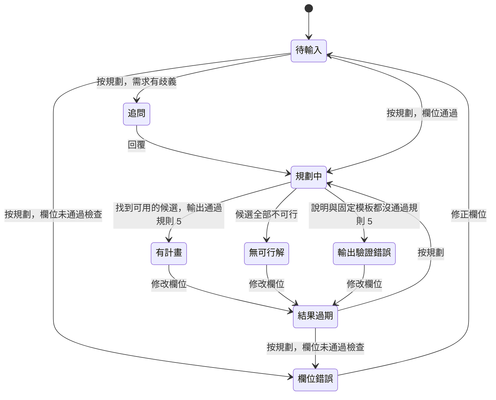

# UI_FLOW — 使用者操作與狀態轉換

> **CR-01（2026-11-15）：** CR-01 重開了 Trip Planner 的輸入區與 [UI_CR01_DELTA.md](UI_CR01_DELTA.md) 列出的項目；其餘內容維持凍結。
> 階段：G2 UI/UX Prototype（2026-11-15）。對應的原型是 [prototype/index.html](../../prototype/index.html)。
> 依據：[G1 Grill 文件](../grill/g1-grill-input.md) 的決議 Q1–Q32。
> 2026-11-15 依 [G3 Audit Report](G3_AUDIT_REPORT.md) 更新：第 1、2、3、4、6 節。
> 狀態：**G3 APPROVED / FROZEN（2026-11-15）。** 裁決見 [G3 Audit Report](G3_AUDIT_REPORT.md) 第 7 節。

## 1. 主要流程

1. 使用者在 Trip Planner 填寫路線、日期、最早可出發時間、最晚抵達終點時間與出發油量，可以再補一段自然語言需求。
2. 按「規劃」。這是唯一會觸發計算的操作。
3. 欄位有問題時，顯示錯誤摘要與欄位旁的錯誤，不進入規劃。
4. 自然語言需求有歧義時（例如提到休息但沒說多久），系統追問，使用者回覆後才繼續。
5. 規劃期間顯示四個步驟的進度文字，按鈕停用。完成後進度收合成一行。
6. 完成後在 Trip Result 分頁顯示結果；細節在 Validation & Replanning 分頁。
7. 使用者修改任何欄位後，舊結果標示為過期，提示會列出變更的欄位，直到再按一次「規劃」。頁面頂端的資料模式標籤仍然描述畫面上的舊結果。

## 2. 畫面狀態

| 狀態 | 畫面 |
| --- | --- |
| 待輸入 | 兩個分頁都顯示「尚未規劃」 |
| 欄位錯誤 | 錯誤摘要在表單最上方，每個有問題的欄位旁有錯誤文字 |
| 追問 | 對話訊息說明缺少什麼，附上選項與回覆按鈕 |
| 規劃中 | 規劃進度的步驟文字；規劃按鈕停用並顯示「規劃中…」 |
| 有計畫 | 計畫狀態為 FEASIBLE 或 CONDITIONAL，見第 3 節 |
| 無可行解 | 計畫狀態為 INFEASIBLE，見第 4 節 |
| 輸出驗證錯誤 | 錯誤訊息；不顯示計畫狀態標籤；仍顯示採用的條件與來源證據 |
| 結果過期 | 結果區上方的過期提示，列出變更的欄位；舊結果仍在，不自動重算 |

## 3. 有計畫時的呈現

「有計畫」再分成兩個計畫狀態，並各自可以搭配搜尋狀態與說明來源。

| 面向 | 值 | 畫面上的差別 |
| --- | --- | --- |
| 計畫狀態 | FEASIBLE | 綠色標籤 |
| 計畫狀態 | CONDITIONAL | 黃色標籤「有條件可行」；結果最上方列出待確認事項，每一項對應一條 UNKNOWN 的規則 |
| 搜尋狀態 | COMPLETE | 出發時間的標題是「最晚的可行出發時間」 |
| 搜尋狀態 | INCOMPLETE | 標題改為「建議的出發時間（搜尋未完成）」，並有未完成的提示 |
| 說明來源 | Planner | 說明文字下方標示來源 |
| 說明來源 | 固定模板 | 另有提示：Planner 的說明沒通過檢查，已改用固定模板 |
| 資料模式 | Snapshot Mode | 頁面頂端的標籤（描述畫面上的結果）；來源類型為資料快照。原型中每一列都標「模擬」，資料快照寫在標籤旁的文字 |

Trip Result 的內容順序：狀態標籤、待確認事項、未完成的提示、四張數值卡片、說明、採用的條件、加油安排、天氣、來源證據。

## 4. 無可行解時的呈現

Trip Result 只顯示 INFEASIBLE 標籤、原因摘要、採用的條件與來源證據，並指向另一個分頁。

Validation & Replanning 依序顯示：

1. 候選搜尋的狀態與評估數量。
2. 原因摘要。
3. 各規則的 FAIL 統計。
4. 代表候選。選法依 G1 Q27：先取 FAIL 規則數最少的；它們都只違反規則 1 時取超過期限最少的，否則取出發時間最晚的。全部候選都只違反規則 1 時稱「最接近時間限制的候選」，其他情形稱「代表性失敗候選」，並寫出實際的選法。一律標明不是有效的建議。
5. 替代方案。標明未經驗證、不會自動執行。
6. 代表候選的逐條規則結果。
7. 全部候選的表格，代表候選那一列有標籤。
8. 重新規劃紀錄。

沒有任何候選時（時間範圍內沒有出發時間能在期限前抵達），不顯示統計與代表候選。

## 5. 重新規劃

- 初次評估之後最多重新規劃 2 次。
- 每一輪在紀錄表中占一列：結構化的變更、評估的候選數、最佳狀態。
- 只會調整休息與加油安排。路線、日期與使用者的時間限制不會被改動。
- 提不出新的合法安排時提前停止，並在紀錄表下方說明。
- 不顯示 Planner 的原始文字。

## 6. 候選的檢視

- 上方固定顯示推薦候選的逐條規則結果（規則 1–4）。無可行解時顯示代表候選的。
- 「全部候選」預設收合。展開後是唯讀表格，依出發時間排列；推薦的候選與代表候選有標籤。
- 選取一列後，表格下方顯示那個候選的狀態與逐條規則結果，展開狀態保持。選取的是推薦的候選時，只提示它的結果在上方。
- 上方的區塊不會因為選取而改變。
- 規則 5 檢查的是最終輸出，所以在「最終輸出的驗證」區塊顯示一次，不隨候選變動。

## 7. UNKNOWN 的呈現

一條 UNKNOWN 的規則顯示四項：

1. 缺失的項目。
2. 原因：五個共用分類之一，加上具體原因。
3. 來源與時間：對應的證據代號，或「沒有可用的來源」。
4. 人工確認指引：每條規則固定的文字。

並註明自行確認不會把這條規則改為 PASS。

## 8. 原型的模擬情境

原型的「Prototype 控制」提供十四個情境，每個情境會填入表單並設定模擬的環境。資料與判定都是模擬的。

| 情境 | 涵蓋的狀態 |
| --- | --- |
| FEASIBLE（含模擬的路況資料） | FEASIBLE、搜尋 COMPLETE |
| 沒有路況來源 | CONDITIONAL、UNKNOWN、待確認事項 |
| 日期超出預報期間 | CONDITIONAL、兩條 UNKNOWN、沒有天氣資料 |
| 傍晚出發 | 規則 1 以民用暮光終為準；候選表格中有 FAIL |
| 高降雨機率提醒落在最後 20% | 規則 3 的 FAIL；天氣表的分類 |
| 高降雨機率提醒在前段與中段 | 天氣表出現高降雨機率提醒的標籤，規則 3 仍然 PASS |
| 重新規劃後可行 | 重新規劃紀錄、新增加油 |
| 重試後仍不可行 | INFEASIBLE、提前停止、代表性失敗候選 |
| 只違反時間限制 | INFEASIBLE、最接近時間限制的候選 |
| 搜尋未完成 | INCOMPLETE |
| 說明改用固定模板 | 說明來源的提示 |
| 輸出驗證錯誤 | 不顯示計畫狀態 |
| 追問 | 追問與回覆 |
| 自然語言與表單衝突 | 衝突提示、以表單為準 |

結果過期、欄位錯誤與 Snapshot Mode 不需要切換情境，直接操作表單就能看到。
